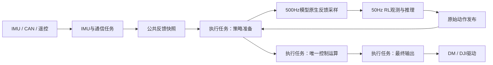

# H7_RL 大机工程总览

本页首页按 2026-11-09 工作区整理。运行路径和开关以现行源码为准，板端是否运行同一构建需核对固件身份。下文带日期的试验配置、旧模型及“当前”字样均按其所在日期理解。

## 当前 VOFA 前向估速诊断（5013）

固定 48 路，U1。相对 5012，零基 I12 为运动学前向估速 ds_raw（m/s），I22 为送入融合的水平前向加速度 a_fwd（m/s²），I46 为 5013。I10 为机体 Z 轴加速度（g，含重力），I11 为融合速度，I13 为生效的前进目标。I15 为低通俯仰角速度，I20/I21 为双轮实测轮速。I9 − I8 可还原当前位置误差（本表位置平衡点为零），I24～I30 的和为左轮限幅前轮矩（本表平衡输入为零）。其余通道沿用下方 5009 表。

## 接手入口

| 要做的事 | 从哪里开始 |
| --- | --- |
| 找控制链 | [任务创建](../Core/Src/freertos.c) → [执行任务](../imcalib/task/task_actuation.c) → [策略准备](../imcalib/task/control/control_strategy.c) → [候选计算](../imcalib/task/control/control_compute.c) → [最终许可与发送](../imcalib/task/control/control_output.c)。大机保留 LQR 与 RL 路径，十态和高度/roll MPC 已移除。 |
| 查参数和模型 | [机器配置](../imcalib/config/machine_config.c)及[编译配置](../imcalib/config/machine_config.h)。十态增益生成与部署见 [MATLAB 入口](#matlab-gain)。 |
| 构建与复测 | [eIDE](../.eide/eide.yml)、[Keil](../MDK-ARM/CtrBoard-H7_ALL.uvprojx)及[构建说明](#build)。11 月 9 日有 119 个实际编译单元的工程外 GCC 全量链接记录，采集开关两种配置均检查过。该次 Keil 完整构建及同构建板端验证待做。 |
| 看当前波形 | [VOFA 源码](../imcalib/task/service/vofa_debug.c)，固定 48 路，零基 46=5013、47 为板端毫秒 tick。通道差异见上方停车位移诊断，基础表见下方 5009 节。 |
| 追溯旧数据 | [变更与试验记录](sysid-change-map.md)、[后退失衡交接](../../交接以及jetson/后退失衡排查交接_20261106.md)、[MPC 历史交接](../../交接以及jetson/MPC嵌入开发交接.md)。先匹配机型、固件和布局，再解读旧 CSV。 |

## 当前问题与后续方向

| 问题与状态 | 已知原因或证据缺口 | 后续方向 |
| --- | --- | --- |
| **LQR 原地站稳后轮组持续抖动，待本轮实测定位** | 5009 观测已接入。固定位置偏置与腿角平衡参考可能互相抵消，同一 pitch 角速度还进入腿角速度和估速。线性模型和历史相关性都无法区分参考冲突、测量噪声与真实闭环振动。 | 优先采常用腿长下的静站与停车 5009，记录实际落点，对齐位置门控、双轮七组轮矩、最终轮矩和命令/反馈电流，再决定是否调整参考或反馈。 |
| **高速后退或带速反向失衡，历史实测效果不佳** | 11 月 6 日样本中后退实际速度超过目标，双轮最终指令触及当时限幅。速度目标限幅没有限制实际车速。可用制动力、轮端实际力矩及整车失稳根因仍缺同条件证据。 | 先复查旧 CSV 与固件对应关系，再以现行 LQR 从可控工况逐步核查制动指令、反馈电流和 pitch 演化。轮端能力确认后再判断是否值得做轮髋分配。 |
| **RL 8000 v2 站立稳定性未通过历史实测** | 零摇杆站立曾出现约 8.5 Hz 振荡和高比例轮矩请求限幅，电机离线在振荡之后。动作映射或单一部件故障均未被该样本证实为根因。 | 先用配套固件做板端推理、动作 PD、限幅和节拍对照，再按同一训练接口核对执行链与训练域。RL 排查与当前 LQR 静站分开。 |
| **跳跃已有动作模块，主链未接入** | 历史宿主检查复现收腿未到位仍推进，以及 HANDOFF 时目标尚在变化。实测接触条件、交还普通控制的完成约定、补偿和事件隔离尚未闭合。 | 维持暂停。恢复时先确定收腿/触地判据、异常撤力和接管完成条件，再对照真实普通候选进行分阶段验收。 |
| **自动磕台阶已接入，实机覆盖待补齐** | 软件复用完整自起至 LQR 交接。现有记录不足以覆盖不同腿长、速度下的识别、误触发和交还。 | 按现行判据录正常行驶与台阶对照，核查触发、退出原因和控制交还。 |
| **USB 完整时序诊断已实现，现配置默认关闭** | 11 月 9 日验证覆盖协议及双配置构建。当前清理后的固件尚缺 USB 实采与节拍数据。 | 需要测延迟时用匹配的采集构建核对包版本和固件身份，再录制；硬件延迟以板端记录为准。 |

---

以下保留按日期记录的细节和已有章节链接。

## 2026-11-08 当前：静止轮组诊断5009（已接入，待录制CSV）

作者要求暂停jump接入，优先排查LQR静止轮组抖动；未主动提到RL时按LQR问题理解。jump仍无任务层调用，`confirmed=0`。

用户补充：原地站稳后仍持续抖动。本轮完成`lqr_state_t.wheel_term[2][7]`与`wheel_unclamped[2]`的固定48路发送；`LQR_Control_Update`记录已经计算出的term，七组为位置、速度、偏航、双腿角、双腿角速度、俯仰角、俯仰角速度。诊断合计64字节，比交接时五组版多16字节；不反馈到控制计算，未测量额外执行耗时。旧5008四髋角布局在`vofa_debug.c`内以`#if 0`保留，只有5009在发送，无运行时选帧。

本轮未改控制参数、增益、物理标定或jump。停车位置基准0与当前`position_hold.pos_target=0.15m`是待对照波形的代码线索，不是已确认的抖动根因；尚无本次静止CSV，不能判断属于调参还是逻辑问题。11月7日的俯仰角速度分项相关性也不能单独证明是纯传感器噪声：同一角速度还进入腿角速度和运动学估速，闭环真实运动/振动也会反映到该信号。

### 当前VOFA：固定48路，46=5009（全部零基）

| 通道 | 内容与单位 |
| --- | --- |
| 0/1/2 | 在线位图 / 电机与投入状态位图 / ctrl_fault，原定义保留 |
| 3/4/5 | 公共状态 / LQR许可位图 / pos_trace停车门控与积分事件位 |
| 6/7 | 原遥控前进速度/偏航角速度请求，m/s、rad/s |
| 8/9 | 停车积分位移 / 生效的位置目标，m |
| 10/11/12 | 运动学速度ds_raw / 融合速度ds_kf，m/s；IMU前向加速度a_fwd，m/s² |
| 13/14/15 | 最近发布的原始pitch角速度，rad/s；pitch误差，rad；控制使用的低通pitch角速度，rad/s |
| 16/17/18/19 | 左世界腿角误差/角速度、右世界腿角误差/角速度，rad、rad/s |
| 20/21 | 左右轮反馈轮轴角速度，rad/s，已应用反馈符号和减速比 |
| 22/23 | 左右轮限幅前总力矩，N·m，包含u_eq |
| 24/25/26/27/28/29/30 | 左轮位置/速度/偏航/双腿角/双腿角速度/pitch/pitch角速度贡献，N·m |
| 31/32/33/34/35/36/37 | 右轮七组贡献，与左轮同序，N·m |
| 38/39 | 左右轮最后电流指令raw计数，按CAN槽取值并还原到控制坐标 |
| 40/41 | 左右轮反馈电流raw计数，已在解析端应用反馈符号；不是独立轮轴力矩测量 |
| 42/43 | 最终左右轮提交力矩请求，N·m；提交成功不等于电机兑现 |
| 44/45/46/47 | 左右实测腿长，m；布局ID=5009；HAL时间，ms |

14/16/18误差为`target+x_eq-x`，NORMAL下与反馈计算一致；只在3=0、4含valid/gain_valid/LQR投入且无AIR时解释分项。各轮七项之和加`u_eq`约等于22/23，分组累加有浮点舍入；当前表u_eq=0。失败或退出可能保留旧/部分诊断，不能当有效控制拍。此表与交接文档的拟议五组5009不同，必须使用这里的最终七组表。

4号掩码：4 valid、8 gain_valid、16 LQR投入、32总力矩开关、64 engage、128遥控在线、256 AIR控制/释放、512 DM提交成功、1024 DJI提交成功、2048髋限矩、16384 pos_armed；未使用位保持空闲。公共状态3号：0 NORMAL、1 FALLEN、2 FLIGHT。

5号pos_trace掩码：1先前速度目标为0、2双腿满足积分姿态门槛、4满足首次锁定速度门槛、8已锁定、16本拍积分、32本拍建立基准、64超距离复位、128 AIR冻结、256已锁定但腿姿态不满足而冻结。单拍事件可能被后台漏采；目标更新在积分更新之后，所以1位反映先前目标，不等于本拍6号遥控命令。

电流：左反馈ID=0x202对应CAN槽1，右0x201对应槽0。38/39读取`wheel_current[feedback_id-0x201]`并乘现有out符号还原；40/41已经乘fb，不能再翻转。四路单位均raw，不擅自换成A或把换算轮矩当实测值。仅对比同侧命令与反馈；需同时检查4号1024位和0号在线位。

采样：UART8、1152000、JustFloat、全部48路；后台`osDelay(5)`，实际间隔用47号差分。临界区防止复制期间任务改写，不保证IMU、轮反馈、控制状态和最终发送属于同一物理时刻；13与15尤其可能来自不同发布时刻。不能用一帧先后判因果，也不能仅凭低频后台数据排除高于采样带宽的振动。

采集顺序：

1. 先选最容易抖动的固定腿长，保持现有参数；开始记录后投入LQR，站稳后零摇杆、无接触保持20～30s，导出全部通道。记录是否扶持、地面、腿长和大致抖动发生时间。
2. 再单独记录低速前移后松杆、低速后退后松杆，各留约10s稳定段；用于区分锁点时机、目标阶跃和后续回位，不要求先做高速或强推测试。
3. 如果通常就能稳定调腿，再补另一常用腿长的静止段；优先完成第一份复现数据。保留原CSV精度，不只导出截图或挑选通道。

分析顺序：先检查ID、时间间隔与许可；比较24/31位置项是否平稳及5号是否反复冻结/重锁；再比较25/32估速、28/35腿角速、30/37俯仰角速及同频抵消；最后比较22/23、42/43限幅/撤力以及38～41电流跟踪。分项大或相关性高只是定位线索，不直接宣称根因。

位置方案仅分析、未实施：现有十态已同时反馈位置和速度；固定位置偏置会产生`K[:,S]*bias`，且同时影响双轮和双腿摆矩。先区分真实停车锚点、慢变平衡偏置与快速回位动态；不能把另一个PID输出直接当“物理位置目标”却保留原环不分析。若CSV确认需要消除恒定偏差，再评估位置误差积分的LQI联合设计与限幅防积累、进出复位；积分本身不保证初始快速收敛。本轮保持0.15m及全部Q/R、滤波与门控。

本轮验证见同日`sysid-change-map`“完成静止轮组诊断5009”记录；未烧录、未实机验收。

### 持续排查：正常Q/R附近的参考一致性（仅软件研究，未修正控制）

作者澄清“不同Q/R”指当前附近的正常参数；不采用桌面15:33的旧`静止测试.csv`。目标仍是不同常用腿长下静站不持续抖动、不往返找稳定位置，必须由新5009 CSV及实物位置观察验收。

读取当前`model_AB.m`、`machine_table.m`和现役C表，固定腿长为0.15/0.19/0.23/0.27/0.31m；每个腿长检查现役拟合K、同Q/R直接dlqr及位置Q×0.5/2、pitch角速度Q×2、双轮R×0.5/2，共35点。未运行自动部署入口，也未覆盖任何增益表。名义模型中全部闭环谱半径<1，但当前参考`[s=0.15, thL=0.5L-0.1045, thR=0.627L-0.1208]`的平衡位置并非恒为0.15m。

| 固定等腿长 | 现役K下名义稳态位移（相对锁点） | 位置Q减半 | 位置Q加倍 |
| --- | --- | --- | --- |
| 0.15m | +0.589m | +0.756m | +0.468m |
| 0.23m | -0.128m | -0.234m | -0.052m |
| 0.31m | -0.894m | -1.293m | -0.608m |

计算为`Acl=Ad-Bd*K; x_ss=(I-Acl)\(Bd*K*reference)`，回代残差均<1e-9；仅将研究输入的腿角参考置0作对照时，35点名义稳态位移都回到0.15m。此为参考一致性诊断，**不是将实机腿角参考改0的建议或授权**。使用理想固定腿长模型，没有摩擦、真实质心误差、传感器偏差、执行器动态、积分冻结/重锁或输出饱和，现役C系数按double算；表格绝不能解释为实机将移动这些距离。

现有`LQR_Offset_Eval`来自旧闭环静止中点拟合，高腿长原记录明确为外推；该数据未独立证明对应姿态和力矩构成当前Q/R下的真实平衡点。下一步用5009的8/9、14/16/18、24～37核对稳态误差与反馈抵消，38～43核对电流与实际请求。先区分位置偏置、姿态平衡参考和估速偏差，再决定具体修正；不凭这项名义研究改标定、offset或新增PID/LQI。

复现脚本及结果位于工程外`C:/Users/ynz/.codex/tmp/wheel-idle-20261108-5009/reference_study.m`、`linear-equilibrium-study.json/.log`，直接参考力矩算术另见`reference-sensitivity.json`。没有新实机证据，持续目标仍未完成。

### 俯仰角速度的多通路影响（仅代码敏感性，5009不再换表）

当前`LQR_State_Update`用同一低通pitch率`w`生成`dthL=dgeomL-w`、`dthR=dgeomR-w`，也用它做轮速补偿。在其余测量固定、世界腿角近0、等腿长L时，`ds_raw`对w的增量系数为`L-wheel_r`；随后经Slip回到速度列。故仅孤立扰动w时，直接角速项的综合系数是`K[DTHL]+K[DTHR]-K[DTHB]`，另有估速和停车积分路径。该公式沿用源码符号，仅用于追踪，不改轴向。

用现役C增益、当前pitch低通及Slip参数，在NORMAL/连续位置积分/轮速创新未触发降权、稳态协方差条件下计算5腿长×7频点。以10Hz为算术对照，左轮对原始pitch率的综合幅值在L=0.15/0.23/0.31m时约3.31/3.57/3.80 N·m/(rad/s)，其中直接pitch率项约1.35/1.04/0.84，双腿角速项约1.78/2.16/2.39。单独pitch率项随腿长下降，但总体影响上升，不能据单列大小选择修正。

该研究只对一个测量输入施加假想扰动，保持角度、轮速及几何腿速等其余输入不变，未模拟机身运动、IMU内部融合、摩擦或电机响应；10Hz不是本轮测得的抖动频率，也不证明存在纯陀螺噪声。结果为`C:/Users/ynz/.codex/tmp/wheel-idle-20261108-5009/gyro-path-sensitivity.json`。实机仍用25/28/30与32/35/37的联合走势、13/15/17/19、20/21及电流判断，不能逐列相关性排名就定因。没有新增固件改动、滤波或死区。

---

## 2026-11-08 当前：仅保留大机与LQR，MPC和小机已清理

按作者明确要求删除MPC及小机支持。十态继续由现有LQR生成轮矩和腿摆矩；NORMAL轴向控制保留四态LQR（`MACHINE_NORMAL_LEG_CONTROL=1`），非NORMAL及开关选择PD的原路径保留。RL、台阶、自起、AIR与最终发送许可仍在原链路。当前大机物理标定、增益表、作者Q/R、动作参数不在本次调参范围。

- MPC：删除求解器、十态后台任务/快照/回退、四态工作区/预览、专用运行统计、MATLAB生成与测试源及生成残留；同步eIDE和Keil登记。保留独立USB时序采集（默认关闭）及仍有用途的四态观察器（默认关闭）。
- 小机：删除配置、增益/候选表、IMU投影/轮ID/AIR参数/节拍分支和MATLAB选机入口。轮驱动只留下大机M3508换算，VOFA固定UART8；采集协议大机ID仍0，未改包格式。四态模型身份检查保留。
- `tools/matlab/balance14`为通用模型研究工具，保留；没有因目录历史与MPC有关而删除模型。
- 此前MPC布局、实验参数、采集和验证已归档`sysid-change-map.md`，不再作为当前代码入口。旧高速轮电流兑现不足问题仍未解决，删除MPC不构成该问题的根因结论。

### 历史VOFA：固定48路，46=5008（已由顶部5009替换）

| 通道 | 内容与单位 |
| --- | --- |
| 0/1/2 | 在线位图 / 电机与投入状态位图 / ctrl_fault，原定义保留 |
| 3/4 | 公共状态 / LQR与许可位图（见下） |
| 5/6 | 实际/目标位移，m |
| 7/8/9 | pitch实际/目标，rad；pitch角速度，rad/s |
| 10/11 | 前进目标/实际速度，m/s |
| 12/13 | 四态roll / roll角速度，rad、rad/s |
| 14/15/16/17 | 四态高度实际/目标，m；高度速度实际/目标，m/s |
| 18/19 | 左右轴向力请求F，N |
| 20/21/22/23 | 左前/左后/右前/右后髋角，rad；保留作者改动 |
| 24/25/26/27 | 左右腿长斜坡，m；左右参考伸缩速度，m/s |
| 28/29 | 左右虚拟腿摆矩Tp，N·m |
| 30/31/32/33 | AIR左右支持力估计，N；有效性位图（bit0 valid、bit1 initialized）；flight |
| 34/35/36/37 | height_trim / common_shift / 左右observer.bias，N |
| 38～41/42～43 | 最终四髋/双轮力矩请求，N·m |
| 44/45/46/47 | 左右实测腿长，m；布局ID=5008；HAL时间，ms |

4号保留的掩码：4 valid、8 gain_valid、16 LQR投入、32 torque_output_enabled、64 engage、128遥控在线、256 air_control或air_release、512 DM已提交、1024 DJI已提交、2048髋限矩、16384 pos_armed。已删除原MPC位，空位不复用。AIR支持力须结合32号判断；输出请求不等于电机实际兑现。48路后台采样不是严格控制同拍数据。

### jump复查结论（本次未修改动作源码或启用开关）

独立模块和配置已存在，但没有主流程调用、初始化、触发或交接接线；`confirmed=0`。eIDE物理扫描包含该源，Keil仍未登记。当前固件不会主动执行该跳跃模块。

1. `Jump_Process_Law`的RETRACTED只看给定到位与实测腿速低，没有核验实际腿长到位。给定0.27m、实际0.25m且速度0时，可能解锁并连续满足0.015m压缩判据，误进LAND。拟先补实测跟踪就绪及早接触处理的合同，再接主流程，不能直接加门槛而漏掉真实早落地。
2. LAND按150ms支撑渐入转HANDOFF，0.27→0.20m以0.3m/s收腿需要约233ms；HANDOFF继续缓冲是现有设计，调用方不能一见该阶段就Complete。需明确持续接触、参考与输出连续的交接条件。
3. 除`control_compute.c`外，还必须接入`Control_Model_Prepare`的补偿选路；若跳跃期间撤销公共valid而未补该分支，重力缓存可能无效，补偿映射失败。THRUST/LAND的normal_*须来自本拍LQR候选，估计器每拍只推进一次。
4. AIR/FALLEN观测继续运行，屏蔽动作抢占、普通落地事件和台阶触发；LAND重判、成功交接、WAIT/RECHECK闭环需配套。成功交接不能消费FALLEN失败重试预算。普通AIR落地写回0.2m的事件也需隔离。
5. static_force复用height_trim公式时区分输入：普通四态用目标投影高度，jump计划用实测腿长，不能称为同一物理量。触发键/防连发、力兑现与缓冲诊断、低推力台架验收仍待接入阶段确定。

### 本轮验证

- ARM Compiler 6.22按Cortex-M7/硬浮点、关闭fast-math编译当前清单中实际存在的118个C源，全部生成目标文件；仅有原BMI088 packed属性告警。未完成正式GCC/Keil链接：本机GCC/AC5及armasm/armlink启动报“无效的系统DLL重定位”。不能把目标文件编译说成完整固件构建通过。
- 用清理前备份强制关闭MPC作纯LQR基线，真实十态/四态LQR、非NORMAL PD、斜坡及姿态源码做96组连续/边界对照，5280个浮点输出与状态逐位相同。映射与补偿为替身，未覆盖真实受力、完整任务调度或实机动力学。
- 重新编译当前jump源码，原87项替身断言全部通过；新增两项复查场景：无支持力有效证据、实际腿长0.25m且速度0，在收腿给定走到0.27m后误判压缩落地，从FLIGHT注入起15ms进入LAND；另一场景LAND约151ms转HANDOFF时参考仍0.2244m。两项均为已复现问题/接口风险，不表示已修复。
- 大机保留配置的全部初始化表达式、MATLAB大机机械参数和Q/R/有效拟合阶次与任务开始备份一致；十态/四态生成表及jump源/头逐字节未改；CubeMX改动只在USER CODE内。Keil XML有效，运行源及工程登记不再引用MPC/小机。差异空白检查通过。
- MATLAB批处理启动失败（errors_warnings插件加载失败），未运行本轮模型数值验证、未重新生成增益。原eIDE清单另有15个已不存在的旧条目（3个HAL源、12个旧AI源），本轮未改这些无关登记；完整IDE构建还需处理该既存问题。

证据位于本次聊天`work/mpc-removal`的`arm-compile.log`、`host-verification.txt`、`static-audit.txt`及对照二进制。未烧录、未实测板端执行时间或稳定性，未提交/推送。

---

## 2026-11-08 跳跃动作模块（已写入，未接入控制流程）

作者选定方案A（独立jump_process，仿台阶Owns_Output），要求先只写逻辑与结构体、不与其他文件耦合、暂不加触发；随后按外部评审修正设计。当前无任何调用者，控制行为不变。

### 文件与职责

- `Algorithm/process/jump_process.c`、`inc/jump_process.h`：单次动作状态机与力律。只读machine配置，不include任务/LQR/AIR/自起头文件；全局实例jump_process已定义但无调用。
- `config/machine_config.h/.c`：新增`jump_process_param_t`、`machine_jump_cfg_t`及`machine_cfg_t.jump`。大机为待台架试用值，`confirmed=0`，Begin拒绝启动；小机配置已删除。
- 工程登记未改：eIDE按`imcalib/Algorithm`物理扫描会自动编入该源（无引用）；Keil未登记、不编译。接入时再按台阶方式登记ControlModules/excludeList与Keil组。

### 阶段（phase编号即诊断值）

| phase | 输出归属与控制 | 转段 |
| --- | --- | --- |
| 0 IDLE | 不归属 | Begin→1 |
| 1 CROUCH | 不归属；调用方普通LQR以length_target为腿长目标（用局部command，不改全局rc_command） | 双腿≤crouch_len+tol且普通候选有效持续crouch_hold→2；超时/许可丢失直接回0 |
| 2 THRUST | F=static_force(实测L)+k·thrust_force+横滚PD；Tp/轮矩沿用普通候选 | 起飞锁存（支持力和<liftoff_ratio·mg且双腿伸长速度>门槛，持续liftoff_time）或任一腿≥thrust_len→3；超时→6 |
| 3 FLIGHT | 从实测腿长起步斜坡收腿，PD的D作用于给定速度与实测速度之差；世界腿角PD；轮矩0 | 卸载后任一腿支持力>touchdown_ratio·单腿静支撑，或收腿到位且腿速降下后压缩量/压缩速度过门槛，连续touchdown_time→4；超时按着地→4 |
| 4 LAND | 从着地实测腿长起步斜坡到land_len，低刚度高阻尼PD+static_force×渐入系数；Tp/轮矩沿用普通候选 | 渐入满→5 |
| 5 HANDOFF | 保持LAND输出，等待调用方LQR交接成功后Complete | 超时→6 |
| 6 WAIT / 7 RECHECK | 零候选；Advance_Exit只返回一次1请求复位检测历史 | 同台阶 |

接管阶段（2～5）硬中止转WAIT：腿valid=0、|pitch|/|roll|超限或NaN、世界腿角偏离trim超限、映射/补偿失败、轮矩非有限。普通候选缺失时Tp改世界腿角PD、轮矩0并置FALLBACK位。正Tp增大几何腿角沿用自起/台阶摆角环约定；横滚PD沿用`machine->lqr.pd.roll`及leg_balance非NORMAL口径（左加右减、Kd×基础周期），不新增横滚增益。

诊断：exit_reason 0无/1完成/2取消/3输入/4映射/5姿态/6蓄力超时/7蹬伸超时/8交接超时/9总超时；touchdown_source位 1支持力/2压缩/4压缩速度/8超时；flags位 1已卸载/2行程保护停推/4普通候选缺失/8轮矩到限/16收腿已停稳。

### 接入计划（拟修改，未实施，需作者逐项授权）

1. control_compute.c：Owns_Output时独立`Compute_Jump`分支（仿Compute_Stair），进出边沿各复位一次普通平衡历史；CROUCH在普通LQR分支用局部command覆盖腿长/速度/偏航目标后调Update。THRUST/LAND/HANDOFF每拍由调用方算普通LQR候选填normal_*，并按四态同一公式填static_force=support_force+height_trim(实测腿长)：接入时把roll_height_balance.c中height_trim线性插值提成共用函数，不在两处各写一份。交接用跳跃专用函数：先算LQR候选到临时输出，成功才Complete替换，未就绪保持跳跃输出，失败走Jump_Process_Abort，不调用Fallen_Process_Fail、不碰FALLEN重试预算。
2. control_detection.c：跳跃接管期间持续AIR/FALLEN观测，只屏蔽选路、落地事件和台阶检测；LAND入口复位AIR，使交接时按新支撑重新初判，避免长腾空后AIR仍锁存flight。
3. rc_command.c：dr16.key已解析但未进入rc_command；触发键、边沿触发与防连发待作者指定。
4. 单独立项，不夹带：air_process.c落地写回0.2m；eide.yml中X-CUBE-AI已不存在的jump/pin/stable/upstairs共12源及4份报告。
5. 不做MATLAB阶段0：直接用leg_solver同一几何公式估算（见下表），实际力臂和电机能力上台架读VOFA。

### 可行性估算（2026-11-08，用leg_solver同一公式及gas_spring模型；全部待台架）

两髋各54N·m、Tp=0时单腿最大轴向力：0.15m约468N，0.20m约389N，0.25m约367N，0.30m约376N；腿长1.5m/s时髋转速约5～7rad/s，该转速下实际可用力矩待台架。弹簧补偿开启，电机只需出F减弹簧模型力（18～42N）。

| 每腿推力 | 蹬伸行程用时 | 起跳速度 | 机身升高 | 腾空 | 着地速度 | 0.27m着地、0.12m内停住所需平均力/腿 |
| --- | --- | --- | --- | --- | --- | --- |
| 60N | 266ms | 1.16m/s | 0.068m | 259ms | 1.39m/s | 228N |
| 100N | 210ms | 1.49m/s | 0.113m | 323ms | 1.68m/s | 275N |
| 140N | 181ms | 1.76m/s | 0.158m | 376ms | 1.92m/s | 322N |

假设：整机25.544kg，蹬伸0.15→0.30m、两轮不动，静态支撑恰好平衡重力；收腿带轮后按动量折算；着地后腿长可压到0.15m。结论：起跳力有余量，限制在落地，着地腿长越短，缓冲行程越少、所需力越大。0.24m着地、100N时平均需约366N/腿，已到电机能力，所以默认retract_len取0.27m。旧蹬伸期限200ms短于100N时的210ms行程，已改350ms。

### 模块初版历史验证（不代替本轮验证）

初版曾记录ARM GCC大/小机及-O2、Keil AC5编译0错误0警告。主机替身（仅替换力映射/补偿，真实状态机/配置/斜坡）87项通过：正常全流程与uint32回绕、各超时、蓄力失败不撤力、起飞锁存/行程保护、三类着地、硬中止含NaN/Inf不卡死、普通候选缺失回退、轮矩限幅、横滚符号。替身不证明映射/补偿/实机动力学；未接入、未烧录、未实测，全部参数待台架。

---

## 2026-11-05 模型整合：十四态约化候选，保持原LQR权重（仅MATLAB）

作者要求先整合模型、沿用当前LQR参数，模型验证后再考虑MPC后端。新增`tools/matlab/balance14/run_balance14.m`、`model_balance14.m`、`verify_balance14.m`；运行`run_balance14`，输出该目录`output/report_latest.txt`及`result_latest.mat`。产物忽略，不部署或覆盖原十态/四态生成表，不修改C控制、补偿、物理标定或VOFA。

状态为原髋轴前摆正十态，追加roll、roll_rate、投影高度H、Hdot；六输入为原四模型力矩和左右等效轴向力，Tp=-u_hip不变。Q/R直接读取现役`lqr_gain_big.c`和`roll_height_model.c`来源头；保持现有权重并重算14态LQR，不把旧K简单扩维。十态质量分项和高度等效质量仍分别沿用原值，尚未通过辨识统一。

当前是明确受限的约化LPV候选：保留冻结调度腿长的十态模型，在同一动力学入口中加入F*cos(theta)对高度/roll的投影，并由该入口线性化得到A/B/仿射槽及ZOH离散模型；不是完整双向多体模型。未加入未经本机推导核定的轮矩竖直耦合、变腿长惯性或轴向力反向驱动十态。横向保持原近直立近似，非大横滚模型。

输入F采用理想弹簧/腿自重抵消后的等效量，真实残差、已启用height_trim、向心前馈及补偿误差尚未接入候选对象。不能把模型平衡输入再次叠加原support_force；这不构成删除或改动现有补偿的授权。初始H按当前腿长及零姿态几何值建立，不使用固定H0代替实际高度。

验证覆盖模型退化、有限差分雅可比、仿射锚点、独立expm的ZOH、左右镜像、20个局部LQR点及5类理想补偿/未饱和非线性投影对象闭环。零腿角名义K与同模型两块dlqr等价；非零腿角出现交叉增益。软件自洽与局部极点通过不证明物理模型准确、完整动力学已整合或适合上板；未构建固件、未烧录或新增实测。整体后端切换仍须先补齐模型/执行器受力记账和同对象对照。

2026-11-04提交前验证：当前工作区含作者生成8000网络，大小机GCC工程外全量编译链接均通过；未覆盖IDE增量产物。自有源码及本次文档差异空白检查通过，生成文件既有尾随空格保留；未重新烧录或新增实机测试。

## 2026-11-04 提交前现状：8000 v2已生成，实机稳定性未通过

当前网络为复旦8000 v2，已由作者生成、烧录并实际切入RL，不再处于1999网络待替换状态。大机100Hz策略/500Hz PD；当前25维观测、125维历史、六维网络动作的定义见下方8000接口段。网络生成报告和桌面模型指纹匹配；生成输入输出尺寸核对不能代替板端数值测试或实机稳定性验收。

公共拨轮限0.14～0.33m腿长；作者当前公共len_init由0.13改为0.15m，应作为公共遥控初值变化单列，不能写“全部LQR相关参数未变化”。RL目标机高=clamp(腿长命令+0.03648,0.22,0.30)，再×5输入obs[8]；未改变电机/IMU符号、机械零点及训练nominal_pos。RL为行走模型，删除旧1999启动保持/低高度退出，使用自身重力Z连续超限终止；LQR普通自起、AIR和台阶独立维护。

VOFA当前仍为顶部台阶动作/完整交接48路，8000 obs/action及失能零位布局均保留为注释或#if 0供人工切换，无运行时帧选择。下方同名“当前VOFA”旧节按日期视为历史，不得据此解释新CSV。此前讨论的158路完整推理快照仅为方案，未实现；VOFA上限仍48。

作者先以LQR站立再切RL，提供零摇杆、无人扶持CSV。历史该次记录有效RL约6.1s，命令vx/yaw均0、目标机高约0.27138m，网络/观测/动作有效，无恢复模式反复切换；前2s约8.5Hz振荡，双轮请求约47～48%采样点达到±3.9Nm。末段电机离线发生在振荡之后。此为异步VOFA趋势证据，不是严格同拍因果或控制频率证明，不把请求力矩当实测电机力矩，行走跟踪未由该零命令段验收。

后续手摆CSV按右主/右短/左主/左短，作者确认主杆朝机头、短摇臂朝机尾并从机身上方绕行，按±pi核对。两主杆约+179.47/-180.43度；结合动作方向，四腿反馈角/速度极性未发现明显反向。短摇臂偏差作者判断为摆位误差，不据此修改零点；该判断不写作精密标定通过。轮速本次未重测，输出物理力矩方向未由失能手摆证明。当前无新证据表明历史FIFO有错，不将未实测的猜测写成根因；下一步由训练与部署共同核对实机响应差异及新模型效果。

工作流程已按作者要求置于本工程md目录，由根AGENTS、md/AGENTS和CLAUDE链接为每次新任务首读；这是旧“四份正文”数量限制的明确例外。当前提交范围不修改训练仓，也不包含桌面CSV或模型原文件。

## 2026-11-03 台阶前进门槛改为实际速度估计>0

按作者要求，将前进请求门槛替换为最近有效普通LQR控制拍的融合前向速度lqr_state.ds_kf>minimum_forward_speed（当前0m/s），不取绝对值；删除minimum_velocity_request旧字段，唯一新字段仍在machine_config.c/.h。松杆但仍前行不会因请求0被禁止；倒退/速度<=0或LQR状态无效不允许检测。检测先于本拍LQR状态/融合更新，明确使用最近有效拍（正常执行相差一个MACHINE_LQR_DT），不重复推进估计、不增加速度缓存。速度是轮腿运动学与IMU融合估计，非独立地速测量；撞停至<=0仍会清确认，不新增冲击窗口或锁存速度。

保持作者当前其他配置：双腿实测>=0.30m、腿角阈值-0.01rad、角加速度阈值-60rad/s²、低通0.01s及联合确认5ms；完整自起/LQR交接与动作参数不改。当前48路动作/交接布局仅12改为融合前向速度m/s、13改为前进请求m/s（观察用途，不参与门槛），替换原位置环Kp/Kd常量；其余沿后处理/交接布局。动作期间普通融合暂停，12为冻结值，不是持续实时速度，阶段3号非0时不要据此评估新的入口；既有动作不因速度<=0取消。

## 2026-11-03 台阶完整复用自起到LQR交接（当前行为）

台阶后摆完成后，独立stair_normal_control继续复用普通收腿/摆正；完成交接由普通自起和台阶共同调用Compute_LQR_Recovery_Handoff：按实时有效AIR结果选择NORMAL/FLIGHT、切普通补偿引用、投入并计算LQR。台阶额外重建暂停期间的反馈/速度历史。只有有效LQR候选生成，才记录STAIR_RESULT_DONE并当拍释放归属，下一拍不再复位刚接管的LQR。完成不走RECHECK，不清检测历史后等待约200ms，不强制把真实AIR当NORMAL。

后摆仍暂停AIR/FALLEN观测；进入委托自起时复位因暂停而陈旧的观测历史，收腿/摆正期间复用公共观测计算但禁止公共选路抢占、落地/倒地事件发布及台阶再次检测。这覆盖旧“台阶全程停止检测计时”的约定。AIR未知时仍保留台阶交接归属并零候选，总期限/许可继续生效；LQR计算失败走台阶失败WAIT，超时/卡滞/取消仍走原退出重判。参数、轨迹、PD和最终输出许可不变。

当前固定48路沿台阶后处理表，仅30～33替换原腿长PD常量：30公共状态（NORMAL0/FALLEN1/FLIGHT2），31位图bit0公共valid、bit1normal_ready、bit2 AIR valid、bit3 AIR initialized、bit4 flight、bit5 applied；32为平均支持力N（31的bit2无效时显示0占位，不是实时零支持力）；33位图bit0 LQR状态valid、bit1增益valid、bit2 air_control、bit3 air_release。0～29、34～47保持，1的bit8仍为LQR投入。检测有效/初始化不等于NORMAL，必须结合30/31/33判断实际路由。

实测验收：录全48路，重点看3从5转0时，4完成/5完成、1的LQR投入位、30公共状态及36～45最终力矩，确认正常接管没有固定200ms全零空档；若是真AIR或无效反馈，不要求地面平衡出力。软件替身通过不证明上台阶或实机交接已成功。

## 2026-11-03 自起到位角容差合并

按作者确认，normal_angle_tol与prepare_angle_tol合并为fallen_process_param.angle_tol=0.1rad，统一用于普通前后准备位、普通摆正（含台阶委托摆正）及倒置前点对齐；仅合并同值参数，原各处比较/确认时间/速率不变。配置位于machine_config.c/.h，不保留旧字段或别名。合并后复核发现工作区已并行调为0.05rad，本轮保留该最新值；当前值始终以源码为准。台阶独立后摆的stair.process.angle_tolerance本次保持不变。下文旧字段名为历史记录，以本节及源码为准。

## 2026-11-03 三类角目标速率独立调节

作者要求拆分：machine_config.c的fallen_process_param.angle_rate用于普通自起准备位/摆正；fallen_process_param.recovery_angle_rate用于倒置前点对齐/翻身扫角；machine_table大机stair.process.angle_rate用于台阶后摆/委托摆正。三组以拆分前作者当前6rad/s初始化，其他增益、角速度输出限幅、腿长速率、目标及期限不变。翻身回正后进入普通自起，就改用普通angle_rate。

Fallen_Process_Update显式接收调用方普通路径角速率，台阶传台阶速率，普通传普通速率；倒置分支直接读取独立recovery_angle_rate，不增加速率状态缓存。台阶后处理VOFA8显示台阶process.angle_rate rad/s，28/29为其斜坡后目标；下方共用速率描述为拆分前记录。

## 2026-11-03 普通自起及台阶摆正恢复角目标斜坡

按作者最新要求，普通SWING摆正从本段首拍实测几何角起步，复用公共Ramp_Update与原angle_rate参数（当前4rad/s），每拍沿既有包角误差方向推进至原leg_trim目标；不新增斜坡状态，仍由actuator.angle_target保存指令。普通自起、翻身回正后的普通摆正及台阶委托摆正共同生效，翻身自身和前侧/后侧准备路径保持。腿长轨迹、PD、角速度限幅、目标终点、到位/超时及交接保持；既有目标角与实测角同时到位的判断继续生效。此最新授权覆盖旧“不加普通SWING斜坡”的约定，旧记录仅作历史。

VOFA沿顶部后处理48路布局：8为angle_rate rad/s，28/29为本拍斜坡后几何角指令rad；与18/19及20/21对照观察。普通摆正是否减轻实机冲击待烧录实测。

## 2026-11-03 当前VOFA：台阶后处理参数与跟踪

本次固定48通道仅改观测，未调整增益、速率、检测和动作。旧台阶检测布局#if 0保留，人工切换，无自动选帧。以下编号从0，替代下方历史布局。

| 通道 | 含义/单位 |
| --- | --- |
| 0/1/2 | 原在线掩码/状态位/故障，1另含bit10台阶归属、bit11总力矩开关 |
| 3/4/5 | 台阶阶段/退出原因/结果 |
| 6/7 | 阶段/总动作累计时间s |
| 8/9/10/11 | 台阶process.angle_rate rad/s、length_rate m/s、angle_speed_max rad/s、四髋单电机限矩N·m |
| 12/13/14/15 | 摆角位置环Kp/Kd、角速度环Kp/Kd（现有误差差分PID参数，不能按物理速度阻尼解释Kd） |
| 16/17 | 后点几何摆角rad、收腿终点m |
| 18/19/20/21 | 左右几何腿角rad、左右几何角速度rad/s |
| 22/23/24/25 | 左右实测腿长m、左右实测腿长速度m/s |
| 26/27/28/29 | 左右腿长指令m、左右几何摆角指令rad；包含委托收腿/摆正给定 |
| 30/31/32/33 | 左右腿长环Kp、左右腿长环Kd（原PID参数） |
| 34/35 | pitch_world rad、gyro1 rad/s |
| 36～39 | 四髋最终请求N·m：左前/左后/右前/右后 |
| 40～43 | 同序四髋反馈N·m |
| 44/45/46/47 | 左右轮最终请求N·m、台阶动作序号、HAL时间ms |

阶段3号：0待命、1后摆、2委托收腿、5委托摆正、3失败撤力等待、4重新判断。结果5号：0无、1运行、2动作完成、3失败、4取消（以stair_process.h枚举为准）；完成不表示实物成功越阶。退出原因沿下方台阶说明，以4号读取。角度比较用18/19对28/29，不能将几何目标直接与世界腿角相减；连续目标与包角反馈跨±pi时按原包角口径分析。8/9为配置速率，普通SWING摆正（含台阶委托段）已按作者最新要求使用angle_rate斜坡；待命/退出时目标可能清零，不解释为新的执行命令。

记录全部48路CSV：动作前稳定站立约3秒，再按正常方式触发一次磕台阶，动作结束或退出投入后多录约2秒。描述“后摆太快/收腿太猛/摆回来冲击大”发生在哪段，以及想降低速度还是减轻出力；如方便提供对应视频。后台异步帧不代表严格同一控制拍；最终请求不是实测力矩，参数/构建通过不证明动作已柔和或越阶成功。仅分析台阶阶段非0区间，不把普通自起时清零的台阶目标当作真实指令。

## 2026-11-03 当前VOFA：台阶检测观测

检测入口新增：左右实测腿长均≥0.27m，且前进请求严格>1.0m/s；不使用机体加速度作前进意图门槛。任一入口条件不满足会清零原联合确认计时，动作开始后不因请求回中取消。VOFA30/31改为前进请求m/s及请求门槛m/s，24/25仍为两腿实测长度m。参数由machine_config.c的大机stair.detection.minimum_length/minimum_velocity_request维护。

已切回固定台阶48路，旧零位及RL布局保留供人工切换，无自动选帧。沿下方台阶表，12=腿角阈值rad（-0.01），13=角加速度阈值rad/s²（当前-100，以配置/实采为准），14/15=左右检测实际角偏差rad，16=连续确认要求s（0.01），17=低通时间常数s（0.01），替换旧12～17请求/轮速通道；其余台阶通道保持。9为联合连续确认累计s，22/23为左右滤波角加速度rad/s²，8为判据位，46为事件计数，6/7为阶段/退出原因。角加速度原始差分未另存/发布；20/21为几何角速度，35为gyro1，不能以后台异步帧差分替代控制拍原始加速度。

采集全部48路CSV：先有效LQR NORMAL稳定约3秒，再按正常方式抬腿、前推接近台阶，异常后退出投入并多录约2秒。标注碰阶时间、是否触发及动作结果。暂停位bit7有效时，14/15和22/23是冻结值；后台可能漏采本拍触发脉冲，以46事件增量判断。该观测修改不改变检测或动作。

## 2026-11-03 历史VOFA：失能零位与反馈方向诊断（当前#if 0）

按作者要求临时替换为持续反馈48路，旧8000输入输出赋值注释保留，不按模式选帧。无须投入RL；不增加出力指令，不改零点、极性、角分支或控制状态。0～2原在线/状态/故障；3～6为驱动符号处理后、尚未加dm_zero的pos_rad；7～10为pos_zero_rad；11～14为pos_continuous_rad；以上每组均左前/左后/右前/右后，单位rad。15～18为独立预览原生模型q（未减nominal），19～22为同序模型速度rad/s，23/24左右轮模型速度rad/s，25～28四髋最终力矩请求Nm，29/30左右轮最终请求Nm，31～33机体系gyro XYZ rad/s，34～36单位重力XYZ，37 pitch/38 roll deg，39策略、40投入、41电机使能请求、42电机模型映射有效、43/44左右腿长m、45/46左右虚拟腿角rad、47时间ms。在线不等于已失能，测试先确认实际无出力；请求力矩为0不证明驱动已物理失能。

预览对本次反馈使用独立临时RL_Motor_Map状态，每帧选reference附近整圈分支，不改控制真实initialized/offset；跨边界可能跳2pi，只在零点附近小范围测试。15～18不是obs：训练obs位置还需减nominal。RL仍使用电机原生角，不使用虚拟腿角作为关节位置。

零位按训练XML：主腿lf0/rf0杆从髋轴指向机尾-X，短摇臂lf00/rf00从髋轴指向机头+X；都指相对机体的XZ投影，非轮子位置。逐项摆到该参考方向各停约2秒并拍侧面照，不要求四关节同时为0、不强行越机械限位，模型q通道15～18对应项应接近0。由各自零位向机体下方偏转时，左主腿q减、左短摇臂q增、右主腿q增、右短摇臂q减；回零反向。闭链联动允许其它轴变化，以被观察杆件实际方向为准，不把整体腿摆/收腿当作每轴方向的绝对依据。每个动作应在CSV说明顺序与参考姿态；无法达到零位则采用已量出的非零杆件角，不推定零点正确。

轮速测试让轮轴固定，仅手转轮胎：按机器人向前滚动对应的轮胎转向，各轮单独测试，模型左轮23应正、右轮24应负（训练左右轴分别+Y/-Y）；向后相反，停止均接近0。手摆只验证反馈方向/零位，不能证明输出实际力矩极性；输出需后续独立受限小力矩台架测试，本次没有增加该驱动功能。

## 2026-11-03 当前RL外围：复旦8000 v2双输入

作者已授权从1999切换至训练仓`c3c8fdffe0739aed314fb71c69f2a2d3135b3fb9`交付的复旦8000 v2。源ONNX为`C:/Users/ynz/Desktop/wheelleg_rl_2026/wheelleg_RL_2026-26_wheelleg/exports/fudan_ppo_walk/20261103_model8000_v2/policy.onnx`，SHA256=`ceccf25e06f0f2598c498c35ad58942423ae344050bb888d7f5009104c0e5fcb`，本次已重新核对。接口依据该目录`model8000-onnx.md`、`interface.json`及封存生产源码，不能套用随后准备的history v3。

作者已完成8000 v2的同名networkzn1完整生成文件替换，当前生成头和报告均为两路float32 batch1：obs[25]、obs_history[125]，输出actions[6]。输入顺序按SDK实际25/125尺寸绑定；单输入旧网络拒绝初始化。当前生成签名MD5=4cd1c6c33484f01d6563a58290a0e460，与作者桌面policy.onnx一致，其SHA256=ceccf25e06f0f2598c498c35ad58942423ae344050bb888d7f5009104c0e5fcb，对应8000 v2交付。IOC和.ai生成元数据配套更新；生成报告说明结构和存储，不把generate报告当成新增板端数值对照。旧“待生成/旧模型拒绝”描述为适配中间状态。

大机策略100Hz（MACHINE_POLICY_DIV=10）、实体PD/反馈采样/正常下发500Hz（MACHINE_RL_CTRL_DIV=2），LQR仍1000Hz。网络包含Encoder和Actor，估速在图内使用，不增加速度输出。公共驱动、IMU、电机符号、零点、连续角首次分支及LQR参数保持，不恢复左右腿交换。

| obs槽位（从0计） | 内容 |
| --- | --- |
| 0～2 | 机体系角速度rad/s ×0.25 |
| 3～5 | 机体系单位重力投影 |
| 6～8 | vx×2、yaw_rate×0.25、机高命令×5；vx裁至±2.5m/s，yaw裁至±2rad/s |
| 9～12 | 左前/左后/右前/右后原生角减nominal_pos |
| 13～18 | 左前/左后/左轮/右前/右后/右轮角速度rad/s ×0.05 |
| 19～24 | 上次环境±100裁剪后的网络顺序动作 |

先缩放拼接raw帧并检查有限性，当前obs最终整体裁至±100；v2历史保存裁剪前帧，不额外裁速度±200，不人为添加噪声。首次用实际反馈填5帧并发布零动作；经过一个策略周期对应的5个有效PD计算子步后，再追加新实际帧，形成4份初帧+1份新帧并首次推理。等待热步时不推进FIFO，之后每策略拍只推进一次，最旧在前。硬件不能照搬仿真的姿态瞬时复位，首次实际姿态是否合适仍需实测。退出投入、失效或推理失败清历史；reset_count防止旧推理跨控制段发布。热步用零action运行PD，并非强制输出零力矩；采集记录中热步network_call字段保留UINT32_MAX，不作为一次网络耗时。

动作先查有限性再裁至±100；网络顺序[左前、左后、左轮、右前、右后、右轮]，内部四腿两轮索引映射为[0,1,3,4,2,5]。腿目标nominal+0.5a，在既有reference中心±3.14rad内裁剪；PD仍60/2并限±40Nm。轮目标10a限±150rad/s，速度P仍0.1并限±3.9Nm。不新增EMA、停车积分、仿真延迟或仿真执行器响应到实机命令。

公共拨轮统一使用MACHINE_BIG_LEG_LEN_MIN=0.14m、MAX=0.33m，LQR继续按腿长使用。RL入口先用训练参考偏置0.06-0.02352=+0.03648m换算，再按8000训练范围裁剪：RL_Command_Height(L)=clamp(L+0.03648,0.22,0.30)，最后×5进入obs[8]（1.10～1.50）。不恢复MACHINE_RL_HEIGHT_CMD_MIN/MAX宏，训练限幅仅在RL入口维护，不回写公共拨轮。腿长≤0.18352m时RL目标为0.22m，≥0.26352m时为0.30m。此为直立目标换算，不乘瞬时腿角、不改实机轮半径和公共几何估计。H7_ROS保留同一偏置，但其旧5999高度函数当前固定0.22m，未照搬该固定命令。

8000是行走模型，无1999的趴地200ms保持/低高度恢复策略。RL独立采用gravity_z>-0.1连续约1010ms终止（训练超过100个100Hz步）；失败锁定到退出投入。这里沿基础执行拍累计连续时长，不是仿真离散步相位的逐位复现。公共LQR倒地、AIR、自起与台阶处理不改。代理height只用于诊断显示，不进入25维实际高度观测（模型只接收目标高度）。

VOFA使用固定48路，旧赋值注释保留，不按模式选帧。0在线掩码、1状态位、2故障码保持原定义；3～27为obs25；28～33当前action，按左前/左后/左轮/右前/右后/右轮网络顺序；34～37四腿PD目标角rad，顺序左前/左后/右前/右后；38/39左右轮目标速度rad/s；40～43同顺序四腿最终门控后请求力矩Nm，44/45左右轮最终请求力矩Nm（固件坐标，非实测）。46为组合状态：低3位RL阶段（0空闲、3正常、4终止），bit3网络ready，bit4观测valid，bit5历史已填充，bit6动作ready，bit7遥控投入，bit8起为warmup_steps（大机正常为5）。47 HAL时间ms。机高命令=通道11/5，四腿模型角=通道12～15分别加nominal_pos，六路模型速度=通道16～21除0.05（按网络顺序）；极端裁剪帧不能精确反算。125维历史未完整发送，禁止据此声称验证了全部历史内容。后台帧异步，当前obs、action、目标和最终输出不保证同次计算，不用于精确时延测量。

录制：替换8000网络并重新构建烧录后，先保持不投入约2秒，再投入RL记录约10秒，操作小幅前后/左右摇杆和拨轮，再退出投入约2秒；异常时保留异常前后整段。CSV保留全部48路及原时间列，说明动作顺序、是否扶持、轮子是否接地。通道2故障0、通道46的ready/valid/history/action位有效、热步到5，且通道11在1.10～1.50，为正常软件链路的可观察判据；这些不代表实机稳定性已经通过。

适配阶段已有工程外大小机GCC及外部采集开启构建、观测/动作等桌面对照与SDK替身验证；后续机高裁剪版51项断言通过。上述替身不代表实机动力学或板端推理数值验收。作者已生成并烧录8000网络，已完成实际零速投入与手摆检查；最新源码的提交前构建另按本页顶部记录，不能继承中间版本构建结论。当前没有整套150维输入与六维输出的板端/ONNX成套实测对照，也不宣称全工况控制通过。

## 2026-11-03 删除Jetson独立镜像与探测

按作者要求删除jetson_uart.c/h、main初始化、comm轮询、后台镜像发送、专用宏及Keil源/浏览登记。eIDE扫描drivers目录，无独立Jetson登记。USB完整时序采集和VOFA独立发送保留，UART10的CubeMX外设配置及生成初始化保留；不调整控制参数、反馈快照或物理映射。旧Jetson接口说明归档到sysid-change-map，不再作为当前功能。当前配置（采集关闭）工程外GCC全量编译链接通过，未覆盖IDE构建目录；未烧录验证。

## 自动磕台阶：当前检测、处理与诊断

大机AUTO、小机OFF。只有已投入LQR、公共判断有效NORMAL、普通平衡运行且反馈/四髋/最终出力许可满足时检测。世界腿角=Wrap(几何腿角-pitch_world)，世界腿角速度=几何角速度-gyro[1]；两腿相对站立参考的世界角偏差均<-0.01rad，任一滤波世界角加速度<=-150rad/s²，联合连续满足10ms才触发，中断清零。不取绝对值；仅增加双腿长度及前进请求门槛，无转向、轮速或旧冲击窗口门槛；持续满足只计一次，条件解除后允许下一次检测，无需摇杆回中。

角加速度差分按MACHINE_LQR_DT，复用公共LPF_Init/LPF_Update，当前时间常数0.01s。参数以machine_config.c/.h为准。识别后双轮零矩，保持触发腿长，按本机rear_angle后摆；两腿实际角及指令到位确认后通过Fallen_Process_Begin_Retract，从普通RETRACT收腿，再普通SWING摆正。目标和PD/rate直接取现有fallen_process_param/machine，参数定义/初始化集中到machine_config.c/.h，变量名与数值保留；不再每拍组装stair_control_param_t。台阶使用公共Ramp_Update推进角指令，PID/斜坡/连续角及委托上下文独立，不写原倒地恢复实例和预算。

动作期间公共AIR/FALLEN判断暂停，底层故障许可及普通自起后半程自身姿态保护保留。摇杆回中不取消已触发动作，退出投入/切换策略作废旧阶段。完成清旧检测历史，用新AIR结果按自起完成方式交接；未知期间零输出，真实倒置仍归原FALLEN。失败独立撤力等待再重判，不把超时当作倒地事实，不续跑旧段。软件验证不能替代本机越阶和避碰验收。

当前VOFA固定台阶48路，旧布局人工切换保留，无自动选帧。编号从0：

| 通道 | 含义及单位 |
| --- | --- |
| 0/1/2 | 在线掩码/原使能状态位/故障；1另含bit10台阶归属、bit11总力矩开关 |
| 3/4/5 | 公共三态/valid/台阶模式（OFF0、OBSERVE1、AUTO2） |
| 6/7 | 阶段/退出原因，见下 |
| 8/9 | 判据位/联合确认时间s |
| 10/11 | 阶段/动作累计时间s |
| 12/13 | 腿角阈值rad、角加速度阈值rad/s² |
| 14/15/16/17 | 左右检测角偏差rad、确认要求s、低通时间常数s |
| 18/19/20/21 | 左右几何腿角rad、几何角速度rad/s；世界角由18/19减34，世界角速度由20/21减35核对 |
| 22/23/24/25 | 左右滤波世界角加速度rad/s²、实际腿长m |
| 26/27/28/29 | 左右腿长指令m、几何角指令rad；委托阶段为普通自起实际给定 |
| 30/31/32/33 | 前进请求m/s、请求门槛m/s、台阶后摆左右Tp（N·m）；最终力矩看36～45 |
| 34/35 | pitch_world rad、原gyro[1] rad/s |
| 36～39/40～43 | 四髋最终请求/反馈N·m，左前/左后/右前/右后 |
| 44/45/46/47 | 左右轮最终请求N·m、检测事件计数、HAL时间ms |

6号阶段：0待命、1后摆、2委托收腿、5委托摆正、4重判，失败3撤力等待。7号：0无、1完成、2取消、3输入/许可、4映射/计算、5后摆超时、6收腿超时、7总超时、8卡滞、9摆正超时、10姿态保护。8号bit0～7：基础检测许可、已武装、双腿负角、负加速度、联合成立、本拍事件、检测AUTO确认、暂停；旧高位清窗原因已退役。后台可能看不到1ms事件脉冲，以46计数为准；暂停时22/23为旧值。28/29几何目标不能直接与世界角相减。记录全部48列和实际碰阶时间/结果，区分未识别、动作阶段失败和实际是否通过。

## 2026-11-03 时序采集固定使用USB

按作者要求删除MACHINE_LATENCY_TRANSPORT及UART采集分支；完整事件、输出和START/STOP固定走板载USB CDC，VOFA始终保持原发送。MACHINE_LATENCY_CAPTURE_ENABLE直接定义，保留作者当前值0u，不再用ifndef允许命令行覆盖；需要采集时在machine_config.h改为1u并重新编译烧录。保留采集开关的#if条件编译及头文件保护，0时仍编译移除测点、队列和新增IRQ。下文USB/UART选择及默认1的描述属于历史状态，以本节为准。本次完成源码检查，未重新构建或烧录。

## 2026-11-03 板载USB首轮正常RL实采

用户完成IDE构建/烧录并接USB后，COM69首采及后续30秒正常RL完整采集成功；实际builder.params已收录三个采集源。仅发送测量START/STOP，不改变遥控或输出。run03连续NORMAL/fault0，1500次推理、15000次PD、75000条CAN、共136500条时序及30000条输出；两流CRC/新增丢弃/缺号0，最终队列与pending0。开头5条PD引用采集前动作，单列无法配对，不补0；后续1500次新动作首次PD配对有效。

本次网络均值725.042us、P99/最大729us；发布到首次PD均值1229.230us、最大1240.947us；PD间隔均值2000us、P99 2012.191us、最大2017.209us；基础执行间隔最大1388.609us，不以均值正常掩盖偶发波动。CAN提交均值约1.72～2.28us，完成观察按总线/ID分别约126/278/428/524us（CAN1四髋，顺序1/3/2/4）、144us（CAN3轮）。同动作首次分发配对的发布到完成观察均值约1.370～1.742ms。均为软件时钟/完成IRQ口径，不是电机生效。

原始与分析在桌面h7-timing-20261103-68166ff9，主报告measurement-summary.md；此前“未采集”是软件准备时状态。修复了时序解码末包完整性检查KeyError，并将统计分组改为一次聚类，run01全部统计逐项等值；原始数据未改，固件未重烧。未做外部时基校准、采集关闭同工况对照或实机行为验收，不保证采集开销无影响，不直接把数值写入训练参数。

## 2026-11-03 eIDE未定义采集符号的工程接入修复

作者实际IDE链接报trace_sample/Latency_Capture_Push等未定义。核对时Keil源登记完整，但.eide/eide.yml已无三个采集源，实际builder.params及对象目录也缺失。已补回ControlModules的latency_capture.c/output_capture.c/latency_usb.c，并排除物理扫描副本以避免重复。IDE弹出工程配置变化提示必须选“是/重新加载”，然后执行Rebuild；若不重载，旧内存配置可能继续生成不含新源的清单。验收需看实际builder.params/sourceList、compile_commands和链接对象，各新源必须进入一次；不以之前临时构建代替IDE验收。不调整控制/测量代码或关闭采集宏掩盖问题。

## 2026-11-03 当前测量传输已切回板载USB

作者最新要求不用VOFA采集，MACHINE_LATENCY_TRANSPORT默认改回1，完整H7LAT001/H7OUT001及启停命令走板载USB CDC，UART8恢复原JustFloat发送但不参与本次测量，不需要打开VOFA软件。不改记录内容/频率/队列或控制参数。下方串口方案作为此前测试状态保留。

当前匹配大机候选在TEMP构建目录的usb-final-m0/CtrBoard-H7_ALL.hex，预期身份清单firmware-machine0-usb-final.json；小机usb-final-m1。大小机完整GCC构建通过，Flash613448/613256B，AXIRAM142528B；实际USB发送C的15项边界回归通过，未烧录或连接设备。IDE重新生成源码清单的界面操作仍需按此前工程登记说明确认。

接线使用板上已配置USB_OTG_HS/CDC对应接口和数据线，不是ST-Link调试串口，也不是UART8转换器。端口以设备管理器或插拔前后列表差异识别；设备代码仍为Full Speed，不能按名称HS声称高速吞吐。关闭占用该USB COM的其他程序。

```powershell
Set-Location "C:/Users/ynz/Desktop/s2rgap/H7_RL"
$py = "$env:USERPROFILE/.codex/tmp/h7-timing-env/Scripts/python.exe"
$build = "$env:LOCALAPPDATA/Temp/latency-v1-build-02fb1f1a91f5451c8e090f01c11540b9"
& $py -m serial.tools.list_ports -v
# 作者下载匹配USB候选后，将COM12换成板载USB CDC端口。
$run = "$env:USERPROFILE/Desktop/h7-timing-$(Get-Date -Format yyyyMMdd-HHmmss)"
& $py tools/latency/record_timing.py --port COM12 --seconds 30 --out $run --firmware-manifest "$build/firmware-machine0-usb-final.json"
& $py tools/latency/h7_latency_capture.py --session $run --out "$run-timing"
& $py tools/latency/h7_output_capture.py --session $run --out "$run-output"
```

先断动力只测数据接收/完整性，不对未执行PD或CAN作零延迟结论。录制程序会START、等待确认、录制、STOP、等待排空；录制退出0不等于数据无丢失，两份解码报告须独立核对。无开始确认、停止未排空或解码退出2均保留原目录。提交数据时发送整个原始run目录，含stream.jsonl/meta.json/身份文件；分析目录可一起发送。工具不发电机命令，实际USB吞吐和控制影响仍待实测。

## 此前测量传输：VOFA所选串口的完整事件流

作者明确选择完整记录改走VOFA串口，不是显示最新时延。MACHINE_LATENCY_CAPTURE_ENABLE=1、MACHINE_LATENCY_TRANSPORT=2为当前配置；1可恢复板载USB。2时后台不调用Vofa_Debug_Send，避免JustFloat与二进制流混发；不改原通道赋值、不改波特率，不改变控制/记录频率、队列容量或采样内容。关闭采集宏恢复原VOFA发送。latency_usb.c保留原名称，但已承接编译选择的UART/USB传输及共用协议。

大机仍用MACHINE_VOFA_PORT选择的UART8（1152000/8N1），复用已生成的DMA1 Stream5环形RX、Stream7 TX；不需新增CubeMX配置。需双向连接：H7 PE1/TX→转换器RX、PE0/RX←转换器TX、GND共地。只接H7 TX无法接收START/STOP。RX由后台读取DMA写指针，分片后交原CRC命令解析；发送前检查gState，Clean对齐缓存，提交失败不出队、DMA完成前不覆盖。USB模式时不初始化这套UART接收，UART模式忽略USB上的测量命令。

VOFA软件JustFloat解析器不能解码H7LAT001/H7OUT001，测试时关闭占用该COM口的VOFA软件，用专用工具保存完整原始字节；这是复用VOFA串口，不是把原始事件转换成浮点通道。原始数据/解码协议/结束确认均保持，不增加最新值替代或降采样。

带宽边界：1152000波特8N1的字节上限为115200B/s，低于正常完整事件/输出的数百KB/s。满负载预期溢出；本轮目的是验证收包与如实识别丢失，不能承诺无损。录制退出0只表示会话STOP排空成功，是否无丢失要看两份解码report；完整性失败退出2时必须保留原文件，不跨缺口配对。

```powershell
$py = "$env:USERPROFILE/.codex/tmp/h7-timing-env/Scripts/python.exe"
$build = "$env:LOCALAPPDATA/Temp/latency-v1-build-02fb1f1a91f5451c8e090f01c11540b9"
# 下载匹配的m0-on1候选后，将COM12替换为VOFA转换器端口；不选板载USB口。
& $py tools/latency/record_timing.py --port COM12 --baud 1152000 --seconds 3 --out "$build/uart-run01" --firmware-manifest "$build/firmware-machine0-uart.json"
& $py tools/latency/h7_latency_capture.py --session "$build/uart-run01" --out "$build/uart-run01-timing"
& $py tools/latency/h7_output_capture.py --session "$build/uart-run01" --out "$build/uart-run01-output"
```

软件验证：大小机UART开/关四种构建和大机USB回归构建通过。UART开启大机Flash614504B、小机614312B，AXIRAM142816B；关闭仍606920/606760B及46496B。实际UART发送/接收C宿主18项覆盖TX忙/失败不出队、RX DMA写指针、CRC及启停；实际C流17B分片经双解码器，1024事件/128输出与76/12溢出均保留失败状态。未接线/烧录/测实机吞吐或控制开销；旧USB测试步骤为此前版本状态。

## 当前状态：主动防翻参考约束v1（2026-11-01）

2026-11-02提交前现状核对：以作者当前工作区为准，大机防翻开启，budget_fraction=0.70、release_rate=3rad/s²，原turn_comp.gain=0.2；仅实际车速依据保持，Jetson镜像开关当前0。作者反馈防翻目前尚可、中低腿长几乎不再翻倒；此反馈仅覆盖已测试工况，不作为高速高腿或所有扰动的稳定性证明。下方0.6及更早参数均为历史。

2026-11-02当前试用参数：按作者要求，MACHINE_MOTION_GUARD_ENABLE=1，大机budget_fraction由工作区已有0.5改0.6，同状态预算提高20%；原0.375为历史值。仅实际车速逻辑保持，release_rate仍3rad/s²，高度依据及原控制/向心补偿不改。此行覆盖下方旧参数状态，重新编译烧录后VOFA5应为1，NORMAL有效时6应为1，实机效果待验证。

2026-11-01最新单变量调整：作者批准speed_guard仅使用实际融合速度绝对值，删除请求速度预限；预算系数仍0.375、解除速率3rad/s²、高度依据及K/向心补偿不改。MACHINE_MOTION_GUARD_ENABLE当前仍0，试验时改1重新编译烧录。下文“实际/请求车速取大”属于旧版，不作为现行计算；VOFA通道含义不变。

2026-11-01最新诊断状态：作者反馈低速低腿至高速高腿均持续难转，已将MACHINE_MOTION_GUARD_ENABLE从1改0，先恢复原参考作同工况对照；本次不调预算/解除速率、不改K或物理参数。下面此前“当前1”为历史接入状态，以本行及源码宏为准。重新编译烧录后VOFA5应为0、17应为1，若关闭后仍难转，不能继续归因于防翻约束。

2026-11-01已修复并完成实际IDE验收：此前motion_guard虚拟登记丢失，仅有排除项导致未定义引用；已补回ControlModules登记，选择IDE重新加载项目后实际构建成功。当前builder.params、compile_commands及objlist均收录该源/对象一次，ELF符号定义齐全；工程配置变化提示须选“是”加载，不能继续使用旧内存配置。此项仅修复编译接入，不改防翻算法。

作者重新批准接入本机适配版：`machine_config.h`的`MACHINE_MOTION_GUARD_ENABLE`为唯一编译调试开关，当前1；0恢复原偏航参考，须重新编译烧录。仅大机LQR NORMAL启用，小机配置关闭。motion_guard按两侧实测/有效目标腿长最大值、实际/请求车速绝对值最大值形成预算，不消费LTR。LQR本拍K就绪后合并航向误差与转速目标的等效偏航参考，统一缩放参考部分；实际角速度反馈、速度请求、K表、向心力补偿与最终输出口保持。专项文档已按作者要求删除，当前实现以motion_guard源码和实际VOFA选帧为准。这是本机适配试用包线，不是浙大原样复现，也不是已验证的实机防翻极限。下文撤除/估力/倒置诊断为历史。

## 此前状态：主动防翻已撤除接入（历史）

按作者要求，已删除执行层的motion_guard头文件、输入组装、观察计算和每拍复位，以及VOFA中的防翻旧布局/引用。motion_guard.c/.h仅保留为未接入源码：MDK源登记已删除，eIDE排除物理目录扫描。下文防翻说明仅作历史，不表示当前仍运行。现有估力分项VOFA、原转弯腿力补偿及AIR/自起/LQR参数保持。

## 当前VOFA：十态分项诊断v1（2026-11-01）

本表覆盖下方全部旧布局。按作者要求把遥控输入、状态量以及十态每个状态列对四路输出的贡献一次录出，用来定位转弯时腿摆角抖动由哪一项驱动。只改后台固定赋值，不改控制参数、Q/R或滤波。

| 通道（0起） | 内容与单位 |
| --- | --- |
| 0～2 | 原在线掩码、原状态位、整机ctrl_fault |
| 3 | LQR位图：1 valid、2 gain_valid、4 AIR、8 轴向释放 |
| 4～11 | 左轮矩8项贡献Nm：ds、dphi、thL、dthL、thR、dthR、pitch、dpitch |
| 12～19 | 右轮矩同上8项 |
| 20～27 | 左腿虚拟摆矩同上8项 |
| 28～35 | 右腿虚拟摆矩同上8项 |
| 36～37 | 遥控速度目标、融合速度x[DS]，m/s |
| 38～39 | 遥控yaw目标、实际yaw角速度x[DPHI]，rad/s |
| 40～41 | 左右世界腿角x[THL/THR]，rad |
| 42 | 机身pitch x[THB]，rad |
| 43 | 机身roll，rad |
| 44 | 左腿长，m |
| 45～46 | 左腿最终虚拟摆矩u[BL]、左轮最终矩u[WL]，Nm |
| 47 | HAL毫秒时间 |

贡献按控制器同式`K[i][j]*(target[j]+x_eq[j]-x[j])`计算，dphi列含reference_scale；省略行进时恒零的s、phi两列。未投入、AIR或增益无效时4～35保持0。20～27八项之和应约等于45（差u_eq，当前为0），可用来查漏项；异步快照不要求逐拍严格闭合。贡献是LQR虚拟矩，实际Tp在leg_balance另取负，勿混用。

## 此前VOFA：倒置上电诊断v1（2026-11-01，历史）

本段为历史，当前以顶部十态分项诊断v1为准。按作者要求只切换固定48路只读诊断；估力分项旧布局完整#if 0保留，0～2和唯一发送保持。此次不改普通SWING、不降速、不修改倒置判据、AIR或动作流程。需区分直接误入普通规划，以及曾进入翻身后过早回正。

| 通道（0起） | 内容与单位 |
| --- | --- |
| 0～2 | 原在线掩码、原使能/投入状态位、整机ctrl_fault |
| 3～4 | 三态condition、condition.valid；0 NORMAL/1 FALLEN/2 FLIGHT |
| 5 | imu.pitch_world_valid |
| 6～7 | fallen_detection.upright（无量纲）、inverted（0/1） |
| 8～10 | 恢复phase、恢复fault、normal.planned（0/1） |
| 11～12 | euler_rad[ATTITUDE_ROLL]实际补角输入、pitch_world，rad |
| 13～16 | 当前映射/归一化四元数w/x/y/z |
| 17～19 | 当前映射加速度x/y/z，g |
| 20～21 | fallen_detection.valid、imu.online |
| 22～25 | 左/右腿几何valid、左/右腿force_valid |
| 26～29 | recovery_enabled、公共后处理phase、恢复阶段时间s、稳定时间s |
| 30～33 | 左/右几何腿角、左/右恢复指令角，rad |
| 34～37 | 左/右实际腿长、左/右恢复最终腿长目标，m |
| 38～39 | 左/右normal.path：0身下保持（未规划时也为0）、1前侧、2后侧 |
| 40～43 | 四髋最终请求Nm：左前、左后、右前、右后 |
| 44～47 | AIR原始flight、AIR valid、电机反馈motor.valid、HAL毫秒时间 |

恢复phase：0 IDLE、1 RETRACT、2 SWING、3 DONE、4 FAILED、5 REAR、6 EXTEND、7 SETTLE、8 PRELOAD、9 FLIP、10 ALIGN_FRONT（倒置前点对齐）。恢复fault：0无、1输入、2超时、3姿态、4许可、5配置。公共后处理phase：0运行、1撤力等待、2重判。upright/inverted在检测valid=0时可能保留旧值，pitch_world在补角无效时可能清零，不能脱离5/20/21解读。planned/path结合恢复阶段解释，不把DONE后的残留当正在普通选路；40～43为最终请求，不代表实体已实现。后台临界区复制仍不是控制拍快照，各来源异步，不逐帧强行对账。

复现：保持当前倒置初姿，上电前让VOFA准备接收并尽早开始录制；上电后先保持未投入约2s，再按平时方式投入LQR，保留首次错误动作及退出后的记录。只需一次完整过程、导出全部48列；不要先正立一次再倒置，以免丢失冷启动条件。原始数据未确认前不改IMU符号、零点、轴映射或倒置阈值。

## 历史VOFA：估力分项诊断v1（2026-11-01）

本段为此前估力观测记录，当前以顶部倒置上电布局为准。作者确认NORMAL静立只有双驱动轮承重，现有CSV低/中/高腿静立总支持力估计约105/125/231N，尚未定位偏差来源。当时仅将`vofa_debug.c/Vofa_Debug_Send`切为估力分项48通道，不改AIR公式/门槛、物理标定、控制输出。完整旧通道/单位/状态位及采集步骤见已删除专项文档的估力分项诊断v1（历史）。估力采集任务并未由此次倒置诊断完成，旧第7通道含义不能沿用到新帧。

## 此前VOFA：防翻第一阶段采集（2026-11-01，当前停用）

按作者要求，`vofa_debug.c/Vofa_Debug_Send`恢复防翻固定48通道，普通自起v3布局以`#if 0`完整保留。本文下方自起v3与其他旧VOFA表均不用于本次CSV；完整防翻通道、单位及采集步骤见已删除的防翻专项文档（历史）。第7通道固定0：仅观察，不主动截断请求；第5通道valid只表示参考计算有效，不表示本机安全上限已标定。先低/较高腿长静立，再低速左右缓转，导出完整48通道CSV；不按参考上限试极限。自起、AIR、LQR及参数保持工作区原值。

## 当前自起与翻身流程

本节仅描述当前实现，参数以fallen_process.c为准；此前试用、回退及旧自起VOFA表已移至[变更历史](sysid-change-map.md#2026-11-01--自起总览旧说明归档)，不作为现行控制依据。

公共姿态检测归fallen_detection.c，低高度候选和三态仲裁归control_condition.c，动作阶段/目标/PID归fallen_process.c。恢复模块返回PREPARE、BALANCE或STOP，由control_compute选择恢复或LQR候选，再经唯一control_output发送；检测和动作完成条件职责不同。

普通入口只运行新版Normal_Plan：每腿沿原连续角上绕通道选择前或后准备位，锁定本次路径；需要移动且腿短时才补伸，其余腿保持当前长度。已经在所选准备位时可跳过对齐；双腿共用阶段等待。作者已自行注释身下快捷if，AI保留该注释及normal_swing_window成员，不另行启用或删除。

| 普通阶段 | 行为与转段 |
| --- | --- |
| EXTEND=6 | 按各腿本次长度目标控制；双腿进入length_tol窗口并持续stable_time后进入准备位对齐 |
| REAR=5 | 此名称保留原编号，实际对齐前/后准备位；连续实际角和指令角都进入prepare_angle_tol窗口并持续stable_time后收腿或摆正 |
| RETRACT=1 | 腿长目标为retract_len，基础摆矩Tp为0；双腿实际长度不高于retract_len+length_tol即转摆正 |
| SWING=2 | 摆角直接给站立trim，腿长继续原目标和支撑渐入；双腿实际/指令角进入normal_angle_tol并持续stable_time后DONE |

普通SWING没有目标斜坡；作者已明确本轮不需要增加。prepare_angle_tol仅由rear_tol改名，仍为原0.1rad，普通摆正容差仍为0.2rad；未加入机身俯仰、速度或外推接管门槛。身下注释、原PID/斜坡推进次数及现有速率保持。

倒置流程为SETTLE=7 → PRELOAD=8 → ALIGN_FRONT=10 → FLIP=9。原腿长准备后，两腿沿连续角分支分别对齐倒置专用前点recovery_front_angle=1.45rad；双腿实际/指令均进入prepare_angle_tol、腿长仍满足预伸门槛，持续stable_time后才开始扫腿。对齐使用angle_rate限速、angle_timeout保护，不累计扫角。FLIP两侧指令统一从1.45rad开始，保留原正向连续扫角、回正及扫角/卡滞保护；普通前点front_angle=1.75rad与其独立。

翻身回正后直接调用新版Normal_Plan，normal.planned置1；旧固定伸腿/统一后摆入口、旧专用函数、旧目标分支及旧0.4rad容差均已删除。自动翻身关闭但仍倒置时撤力等待。动作超时仍经公共撤力、等待、重判及重试预算处理，不将超时直接当作倒地事实。

DONE仍通过原接口交接LQR；实际选NORMAL还是FLIGHT取决于有效AIR结果，不强制先NORMAL。正常控制腿长读取遥控目标，恢复PID与正常控制器历史不共用。当前AIR和物理标定不属于此次接口清理范围；VOFA固定布局以上方“倒置上电诊断v1”为准。

### 历史VOFA入口：主动防翻第一阶段

此前VOFA为主动防翻第一阶段观察；其历史48路定义保存在已删除的防翻专项文档（历史）。当前motion_guard仅留源码，不参与工程编译或运行，不按历史表解释当前CSV。

2026-10-30当前LQR目标范围按现有机械配置：大机0.13～0.34m；公共拨轮下限已解除对LQR表下限的依赖。十态K表仍0.15～0.31m，目标超出该表域时使用边界K，尚未验证两端稳定性；下文旧交集裁剪记录仅为历史。

2026-10-30当前VOFA以本文“当前VOFA与调试入口”的十态/四态联合表为准；下文RL及自起布局描述为此前记录。

# 工程代码总览

## 2026-11-02 完整时序测量第一版（当前软件候选）

**2026-11-09当前核验：** 下文默认开关和构建数据属于11月2日历史快照；当前源码`MACHINE_LATENCY_CAPTURE_ENABLE=0`。本次清理分别在工程外强制采集关闭/开启，全量编译与链接均通过，未改源码开关。H7LAT001的64 B、H7OUT001的88 B及全部字段偏移、测点、编号配对和电脑端解析保持；采集、打包、USB传输和时钟模块的目标代码与清理前一致。删除冗余工作后实际测得延迟可能变化，未进行板端录制或耗时验收；本批范围及证据见sysid-change-map同日“清理冗余状态与计算并核验USB诊断”。

本轮以实际脏工作区为基线，不回退作者已有自起/AIR/防翻调参。MACHINE_LATENCY_CAPTURE_ENABLE在machine_config.h默认1，0编译移除测点/队列/新增CAN完成IRQ。运行时START/STOP只控制记录，STOP不等于编译关闭的零采集开销。VOFA原UART8布局和Jetson原开关保持；USB为独立CDC数据流，没有搬入ROS控制代码或镜像布局。

### 文件和测点

- bsp/latency_capture.c、inc/latency_capture.h复用训练仓H7LAT001的64B事件、1024项队列/128项批量；latency_state.h保存诊断样本、动作和分发编号，与控制状态隔离。output_capture.c/h复用H7OUT001的88B输出、128项队列/48项批量。latency_usb.c/h独立发送两种包，不调用Vofa_Send。
- SAMPLE起点保存于读取本拍反馈快照前，终点为Compute_RL每控制子步模型缓存发布；记录同份来源数据龄。POLICY覆盖任务读取、构建、SDK、动作发布及未选择/坏观测/SDK失败/跨reset丢弃。PD紧贴实际RL_Torque_Compute调用前后计时，年龄计算放在结束计时之后；首次有效采用按reset/policy编号判断。ACTUATION覆盖全部执行拍，包括不分发拍。基础触发观察在main.c用户回调内、ctrl信号量释放前；CAN覆盖有效总线的提交、失败、buffer完成IRQ/复用前观察与恢复中取消。
- IMU received_ns与实际姿态、DJI parsed_rx_ns与实际轮反馈、RC received_ns与命令一同传递；DM复用parsed_rx_ns。Control_Frame_Read固定同批来源时刻。接收时刻不是硬件采样时刻；断流/坏数据结合原故障与有效标志解释。
- CAN保留当前DEAD/FIFO判断、返回码、原8字节和恢复逻辑，只新增完成通知及测量上下文。IRQ/轮询时间为软件完成观察，不是总线精确EOF或电机力矩生效。PD有效不等于最终出力，通过H7OUT001核对门控后的请求与发送结果。
- USB沿用内置PHY Full Speed且DMA关闭的实际配置，不因名称HS当作高速。数据缓冲只在Ready后写，提交失败不出队，提交成功才消费队列，异步完成前不复用。数据队满只计数，绝不阻塞控制。新源已登记Keil和eIDE的ControlModules，物理扫描副本排除；本次外部构建显式包含三个新增源，IDE重新生成sourceList的操作尚未在界面实测。

### 测量命令和会话边界

USB RX仅识别14B命令`<4sBBHIH>`：H7TC、op(1开始/2停止)、version1、reserved0、uint32 token、前12B的CRC16/CCITT-FALSE。只写测量请求，不修改目标/使能/参数。仅空闲/已结束接受START；STOP须token一致。停止后不生成新普通记录，继续导出已挂起CAN结果；不能确认完成会保留pending，不伪造零延迟。

每次USB提交追加34B H7STAT01状态（CRC覆盖前32B），状态0等待/1采集/2排空/3结束，带token、剩余双队列及pending CAN。只有成功提交末包才转结束，电脑收到同token结束确认才标capture_complete。CRC、缺号、队满、尾包和中断均保留。再次连接遇到旧会话未结束时不会自动覆盖旧数据，须先结束/复位测量会话。

### 本机准备和录制

已准备独立Python采集环境`C:/Users/ynz/.codex/tmp/h7-timing-env`（pyserial3.5，NumPy复用本机运行库），没有连接设备。固件/manifest均在工程外TEMP，默认大机候选：

```powershell
$py = "$env:USERPROFILE/.codex/tmp/h7-timing-env/Scripts/python.exe"
$build = "$env:LOCALAPPDATA/Temp/latency-v1-build-02fb1f1a91f5451c8e090f01c11540b9"
# 列出端口。必须选板载USB CDC，不能选UART8 VOFA串口。
& $py -m serial.tools.list_ports
# manifest只是预期构建身份；重新构建后使用新输出文件名重新生成。
& $py tools/latency/make_manifest.py --params "$build/m0-on1.params" --out "$build/firmware-machine0-final.json"
# 由作者确认并下载匹配的m0-on1/下HEX后，再运行；COM12需替换为实际USB端口。
& $py tools/latency/record_timing.py --port COM12 --seconds 30 --out "$build/run01" --firmware-manifest "$build/firmware-machine0-final.json"
& $py tools/latency/h7_latency_capture.py --session "$build/run01" --out "$build/run01-timing"
& $py tools/latency/h7_output_capture.py --session "$build/run01" --out "$build/run01-output"
```

录制脚本仅发送测量START/STOP，不发任何电机控制命令；原始stream.jsonl/身份文件/meta.json包含哈希、连接与结束事件。STOP排空超过5秒或START无响应均返回2并保留失败文件。解码器保留训练仓事件/输出协议，依赖轻量timing_session，不依赖MuJoCo/显示/网络。输出records.csv、measurements.csv、statistics.csv、report.json及outputs.csv，按模式/阶段/总线/ID分组；std为总体标准差，百分位按NumPy默认线性插值。无效或缺测不能解释为0。

先断动力检查USB及数据完整性，只评价实际执行到的环节；再由作者在保护条件下投入真实RL，录未投入→投入→退出，最后停止记录。RL正常500Hz/50Hz与禁用1kHz发送分别统计；LQR/自起覆盖执行/CAN/输出，不声称测到未执行的RL推理或PD。第一版测试不调整训练延迟。

### 当前验证边界

大小机×开/关四种GCC工程外构建通过。大机开采集Flash613448B、AXIRAM142496B，关采集606920B/46496B，新增约96KB AXI静态存储；小机613256B/142496B及606760B/46496B。原有函数关采集机器码对照11个文件57个函数一致。真实C双队列/USB发送宿主15项边界通过：CRC、溢出、忙、失败不出队、分片命令、STOP排空。实际C字节流按17B切片经两套Python解码通过，1024时序/128输出记录及76/12丢弃均正确报告为完整性失败。当前匹配大机清单为TEMP构建目录firmware-machine0-delivery.json；源码变化后需重新生成清单。

上述不包含真实USB持续吞吐、CAN完成IRQ竞态与恢复全覆盖、H7时基校准、开启采集的最坏临界区/截止时间和实机行为验收；不能据此保证上板控制效果不变。CAN callback额外负载和既有后台5tick轮询是否足以排空，必须实采验证。源码/原脏工作区备份在TEMP的latency-baseline-23fd70dd12b143b1b7a43a1b89bd33b1，未烧录/提交/推送。

2026-10-30最新参数回退：control_condition_param.body_contact_height恢复为0.15m，confirm_time保持0.05s，覆盖下文此前0.16m的修改记录；AIR参数和选路优先级保持。

2026-10-30最新三态约定覆盖旧AIR屏蔽说明：FALLEN与AIR在执行拍各自观察一次，选路优先级FALLEN > AIR > NORMAL。删除air_inhibit/air_normal_ticks/air_rearm_time与Control_Condition_Air_Allowed，不再因FALLEN进入或恢复完成清空AIR；超时撤力重判仍按原公共流程复位。已运行FALLEN原动作保持至完成，FLIGHT原压缩落地退出保持；恢复完成按有效AIR结果进入FLIGHT或NORMAL，未完成初判时零输出等待。大小机force_off/on均35N；body_contact_height为0.16m，50ms确认不变；AIR内部air_min_height保护保持原值。严格小于35离地、严格大于35初次支撑，恰好35不累计。

2026-10-30修复FALLEN优先级：control_detection先调用Control_Condition_Observe完成FALLEN/触地观测，再更新AIR；Control_Condition_Select在硬许可、姿态有效性及已运行恢复归属之后，先判首次FALLEN、NORMAL原恢复触发及FLIGHT真正倒置，再进入高度候选等待和AIR初始化等待。FALLEN条件成立不等待AIR，选中后由原处理撤轮矩并执行原恢复；支持力算法、参数和恢复内部未改。

2026-10-30自起入口诊断更新：仅替换上一版19～40通道，其他通道保持。19遥控策略（LQR=1）；20 rc_enable；21遥控online；22 pitch_world_valid；23 fallen_detection.valid；24公共height m；25 height_valid；26触地hint_available；27触地candidate；28触地累计s；29触地confirmed；30三态started；31 AIR valid；32 AIR initialized；33 AIR fault；34平均支持力N；35 AIR条件计时s；36初始低力计时s；37 force_off N；38 force_on N；39总输出开关；40恢复模块enabled。用于区分自起未启动的许可、触地或AIR初判阻断。默认仅VOFA/CSV。

2026-10-30当前VOFA已临时切换为自起卡住诊断（从0编号），下文旧布局不用于本次CSV：0～2在线/原状态位/故障；3投入请求；4恢复phase；5恢复fault；6阶段秒；7稳定秒；8重试；9后处理phase；10三态；11三态valid；12世界pitch rad；13～14左右腿长m；15～16恢复最终腿长目标m；17～18恢复斜坡m；19伸腿目标m；20收腿目标m；21腿长容差m；22腿长超时s；23摆角超时s；24～25左右几何腿角rad；26～27恢复指令腿角rad；28～29后摆连续实测角rad；30～31后摆连续目标角rad；32路径就绪；33后摆容差rad；34摆正容差rad；35～36腿长PID输出N；37～38摆角PID误差rad；39～40摆角速度PID输出Nm；41～44最终四髋请求Nm（左前/左后/右前/右后）；45恢复补偿限矩标记；46 DM发送成功；47 HAL毫秒时间。phase：0等待、1收腿、2摆正、3完成、4失败、5后摆、6伸腿、7稳定、8预伸腿、9翻身；fault：1输入、2超时、3姿态、4许可、5阶段配置。默认只使用VOFA/CSV，不要求Watch。未进入恢复或退出后的PID/轨迹可能保留旧值，应结合phase和许可解释。

## 当前VOFA布局：腿长差排查（2026-10-30）

本段优先于下文全部VOFA描述，只改`service/vofa_debug.c`的固定赋值，不按模式选帧，上一版十态/四态联合表用`#if 0`保留。

0～2在线/状态/故障；3同上状态位（四态有效/限矩/偏置学习/三态/发送）。通道从4起：4～5左右虚拟腿长、6腿长差、7腿长均值、8～9左右伸缩速度；10～13四髋反馈关节角（左前/左后/右前/右后，rad，已含驱动标定）；14～15左右轴向力请求、16向心项、17偏置共模；18最终腿长目标、19～20左右斜坡目标；21机体俯仰、22～23左右世界系腿摆角；24 roll、25 roll角速度原始、26滤后；27投影高度、28斜坡目标；29前进速度、30 yaw角速度、31 yaw角速度目标；32～33左右轮力矩请求、34～35左右轮角速度rad/s；36～37 AIR每腿支持力估计、38～39每腿电机轴向力反解；40原始左右轴向力半差、41下限协调共模增量、42左腿力映射行列式；43～46四髋最终力矩请求；47毫秒时间。腿长m、角rad、速度rad/s、力N、矩Nm。

排查用途：10～13看机构是否在剪叉、两腿是否同一分支；36～39看是否单轮卸载；40对比(14−15)/2看请求力差是否保留，41看平均力被抬升多少；42看映射行列式，34～35看轮速；6、8～9是待解释的结果量。

2026-10-30机械腿长上下限统一在machine_config.h的MACHINE_BIG_LEG_LEN_MIN/MAX、MACHINE_SMALL_LEG_LEN_MIN/MAX维护，machine_config.c两机表引用各自宏；数值不变。它们与MACHINE_RL_HEIGHT_CMD_MIN/MAX的高度命令范围独立。

2026-10-30 四态轴向力下限改为协调分配：仅触及−10N下限时抬升平均力，保留原始左右力差；未触限保持原请求。通道3新增bit16（65536）表示本拍共模抬升。通道40/41单位N，42仍为行列式。最终电机限矩仍可改变实际力差；该分配优先保留roll纠偏，会牺牲触限期间的高度收缩请求。Q/R、K、低通和物理参数不变。

## 2026-10-30 当前RL：旧高度门控model1999试验

最新限幅分层：公共拨轮范围与当前模式无关，下限取LQR机械/K表交集（大机0.15m），上限取RL高度命令0.47m。公共值保存在现有leg_length_target字段，不在切换算法时被算法回写。LQR_Enable_Latch和LQR_Target_Update各自按机械/K表交集裁剪腿长（当前大机0.15～0.31），RL_Observation_Build单独按0.27～0.47裁剪机高命令并×5；算法各自限幅，不共享机高/腿长范围，不增加几何目标换算。未投入重置原初值的行为保留。

作者最新指定RL高度命令上限扩到0.47m：统一MACHINE_RL_HEIGHT_CMD_MIN/MAX为0.27/0.47，Rc_Command_Update在RL模式放开拨轮上限至0.47，模型入口按该范围裁剪后×5；VOFA I6可达2.35。LQR仍使用原机械/K表腿长限幅。该字段在RL作为高度命令使用，没有将实测腿长当作机高反馈，也未增加几何目标换算；0.34～0.47超过1999训练范围，效果未验证。

2026-10-30接地CSV显示原0.20m代理门槛提前截断起立，作者指定仅将RL_RECOVERY_HEIGHT改为0.13m。比较对象仍为公共髋轮投影+0.03648m的代理机高，保持200ms启动保持和400ms连续低高度/倒地失败；下方0.20m为首次适配历史值，不是当前阈值。该门槛同时用于初始趴地识别和低高度失败，非实测机身触地开关；前导轮接地影响尚未确认。

作者重新CubeMX生成后已核对：networkzn1来源1999、35输入/6单输出、25379个64位权重字与验证版逐项一致，IOC当前已改选桌面的model_1999_opset13.onnx，下面旧“IOC仍5999”仅描述CLI首次适配时状态。VOFA I3～6命令、I7～9角速度、I10～12重力、I13～18位置、I19～24速度、I25～30上一动作、I31～37模式、I38～43当前动作、I44阶段、I45观测有效、I46网络us、I47时间ms。当前动作/观测是后台最新共享值，非严格同次推理配对数据。

本节优先于下方5999/RL39及旧VOFA说明。作者明确指定`artifacts/height-response-a2500-20261012/models/model_1999.pt`，SHA256为1c3487a7da8d1fe74c418466ec4068f621c162e36406c14786c972a2839e7027；35维单帧、6动作，MLP256/128/64 ELU，无归一化/历史编码器/估速输出。旧源码从训练仓备份提交e451b3d491b693de3d970f83a958a8dc0a2208ec提取，检查点内实际配置优先于基类默认参数。

- 0～3为vx/0/yaw/高度×5，vx限±2.7、yaw限±2π、高度命令将现有腿长遥控值裁剪0.27～0.34（作为机高命令的旧实机接法）；4～6角速度先限±100再×0.5，7～9单位重力，10～15四髋相对名义角/零轮位置，16～21六电机速度先限±200再×0.1，22～27原始上一action，28～34固定[1,0,0,0,0,0,0]。训练dynamic_modes=false，不能给此模型输入5999恢复onehot或承重解锁逻辑。
- 网络反馈/动作/PD全部为左前、左后、右前、右后、左轮、右轮，RL_Action_Index变为恒等映射。50Hz策略/500Hz采样与PD；四髋60/2、位置缩放0.5、轮速度缩放10、轮P0.1、目标轮速限100rad/s，力矩仍40/3.9Nm。连续角和首次reference分支定位、机械零点/极性/LQR保留。
- 退役5999的FIFO、估速SDK和独立RL承重估计；趴地初态保持200ms零力矩，之后运行固定普通模式actor。旧训练触地或倾倒连续20个50Hz步（400ms）终止，实机用公共40°姿态倒地或髋轮投影+0.03648m≤0.20m作代理，400ms锁定FAILED，退出投入复位；这不等价训练接触传感器。原始训练时传感噪声/随机延迟不在实机额外模拟。
- VOFA固定0～2在线/状态/故障，3～37完整obs35，38～43原始action6（四腿两轮），44运行阶段，45obs有效，46推理us，47毫秒时间；旧布局保留注释，无模式选帧。
- 模型包位于训练仓`deployment/H7_RL/models/model1999-20261030`，含PT/ONNX/参考向量/冻结配置/哈希。ONNX64组与PyTorch最大差3.10e-6，ST生成C64组最大差3.82e-6；实际观测/PD源码64帧1363项宿主检查通过，两机构建通过，未烧录。原5999工作区备份在`C:/Users/ynz/.codex/tmp/rl5999-before1999-20261030/local-before.zip`。
- 本次用ST CLI生成网络；IOC仍为作者之前选择的5999来源，下次CubeMX生成前必须手动改选1999 ONNX，避免覆盖。当前CLI构建不读取旧IOC模型路径。旧1999历史严格站起验收未通过，本轮只提供对照试验，不宣称性能优于5999。

2026-10-30当前VOFA已切回下方model5999的RL布局：0～2在线/状态/故障，3～34 obs32，35～37估速XYZ，38恢复阶段，39代理机高，40估力有效，41～42左右支撑力，43已站起，44稳定ms，45运动解锁ms，46推理us，47毫秒时间。下面LQR诊断布局暂仅注释保留。

## 历史VOFA临时布局：LQR自起失败录制（2026-10-29）

本段优先于下方5999布局。仅修改service/vofa_debug.c固定赋值，原RL布局注释保留，不按模式选帧。0～2在线/状态/故障；3策略、4投入、5自起阶段、6失败码、7阶段秒、8稳定秒、9三态、10三态有效、11公共高度、12pitch_world；13/14左右腿长、15/16长度目标、17/18长度斜坡；19/20左右腿角、21/22角目标、23/24角PID当前误差、25/26角速度、27/28位置环输出的目标角速度、29/30速度环输出的虚拟摆矩、31/32腿长PID力；33～36最终髋力矩、37～40反馈髋力矩（均左前/左后/右前/右后）；41补偿限幅、42DM发送成功、43DJI发送成功、44重试次数、45摆角超时秒、46高度有效、47毫秒时间。长度m、角rad、速度rad/s、力N、矩Nm；阶段后复位的PID可能保留旧输出，必须结合阶段读取。录制需覆盖投入前、收腿、摆正、失败和失败后至少1秒。

## 2026-10-29 当前RL：model5999稳站v2

本节取代下方历史RL39、单圈角、50Hz与旧VOFA布局描述。权威适配源为训练仓5183608的`deployment/H7_RL_ros`；迁入本地分目录结构，网络由作者生成，未复制USB工程或改变本地UART配置。实际观测/恢复代码按本地字段名适配后与参考源码一致。

- 输入为每帧32维、五帧旧→新历史共160维；首帧填满，退出/失效重填，NORMAL/RECOVER切换保留。0～2角速度×0.25，3～5单位重力，6～8实际vx×2/零yaw/固定高度0.22×5，9～12四髋角减名义角，13～18网络顺序六速度×0.05，19～24原始上一action，25～29五模式，30～31跳跃量保持0；缩放后整体裁剪±100。估速3维为网络附加输出，仅诊断。
- 基础1kHz、RL采样/PD500Hz、历史/推理100Hz。速度±0.5m/s且1m/s²限速；has_stood锁存、NORMAL额外500ms后接受速度；恢复立即清零。四髋/轮PD、动作缩放、力矩上限、名义角和全部实机标定保持。
- DM驱动同时提供单圈`pos_zero_rad`和连续`pos_continuous_rad`，LQR几何保持单圈；RL首次按`position_limit_center`选最近整圈分支，之后锁定偏移，观测与PD共用。退出投入/退出RL重选，不逐拍环绕PD角差。Jetson镜像10～13槽改为零点后连续角，协议帧长不变。
- `control_strategy`先准备实体模型，再用独立`rl_support`每1ms估力，恢复每10ms判断。统一200ms零力矩保持；首次起立前不沿用旧2秒失败。代理机高为公共髋轮投影＋(0.06−0.02352)m；名义W=131.40087N，每轮至少max(0.1W,5N)、合计至少0.8W。NORMAL需非公共倒地且代理高>0.20m持续500ms；首次站起还需重力z≤−cos15°、高≥0.20m、承重持续500ms。站起后倒置立即失败、双轮≤1N持续200ms失败、倒地持续>1s失败。FAILED须退出投入；这些均为实机估计代理，未验证真实精度。
- VOFA固定48路：0～2原在线/状态/故障；3～34当前obs32；35～37估速xyz；38恢复阶段；39代理机高；40估力有效；41～42左右支撑N；43 has_stood；44稳定ms；45运动解锁ms；46推理us；47毫秒时间。旧LQR赋值仅注释保存，不按模式选帧，未发送全部160维历史。

当前验证：网络39909个64位权重字与训练仓5999一致；实际观测/映射/恢复C的80帧、657项宿主检查通过（配置/遥控为替身，fmaxf用有限值兼容实现）。板端SDK数值、真实节拍、估力与站立效果未测。大小机完整构建结果见历史记录。

2026-10-17按回退后的当前工作区源码更新。本文说明职责、调用关系和参数入口；数值以源码为准，编译成功不等于实机标定或控制效果已验证。

## 文档与阅读顺序

根目录[AGENTS.md](../AGENTS.md)提供AI自动阅读入口，规则正文统一在本目录。按2026-11-04作者要求，五份长期维护文档为：[AI任务工作流程.md](AI任务工作流程.md)（每次任务必须首读）、[AGENTS.md](AGENTS.md)（含Git与协作偏好）、[CLAUDE.md](CLAUDE.md)（阅读入口）、本文（代码总览）、[sysid-change-map.md](sysid-change-map.md)（历史记录）。作者另行要求的[训练部署对接说明](file-guide.md)为可交付的版本快照；历史参数、通道和规划不替代当前源码。

先看`main.c → freertos.c → robot_control.c`了解启动，再看`task_comm/task_imu → feedback_snapshot → task_actuation`了解控制主链；处理RL时继续看`task_policy → rl_observation/rl_policy/rl_torque`。

## 本轮修改概要

2026-10-17在回退后按作者重新确认的方案接入model5849平地命令与倒地恢复：复用公共rc.velocity_target/yaw_rate_target/leg_length_target，仅在RL观测入口限制至训练命令包线；公共高度只求两腿L*cos(theta)均值；RL实际投入状态决定NORMAL/RECOVER、ground_start、policy_active和恢复出力。保留作者生成网络、K表、自起参数、IMU与电机标定。完整软件链路已接入并通过下述软件检查，板端站立、估计准确性和恢复效果仍待验证。

| 文件组 | 已实现变化 |
| --- | --- |
| rl_types、rl_observation C/H | 内部四腿两轮，网络原始action为左右两侧顺序；唯一映射[0,1,3,4,2,5]供目标/历史观测共用；原生q/dq构造obs39，仅保留最新样本，无人为延迟 |
| rl_policy C/H | 单float32输入39、输出6及独立I/O缓冲；保留SDK接口/返回/输出检查；作者新生成的model5849保留，外围支持平地命令和倒地恢复，板端效果待验证 |
| rl_torque C/H、machine_config C/H | 跟随训练默认角与参考角、腿60/2及轮0.1速度环；目标与力矩分别限幅，再配对还原固件方向；不使用CPU回放的轮0.12/0.02或装配角目标 |
| dm、feedback_snapshot、task_comm | 保留原驱动标定的单圈`pos_zero_rad`，经同一快照同时供腿几何、RL与镜像使用；动作停更/持续不可用分开处理 |
| robot_control、robot_state、task_policy、task_actuation | 大机500Hz采样/PD/正常下发、50Hz推理；普通初态无保持，趴地初态保持200ms；投入/退出/失败清历史，模式切换只撤销旧动作就绪并拒绝在途推理；观测完整发布，统一输出口复查许可 |
| air_detection、slip、leg_solver、斜坡、DM/DJI初始化 | 删除固定配置/初始参数合法性扫描及无消费者的状态字段；反馈、新运算、奇异性、公共协议/SDK边界、状态机和出力许可仍检查 |
| math_utils、PID/腿解算/LQR消费者 | clip、clampf和相同逐圈环绕统一公共内联入口；保留原NaN/Inf、负零、端点和舍入语义，独有fmodf/非有限清零/协议行为保持 |
| vofa_debug C/H | 所有模式固定通道赋值、一次发送；旧腿部/LQR赋值注释保留，换布局手动编辑，不用模式/就绪标志选帧 |

2026-10-17公共驱动采用作者提供的LQR可用标定，RL通过额外配对映射恢复作者提供的RL可用坐标：motor_sign按左前、左后、右前、右后、左轮、右轮填写为{1,1,-1,-1,1,-1}，额外motor_zero为0；不能按网络action的左右两侧顺序填写。24组电脑端对照确认模型q/dq和最终硬件方向力矩与原RL标定等价；单圈角跨协议角界、板端及实机控制效果待验证；权重正确和电脑端通过不等于机器人已验证能站立。

LQR仍使用原单圈标定角解算几何、原K/增益/限矩/补偿和1kHz周期；RL专属坐标、增益、限矩和节拍不套到LQR。RL计算频率增加会改变任务及总线负载，实机调度和控制效果尚未验证。

## 目录职责

| 路径 | 职责与主要入口 |
| --- | --- |
| [Core/Src/main.c](../Core/Src/main.c) | 时钟/外设与通信初始化，启动FreeRTOS；用户改动限定在CubeMX保护区 |
| [Core/Src/freertos.c](../Core/Src/freertos.c) | 五个任务的创建、初始化调用、等待与循环节拍 |
| [imcalib/config/machine_config.c](../imcalib/config/machine_config.c) / [头文件](../imcalib/config/machine_config.h) | 两机只读配置、编译选机和节拍宏；驱动/几何/IMU/LQR/RL共用 |
| imcalib/task | 反馈准备、策略仲裁、求解调用、最终输出及后台服务 |
| [control_detection.c](../imcalib/task/control/control_detection.c) / [头文件](../imcalib/task/control/inc/control_detection.h) | 同拍检测输入组装、公共观测与三态调度；管理后处理超时撤力、等待及旧历史复位后重判，返回进入FALLEN事件 |
| [fallen_detection.c](../imcalib/Algorithm/detection/fallen_detection.c) / [头文件](../imcalib/Algorithm/detection/inc/fallen_detection.h) | 公共倒地姿态检测：反馈有效性、重力朝向、倒置及原普通异常；不选路、不生成力矩 |
| [fallen_process.c](../imcalib/Algorithm/process/fallen_process.c) / [头文件](../imcalib/Algorithm/process/inc/fallen_process.h) | FALLEN后的完整动作算法：普通自起和倒置自救阶段、目标、PID、映射与补偿，生成候选力矩 |
| [air_process.c](../imcalib/Algorithm/process/air_process.c) / [头文件](../imcalib/Algorithm/process/inc/air_process.h) | 消费已发布三态和落地沿，执行原AIR目标回置、基准复位及控制选择；不推进检测 |
| [control_strategy.c](../imcalib/task/control/control_strategy.c) / [头文件](../imcalib/task/control/inc/control_strategy.h) | 同拍RL恢复、模型准备和公共检测；只确认本拍策略及进入FALLEN事件，不求力矩 |
| [control_compute.c](../imcalib/task/control/control_compute.c) / [头文件](../imcalib/task/control/inc/control_compute.h) | 按已确认策略调用原LQR、自起、AIR、RL或补偿计算；只生成候选力矩，不发送报文 |
| [control_output.c](../imcalib/task/control/control_output.c) / [头文件](../imcalib/task/control/inc/control_output.h) | 复查候选力矩与最终许可、发布诊断并唯一发送DM/DJI；不更新检测或控制器状态 |
| imcalib/Algorithm | 姿态、几何、LQR/RL、自起、离地、速度融合与补偿；不直接发送控制报文 |
| imcalib/drivers | DR16、HI229、DM/DJI等协议解析、反馈换算、在线判定与报文发送 |
| imcalib/bsp | CAN/UART、DMA缓存、单调时间、VOFA发送及板级适配 |
| imcalib/common | PID、斜坡、低通、数学/DSP及motor/RC/RL纯类型；kalman是保留数学工具 |
| [imcalib/common/inc/math_utils.h](../imcalib/common/inc/math_utils.h) | 纯数学公共内联入口：区间clampf、对称clip、逐圈Angle_Wrap_Pi及Float_Array_Finite；不依赖几何/PID任务状态 |
| [tools/matlab/lqr10/run_all.m](../tools/matlab/lqr10/run_all.m) | LQR模型、Q/R选择及增益表生成入口 |
| X-CUBE-AI/App、Middlewares/ST/AI | networkzn1生成网络/权重和AI运行库；通过rl_policy封装调用 |
| Drivers、Middlewares | HAL/CMSIS、FreeRTOS、USB及厂商运行库，保留其版权和生成边界 |
| gcc_support | eIDE专用GCC补充依赖：原版FreeRTOS ARM_CM4F端口及CubeAI10.2.0 GCC库，置于CubeMX生成目录之外，内容与原版本一致 |
| USB_DEVICE | USB设备/CDC基础实现，当前不承担VOFA传输或电机控制协议 |

## 启动与任务主链

`main`在系统时钟配置后、三路MX_FDCAN初始化前，先于USER CODE SysInit调用Can_Bus_Reset_Hardware清共享FDCAN硬件和CAN待处理中断；完成外设初始化后调用FDCAN_Config更新FDCAN1/3的机器数据段时序，再由Can_Bus_Init统一执行HAL初始化/滤波/启动，最后启动RTOS。FDCAN2仍取其初始化配置。统一CAN初始化失败保留DEAD供任务重试，FDCAN_Config不再重复HAL初始化并直接Error_Handler。BMI088源文件保留，主初始化未启用它，运行姿态来源为HI229。

| 任务入口 | 单周期职责 | 节拍来源 |
| --- | --- | --- |
| [comm_task_body](../imcalib/task/task_comm.c) | DM/DJI解析与物理量刷新、两腿解算、遥控解算/发布、故障/跌倒与使能看门狗 | freertos中的osDelay |
| [imu_task_body](../imcalib/task/task_imu.c) | HI229读取/去重、按机器表取轴和符号、姿态/补角、IMU发布 | freertos中的osDelay |
| [ctrl_task_body](../imcalib/task/task_policy.c) | RL39观测、CubeAI推理、原始动作发布 | TIM6按MACHINE_POLICY_DIV释放策略信号量 |
| [output_task_body](../imcalib/task/task_actuation.c) | 读取快照并同步调用策略准备、唯一控制运算和最终输出 | TIM6基础执行信号量；RL按MACHINE_RL_CTRL_DIV执行分频 |
| [background_task_body](../imcalib/task/background_service.c) | 普通VOFA与灯效；USB初始化仍在默认任务入口 | 默认任务循环及osDelay |

LQR使用`MACHINE_LQR_DT`，RL内环使用`MACHINE_RL_CTRL_DT`，策略使用`MACHINE_POLICY_DT`。公共腿长拨轮累加在通信任务的`Rc_Command_Update`完成，按`MACHINE_TICK_DT`推进。原通用周期兼容别名已移除，不能用一个周期替代各路径。大机RL间隔拍保持原已发输出，退出/故障仍在每个基础执行拍优先检查。



<a id="shared-state"></a>
## 状态所有权与模块边界

[robot_control.c](../imcalib/task/robot_control.c)定义共享实例、总初始化和动作清零；[robot_control.h](../imcalib/task/inc/robot_control.h)声明任务/许可接口，[robot_state.h](../imcalib/task/inc/robot_state.h)声明共享状态。当前单模型RL已删除切换入口，参数直接读机器表；算法不能包含这两个任务头，应接收显式参数或读取只读机器配置。

执行拍类型`control_frame_t`定义在robot_control.h，实例仍由task_actuation.c私有持有；其compensation字段保存本拍统一预计算的模型值。反馈快照只保存当前控制会读取的IMU、电机、腿、遥控和公共高度；工程自有结构体类型统一放入对应头文件，类型可见不代表实例跨模块共享。

| 状态 | 周期写入方 | 消费方式 |
| --- | --- | --- |
| imu_state | IMU任务 | 经公共快照供策略/执行读取 |
| motor_state、leg_l/r | 通信任务 | 电机反馈及对应双腿解算配套发布 |
| rc_command、robot_state、ctrl_fault | 通信任务；有效落地更新公共len | 执行/策略消费命令和许可，后台读取状态 |
| RL最新反馈样本、PD/目标与力矩 | 执行任务500Hz | 策略在短临界区读取样本；PD使用当拍反馈 |
| RL39观测、上一请求、policy、action_state | 策略任务50Hz | 执行消费原始请求；执行清零时递增reset_count使旧推理失效 |
| lqr_state、leg_balance、自起/离地/速度状态、最终力矩及模块内补偿饱和标志 | 执行任务 | 求解和最终输出；后台按实际代码读取 |

[feedback_snapshot.c](../imcalib/task/service/feedback_snapshot.c) / [头文件](../imcalib/task/service/inc/feedback_snapshot.h)由发布方在短临界区提交，执行任务每基础拍读取完整快照；策略任务读取执行任务准备的RL最新样本，不另直接读取原始快照。成功复制不代表传感器有效，各消费者仍检查所需online/valid和许可；同一软件快照不代表物理采样同步。

`Robot_Feedback_Read`只复制快照，返回类型为`void`；已删除从未被调用方使用的恒定成功返回值，原临界区和复制顺序保持。

旧的IMU/遥控发布序号、发布时刻、快照时刻和样本接收时间链路没有消费者，已删除；它们不再构成样本龄门控。DM每台电机的`parsed_rx_ns`仍由驱动随电机快照发布，离地检测与固定控制周期的关系保持原实现。

2026-11-09清理后，电机快照不再复制DM/DJI的`last_rx_tick`及DJI的单圈/累计角度；在线期限仍读取驱动原始时间戳，DJI驱动角度仍保留。DM的`parsed_rx_ns`及采集开关下DJI的`parsed_rx_ns`继续按原链路发布，速度、电流、在线和有效标志保持。

几何、速度和雅可比只归`leg_solver`；DR16字节解析只归驱动，遥控死区/量程与模式请求解码只归`rc_command`；网络生命周期只归`rl_policy`。实际出力许可、控制求解与力矩下发只归`task_actuation`，通信任务保留电机使能/失能/故障看门狗职责。

## 数据有效性与校验边界

当前调用关系中，控制/观测对象和数组由任务提供固定有效地址；相应固定指针防御和重复扫描已精简。固定配置和代码初始化参数直接使用，不在初始化或实时循环扫描合法性。SDK动态缓冲区、可选模型、公共接口边界、反馈有效性、几何奇异性、新运算结果、设备/动作失联超时和最终发送许可仍按实际语义检查。离地不再另设样本龄、四髋时间偏差或新帧门控。

| 数据 | 当前保证与消费者 |
| --- | --- |
| IMU | Attitude_Update完成四元数归一化、欧拉角换算、三路数值验证，并调用原Attitude_Accel_Vertical生成accel_vertical；竖直结果也通过后才返回成功，由task_imu发布online=1。离地直接读取缓存值，不每执行拍重复投影和校验。pitch_world_valid仍独立表示补角可用；轴向和原计算公式保持 |
| 双腿 | comm在两路源电机在线时解算，否则清输出有效标志；Leg_Solve统一验证腿长/腿角/变化率/虚拟关节量与各雅可比，成功后valid=1。force_valid另外保证力映射行列式有限且满足原奇异性阈值。LQR/自起/离地消费这两个标志，不重复扫描原始反馈 |
| 电机组 | motor.valid由通信更新时一次汇总四髋/双轮online及四髋无DM故障；故障沿用Dm_Has_Fault原判据，与反馈复制共用一次遍历。RL、执行许可和Robot_Fault_Update直接读组标志，不再另遍历DM故障；CAN异常仍单独检查，数据可用不等同于电机已使能或命令已执行 |
| 轮速/遥控 | 轮速由int16_t RPM及本机固定非零齿比换算，LQR/RL的重复轮速有限性扫描已删；RC用整数通道及固定公共量程产生有限命令，LQR目标更新只保留在线门控 |
| RL观测/动作 | 电机和IMU由发布端保证；RL_Motor_Map验证新模型位置/速度，投影在采样生成处检查。RL39生成后发布valid，推理信任valid；SDK形状/类型、动态缓冲区、返回值及6维输出动作仍检查。不存在125维历史或latent |
| 补偿 | 执行拍准备阶段使用固定本机模型和同拍几何计算实体弹簧力、抵消量及两种角度引用的重力值；模型新结果在准备端验证，消费端读取valid，保留反馈反解和叠加新结果检查。模型、坐标、符号及原叠加顺序保持 |

LQR_State_Update已删除无计算用途的dt参数，只检查imu.online/左右腿valid后进行状态构建；速度融合、位置积分、PID/斜坡等实际使用周期的函数仍传各自周期。执行入口读取本拍IMU/补角/双腿/电机组可用标志后形成drive，避免仅等待缓存故障汇总。自起实测角度范围、运行状态、新计算结果、最终出力许可仍保留必要检查。纯计算助手只在调用方确认反馈可用后使用，不能把无效数据强行标为有效。

2026-10-13再次按作者要求检查当前全部自有源码调用：固定对象/数组不重复检查NULL；Slip消费LQR已验证的运动学速度/加速度和固定周期，LQR速度回填消费Slip.valid，不再逐层检查同一速度。斜坡实测量由几何保证、周期由任务保证，目标及新斜坡结果仍检查，固定速率范围检查已于2026-10-14删除。自起保留入口反馈标志与阶段/许可，删掉后续重复补角检查；补偿台架信任normal已包含的补角许可。Rc_Axis不再重复夹取DR16_Validate已验证范围内的原始通道，公共命令量程与腿长限幅保持。DM/DJI接收回调信任Can_Bus已经检查的标准数据帧和8字节长度，缓冲地址和上下文由注册表固定提供；协议入口、缓存容量、设备状态、SDK返回及最终发送保护仍保留。

2026-10-14按作者要求扩展检查所有自有模块：删除Air_Params_Valid及仅转调复位/校验的Air_Detection_Init，初始化直接Reset；Slip删除初始方差/Q/R/门限参数范围和独立noise正值检查，保留计算方差的有限/正值及状态/协方差结果检查。Leg_Input_Valid只验反馈，固定杆长和腿配置就绪标志不再扫描；腿map与config中无人消费的configured字段及初始化赋值同步删除。comm只按绑定电机的online决定腿解算；DM/DJI初始化不再扫描固定总线/ID。轨迹速率直接使用配置，保留目标/运算结果检查。机器功能开关、状态机保护、实际限幅、协议/公共接口边界以及SDK模型接口检查保持。

## 拨杆模式与输出许可

唯一解码入口为[Rc_Command_Update](../imcalib/task/service/rc_command.c)。每次通信更新生成`rc.mode.strategy / rc_enable / engage`，随遥控指令一起发布；执行快照直接读取`control_frame.rc.mode`，总使能检查读取`rc_command.mode`，不再重复解码。模式类型归公共`rc_types.h`，保留原策略枚举值；`robot_state.rc_enable`在发布时同步mode许可，供既有状态/调试读取。故障、跌倒恢复、电机使能和总输出开关仍按实际周期检查，不缓存成模式请求。

| 左拨杆 | 右拨杆 | 请求行为 |
| --- | --- | --- |
| 中 | 上 | 仅弹簧与完整重力台架，两轮为零；模型或许可不足则失能 |
| 中 | 中 | 自起/LQR投入 |
| 中 | 下 | 已选LQR，零力矩 |
| 上 | 中 | RL投入，实际出力仍须网络ready与有效动作 |
| 上 | 上或下 | 已选RL，零力矩 |
| 下或遥控离线 | 任意 | 失能 |

投入请求不等于实际出力，仍需在线、故障、翻倒/恢复许可、电机使能、总输出开关和求解有效性。`output_dispatch`在发送前复查实时故障与总输出开关；无效/失能路径发送零力矩或停止。发送入队、请求力矩和实际受力是不同概念。

## 配置与调参入口

只保留大机：`machine`固定指向`machine_config.c`的私有`machine_big`；已删除机型选择宏、小机配置及小机增益表。模型/采集记录沿用大机身份ID=0。

| 配置 | 内容与生效位置 |
| --- | --- |
| machine.rc | 公共前进/偏航量程、腿长初值/速率；RC统一解算，LQR直接使用，RL读取同一命令后按训练包线限幅，不回写RC |
| machine.lqr | trim/位移目标、停车条件、角速度低通、腿长/横滚增益、支撑前馈、单腿轴向力下限、turn_comp向心参数和运行开关默认值；正常显式PD在初始化换算D单位，恢复仍使用原差分PID |
| lqr_debug | LQR运行时工作配置与对照入口；初始化取机器默认值，部分物理符号对照保持原源码，不能擅改 |
| machine.rl | 实体motor_sign/motor_zero、原生nominal_pos/position_limit_center、RL39缩放/裁剪、训练四腿PD/轮速度比例及独立限矩；两条动作看门狗，无人为延迟或NORMAL启动保持 |
| fallen_process_param / air_param / slip_param | 地面恢复、接触估计/空中接入、速度融合模块参数，读取对应源文件顶部 |
| machine.spring / machine.gravity | 弹簧几何模型及完整腿自重模型；固定大机绑定 |
| DM/DJI量程、极性、零点、几何、IMU映射 | 物理标定；只能由作者实测决定，遵守AGENTS红线 |

控制周期直接取`MACHINE_LQR_DT / MACHINE_RL_CTRL_DT / MACHINE_POLICY_DT`；仅为配套检查设置的`.lqr.dt`已删除。运行参数或PID在初始化/复位位置加载，不能假定改配置副本会自动同步现有控制器。name仅是调试标签，不参与控制。

`rc_command.leg_length_target`为米，沿用原公式：拨轮死区/归一化后，`leg_length_target += wheel × rc.len_rate × dt × 0.3`，回中保持，夹到原机械范围与K表域交集。通信任务直接传`MACHINE_TICK_DT`，更新后若未投入LQR/RL则把腿长恢复`rc.len_init`；离线由RC恢复初值。LQR离地时拨轮仍更新公共目标，轴向释放继续由执行层处理。有效落地按air_process.c当前值回置腿长，写公共目标及执行当拍命令。2026-11-09修正旧副本覆盖窗口：Remote_Control_Update仅将遥控目标的复制、更新和发布放入同一个临界区，与落地回置互斥；DR16接收解析、电机解算、CAN与使能处理仍在该区外，不恢复通信整段临界区。无新增累加状态、时间戳或复位接口，模式请求在RC解码，实际出力由执行层检查。

DR16在线状态由通信任务在DR16_Process后调用一次DR16_Online刷新，再读取DR16_Snapshot并发布遥控命令；超时离线因此在本轮命令发布前生效。Robot_Fault_Update与VOFA只读dr16.online，不再调用会清空过期遥控数据的在线刷新函数。原超时阈值与有效帧解析不变。

## LQR与腿力控

[lqr_balance.c](../imcalib/Algorithm/lqr/lqr_balance.c)构建十维状态/目标，按实测腿长求K并输出双轮及左右虚拟髋摆矩。状态顺序为`[s,ds,phi,dphi,thL,dthL,thR,dthR,pitch,dpitch]`，输出顺序为`[左轮,右轮,左虚拟髋,右虚拟髋]`。

2026-10-18按作者要求记录站立震荡分项：u_col保存左轮十列贡献，u_hip_col保存左虚拟髋十列贡献，均复用实际反馈求和中的term，包含原保持开关、角度环绕和AIR列选择，不在VOFA重算K/误差。每次求解开始及运算失败清分项，避免带出上次有效值；此清理只影响诊断。各分项为限幅前的N·m，求和加u_eq后再经过原限幅得到u；虚拟髋u不含腿长/横滚轴向力、模型补偿及最终电机门控，不能当作实测电机力矩。

[lqr_gain_table.c](../imcalib/Algorithm/lqr/lqr_gain_table.c)固定绑定`lqr_gain_big.c`；不再维护小机表或机型选择分支，也不新增固定参数的运行时扫描。生成表中相关字段只保留来源描述。目标腿长夹到机械范围与K表域的交集；实测超域只夹增益求值位置，不伪造测量，也不证明域外稳定。实时输入/计算结果的有限性检查保留；LQR默认使用编译机型绑定的表，不再存储恒为1的lqr_configured；四态模型机型匹配与实际出力许可仍检查。

仅保留大机当前生成表，小机源表、候选表和生成入口已删除。腿长变化超过原阈值时重新求K，这是同一张表随实测腿长求值，不是切换表。

[leg_balance.c](../imcalib/Algorithm/lqr/leg_balance.c)在NORMAL下固定调用四态LQR/偏置观测求左右F，不再提供PD后备或关闭轴向环后只输出支撑前馈的路径。当前四态生成数据只匹配大机；其他机型若模型不匹配则返回无效候选，不借用大机模型、不退回PD。遥控投入、故障及最终发送许可仍由任务层原有逻辑检查。

2026-10-30：NORMAL长度参考改为成对位置/速度轨迹，速度上限复用machine.rc.len_rate，加速度上限取machine.lqr.length_ref_accel_max（当前2.0m/s²，首版1.0m/s²）；首次从实测长度、零参考速度播种，切换/释放时清参考速度。非NORMAL保留原长度斜坡。向心前馈与输出映射保留。NORMAL计算向心项后传给四态模块，只组合一次；F/Tp经原雅可比映射，再叠加弹簧/完整腿重力并执行原最终电机限矩。Tp与轮矩仍来自十态控制。向心系数以当前machine_config.c数值为准，不能依赖历史注释；本轮删除NORMAL PD不调整该参数。

四态支撑口径与十态机体质量不是同一个量：`roll_height_model`的M取整机含两轮（站立负载口径），`machine.lqr.support_force`按同一质量算`M*g/2`，两者必须成套修改；十态sjtu5的`m_b`只是机体，不能拿来当支撑前馈。`Roll_Height_Force_Update`对左右F施加`machine.lqr.leg_force_min`下限，避免差动/高度回路把单腿卸到零力（参考CKP力箱F_MIN同口径）。roll角速度低通系数同时进入四态生成脚本的验证：`verify_roll_height4`的观测器+滤波+延迟联合极点要求该α≥0.02，过小会在该线性模型上超界；生成出的K/A/B/f/L与α无关，α只影响闸门。

非NORMAL调用固定使用原长度/横滚PD（包括AIR预接触）；已删除len_pid_enable及其固定支撑替代分支，NORMAL固定四态。AIR轴向释放保持F=0、暂停斜坡并清四态历史；主动轴向释放不等于Tp/重力全部清零。自起/翻身仍运行fallen_process的独立PID、阶段/轨迹和超时机制，未改变。

Leg_Balance_Init/Reset继续初始化/清理共享PD实例，是为非NORMAL路径服务，不表示正常出力还在算PD。机器表machine.lqr.leg_len/roll继续供非NORMAL及恢复读取，参数和单位不变：非NORMAL显式PD初始化时Kd乘MACHINE_LQR_DT转为速度阻尼；恢复动作PID仍直接用原差分Kd。最终目标、斜坡目标与实测腿长仍为三种不同量，原Ramp_Target_Update从实测播种后按原速率推进，不在本轮重做轨迹或重新调参。

通用[pid.c](../imcalib/common/pid.c)位置式D使用每拍误差差分，未除周期；RL腿D则直接乘实际关节速度，两者不能按同一Kd口径解释。`PID_History_Set(pid, error)`只预置误差历史，不能每拍调用来抹掉真实阻尼。2026-11-09删除无读取的`target[3]`、`measured[3]`及搬运，同步自起/台阶的4处历史预置调用；实际使用的`err[3]`、PID公式、复位和限幅保持。

2026-11-09删除未使用的前馈控制器、前馈状态及初始化函数指针。`PID_struct_init(pid, mode, maxout, intergral_limit, kp, ki, kd)`直接保存原六项参数；腿力控、自起和台阶共8处调用同步删除末尾两个前馈零参数。只写不读的`last_position_mode_output`一并移除，位置式/增量式公式、误差历史、积分和输出限幅保持。

2026-11-09在[roll_height_balance.c](../imcalib/Algorithm/lqr/roll_height_balance.c)的`Roll_Height_State_Update`内复用本拍相同输入的余弦值，每次更新的`cosf`调用从10次降至5次，原乘加顺序与公式保持；未测量板端耗时。十态增益统一使用`LQR_Gain_Eval`，无调用的`LQR_K_WBR`包装及声明已删除；MATLAB生成器、输出表和部署表仅同步用法注释，没有运行生成器或修改增益数值。

2026-10-14按作者要求将重复纯数学助手统一到math_utils.h：rl_observation/rl_torque的clip、原leg_solver.h的clampf，以及腿解算/LQR/PID的逐圈角度环绕均共用该头。leg_solver.h和pid.h引入公共头维持现有调用可见性；新增调用可直接include math_utils.h。短函数使用static inline，无需新增C文件或修改构建清单。NaN处理、比较顺序、float常量与±π端点保持；Standup_Wrap原fmodf预处理、abs_limit非有限清零、fminf/fmaxf边界夹取及协议编码限幅保持原实现，不按名称强行替换。

<a id="rl39"></a>
## RL39观测、推理与实体电机执行

2026-10-15按作者批准方案迁移至`chuanliantui-huananhu-multimode-39-82-v1`、model3023；训练仓交付提交773f88e，导出源码记录269ba935eeb3a39fc3fedcb87b554a4f654ffcec。权威源为训练仓`docs/onnx-huananhu-multimode-model3023.md`、`docs/model-deliveries/20261015-model3023-onnx-export.md`及对应v14_observations、huananhu_action/env_cfg、model.py和版本化XML。本轮只改外部H7外围，不改训练源码和生成网络。首轮范围为平地NORMAL静站，不实现跳跃、台阶、坡地和地面恢复状态机。

模型位置/速度、PD目标/诊断及观测电机段采用`[lf0,lf00,rf0,rf00,lfwheel,rfwheel]`；网络原始action、action_state.a及last_action采用`[lf0,lf00,lfwheel,rf0,rf00,rfwheel]`。RL_Action_Index统一[0,1,3,4,2,5]，供PD目标与上一动作观测共用；这是通道排列，不是左右角色交换或极性变更。

### 输入与映射

DM反馈只保留单圈`pos_zero_rad`：驱动解码`pos_rad`后叠加已有`dm_zero`。同一量随电机快照发布，腿几何、RL与Jetson镜像均使用它；RL不使用thigh、virtual_shank或固定加π作为电机位置。

`motor_sign[6]`与`motor_zero[4]`仅描述已标定固件反馈至模型实体坐标的映射：`q_model=s*(q_zero-zero)`、`dq_model=s*dq_firmware`；输出采用`tau_firmware=s*tau_model`，驱动继续执行其既有物理极性和单位编码。

2026-10-17回退保留本轮前已确认的RL/LQR兼容入口：公共驱动保持作者提供的LQR可用dm_sign/dji_sign/dm_zero，RL额外motor_sign按四腿两轮顺序为[1,1,-1,-1,1,-1]、motor_zero为0。它将公共驱动反馈及输出配对转换到作者原RL可用坐标，不能按网络action的左右两侧顺序填表；此前24组电脑端等价对照记录见历史账本，单圈角跨协议角界和板端控制效果仍待验证。旧虚拟角sign/zero不恢复。

| 索引 | actor39内容 |
| --- | --- |
| 0～2 | clip(rc.velocity_target,1.5)、0、clip(rc.yaw_rate_target,1.5)，单位m/s及rad/s |
| 3 | clamp(rc.leg_length_target,0.27,0.34)后×5；作者接受腿长目标直接作高度命令，初值0.15被截到0.27m |
| 4～6 | 机体系gyro限±100后×0.5 |
| 7～9 | inverse quaternion投影世界重力[0,0,-1]，限±100 |
| 10～13 | 四实体模型角减名义角，限±100 |
| 14～15 | 轮位置槽固定0 |
| 16～21 | 同顺序实测速度限±200后×0.1 |
| 22～27 | 上一拍原始网络action按[0,1,3,4,2,5]重排，再限±100 |
| 28～34 | 普通为[1,0,0,0,0,0,0]，启动保持/恢复为[0,0,0,1,0,0,0]；其余模式槽0 |
| 35～38 | ground_start在实际投入时锁存；policy_active仅NORMAL/RECOVER为1；airborne/step_active固定0 |

nominal_pos是训练微蹲默认姿态在模型原生坐标下的q_nominal；position_limit_center是XML的qpos0，二者不是实机编码器零点。版本化XML与主线XML的19个body、19个joint、14个site属性一致；本机未安装指定mjlab环境，按相同前腿目标和定位点独立核算后链闭合，得到原生默认角，未冒充运行过训练环境。参数以machine_config.c为准。输入单位rad/rad/s，轮速已由驱动按轮轴齿比换算，不重复换算。

执行任务500Hz保存最新模型样本，策略50Hz在短临界区复制样本和动作历史，在本地构造39维输入后完整发布，避免遥测读到半更新观测。坏反馈立即清sample_valid。部署不主动添加训练噪声、观测/目标延迟或均值方差归一化，仅存在实际任务、总线与设备延迟。模式和启动标志来自执行任务的同一恢复状态，SDK ready与policy_active分开；当前接model5849的平地运动/起立/倒地恢复，不自动请求跳跃、台阶或坡地，不借用LQR离地检测制造airborne。

### 输出与启动

先按唯一映射取得各实体action。腿目标`clampf(q_nominal+0.5*a,q_reference-3.14,q_reference+3.14)`；轮速目标`clip(10*a,150)`。腿力矩为`60*(target-q)-2*dq`；轮为`0.1*(target-dq)`。采用训练侧定义，不使用独立CPU回放的q_reference目标或轮0.12/0.02公式。位置误差不做最短路径环绕，PD使用当前未缩放的模型原生反馈。先按RL独立40Nm/3.9Nm裁剪，再通过相同motor_sign还原固件电机力矩，进入唯一输出口。

训练腿D项是实际速度阻尼，现有pid_calc的位置式D是两拍误差差分且未除dt，目标变化也会进入D；相同Kd数值不能直接互换。当前直接计算训练公式，不维护多余PID历史或积分；若将来复用PID，必须保证P/D含义和P+D合成后的限幅顺序一致，不能先限P再叠D。RL独立限矩与公共DM/DJI限幅、MIT编码刻度分别维护。

RL不调用雅可比、不叠加弹簧抵消或重力。实体被动弹簧仍存在；LQR/自起/台架的几何、补偿和原参数保持。RL实体PD不依赖雅可比；恢复流程需要公共height_valid，因此坏腿几何不会被当作有效低高度，届时停止本次输出。IMU、补角、电机组、模型、故障和实际输出许可继续检查。

大机基础/LQR仍1kHz，RL分频2→500Hz，策略分频20→50Hz，一个原始action保持10个2ms控制子步。正常力矩每RL子步计算/下发，中间基础拍保持命令；退出/故障仍每基础拍检查。增加的执行与总线负载需要实测逐次周期、漏拍和发送成功，不能用宏定义或平均频率代替实测。

实际投入、退出、失能及恢复超时清原始动作/历史/PD目标；NORMAL与RECOVER/启动激活切换保留原始历史，仅清rl_ready并递增reset_count，拒绝切换前在途的推理，等待新模式首帧才出力。普通初态直接NORMAL；趴地初态200ms内继续推理但最终门控强制零力矩，之后进入RECOVER。ground_start锁存整个投入段，中途倒地不重新等待200ms。未实际投入但选择RL可零出力推理，不能提前推进恢复计时；零action不是零力矩。

退出/坏观测/推理失败清动作可用性并发送零输出；模型未就绪不触发尚未开始的动作超时。动作停更和实际投入持续不可用仍分别使用现有期限保护；SDK就绪、模型policy_active、实际硬件出力许可保持独立语义。

### 网络与接入

2026-10-17当前生成文件来源为作者的model5849，本次保留生成文件/IOC原样，接入其平地命令与恢复外围；下述3023导出及数值校对为2026-10-15历史，不是当前权重的验收结论。5849此前电脑端核对见历史账本，本次不重复生成/验证权重，也不把宿主任务检查说成板端或真实网络行为验收。

`rl_policy`仅接受float32单输入[1,39]、单输出[1,6]、batch1；初始化检查生成头及SDK实际逻辑元素数/格式，显式绑定独立的39/6维I/O缓冲，不依赖导出时是否将I/O放在activation。2026-10-15作者曾用ST Edge AI Core 2.2.0 / CubeAI 10.2.0生成并替换model3023网络，输入obs39、输出actions6、四层Dense和三个ELU；输出无tanh。当前静态接口匹配，板端policy.ready及实际SDK调用尚未验证，不能仅凭宏定义声称上板成功。

2026-10-15核对桌面ONNX的SHA256与3023交付记录一致；按生成C实际偏移逐字节比对8组权重/偏置，共51782个float，全部与ONNX一致。ST工具host模式用交付前64组参考输入/输出核对，384个输出最大绝对误差约6.635e-6，小于1e-4；该结果来自电脑端C模型，不代替板端数值验收。生成配置启用activation内I/O分配，与当前封装另行绑定独立I/O的方式兼容，无需为此修改作者生成文件。

当前自有机器配置中不再保存lqr_configured或rl.configured；固定大机，LQR/RL策略选择仍按原模式许可。ctrl_task_init统一初始化已编译网络，ctrl_task_body只在遥控在线且选择RL时推理。policy.ready仅反映网络初始化及39/6接口检查，不能证明训练机型适配。反馈有效、动作期限、engage、电机状态和最终出力门保持。

rc_enable暂按作者最新要求保留。它表达当前模式是否允许参与控制，与online不同；在线且拨杆关闭时rc_enable仍为0，参与电机使能许可及有效策略选择。今后若以strategy==DISABLE替代该派生字段，必须保留停档语义，不能只删除所有判断。

2026-10-14按作者要求删除RL_Config_Valid及初始化中的配置限矩比较；固定RL极性、零点、缩放、增益、延迟和期限直接读取机器表，不扫描合法性。按当前作者要求，机型configured开关已删除；SDK接口/返回值、新观测/动作/力矩的运行时检查与最终出力许可保持。RL算法、配置及任务C/H已补核心流程、坐标、单位、延迟和状态切换注释。

新ONNX须使用上述实体契约及配套JSON；在CubeAI中保持网络名`networkzn1`，生成并成套替换`X-CUBE-AI/App/networkzn1.c/h`、`networkzn1_data*.c/h`及`networkzn1_config.h`（按实际生成清单），保留该工具链配套运行库。不能只改尺寸宏、只换部分权重或复用旧模型。当前只有单模型入口，旧多模型切换/索引及无人消费的命令镜像删除。导入后正常初始化自动恢复policy.ready，再做同输入PyTorch/ONNX/CubeAI对照。

Watch输入为`rl_control.observation.obs[0..38]`；原始请求为`action_state.a[0..5]`，按网络左右两侧顺序；PD目标、当前模型位置/速度、模型裁剪力矩及固件请求为`rl_control.torque_state.target/pos/vel/motor_torque`，按四腿两轮顺序。最终门控后命令为`output_dm_torque_nm/output_wheel_torque_nm`，不能混为同一层量。板端网络数值与实际2ms/20ms周期、反馈更新和总线发送仍待验证。


RL恢复状态复用rl_observation.c/h内的模式生成逻辑，不新建公共离地/运行框架。执行任务每基础拍推进一次：request=遥控在线且选RL并投入，feedback_valid=实际驱动许可且公共高度有效；进入时锁存ground_start=(fallen || height<=0.20)。状态及时间如下：

| phase | 含义及转移 |
| --- | --- |
| 0 IDLE | 未实际投入/运行反馈不可用，不出力；等待有效投入 |
| 1 HOLD | 趴地投入前200ms，recover=1、policy_active=0，持续推理而最终力矩为0 |
| 2 RECOVER | 允许训练PD恢复出力；姿态正常且height>0.20连续500ms才转NORMAL |
| 3 NORMAL | 读取限幅后公共命令；fallen或height<=0.20立即转RECOVER，中途不重复HOLD |
| 4 FAILED | 连续倒地严格超过2000ms，清动作并禁止使能/输出；退出投入才复位 |

连续倒地计时在姿态回正且高度高于门槛时清零，恢复稳定计时被任意一次倒地打断就清零；不是从进入RECOVER起固定2秒超时。ground_start在成功及后续倒地时保持原值。故障、模型失败、源反馈不可用与最终发送许可各自保留，失败锁定不被姿态回正自动解除。RL可在公共fallen下使能，但不因此放开LQR的使能条件；公共40度判据本身仍由两种策略共用。

公共rc.len仍受机械/K表域限制，当前大机最大约0.31m，故直接夹取时实际可调RL高度为0.27～0.31m；低于0.27m的拨轮行程被截住。未额外重映射拨轮、修改公共初值或新建rc.height。

## 自起、离地与姿态补角

公共robot_state.fallen继续直接用IMU euler_deg（沿用LQR实际取轴），pitch或roll任一严格超过40度为倒地；IMU故障保留旧标志。公共高度由Leg_Height_Estimate单独计算0.5*(L_left*cos(theta_left)+L_right*cos(theta_right))，随同批电机/双腿发布到robot_state.height/height_valid及反馈快照；RL原语义保持，LQR新触地判断消费同一高度。该值是机体系髋轮投影间距，悬空/倾斜时不等于绝对离地高度，也不等于仿真base_contact>1N；收腿悬空与低机身触地仍可能不可唯一辨识。

[fallen_process.c](../imcalib/Algorithm/process/fallen_process.c)独立管理起立准备和倒置恢复，按姿态/许可推进阶段，生成目标后运行独立控制器与公共补偿；PREPARE/BALANCE/STOP路由交给执行层，准备过程两轮为零。其上下文分为`lifecycle`、`normal`、`self_right`、`actuator`，普通自起和翻身共用独立长度速率`fallen_process_param.length_rate`，与LQR长度速率分开。

后摆与翻身扫腿共用`angle_rate`，当前为6.7 rad/s。翻身链为SETTLE→PRELOAD→FLIP：SETTLE在进入姿态播种目标与PID历史，PRELOAD持续给`recovery_len`且确认双腿均达到`recovery_len - length_tol`，才允许FLIP扫腿；PRELOAD不再按固定时间抢先进入FLIP，并用既有`length_timeout`兜底。FLIP以扫满`2π`或卡滞触发重试；翻身退出仍要求正立、`recovery_pitch_tol`内并连续满足`stable_time`。

普通起立只保留`length_timeout`和`angle_timeout`：EXTEND/RETRACT共用腿长超时，REAR/SWING共用摆角超时，当前均为1.5 s。`length_tol`同时表示伸腿下容差和收腿上容差，收腿可进入SWING的条件为双腿不大于`retract_len + length_tol`。翻身轴向力和虚拟腿摆矩均不再有恢复专用预映射限幅，统一由最终四髋限幅处理。

[air_detection.c](../imcalib/Algorithm/detection/air_detection.c)用同侧髋反馈反解、弹簧/自重和IMU估计支持力；initialized表示已连续完成高或低支持力初判，valid是本拍估计有效，flight是接触状态。首次低支持力也可进入AIR，初次高/低力使用独立计时，不能互相接续。取消输入中的LQR运行/自起完成permit，改由已发布的IMU/双腿有效性、四髋在线/实际使能和模型结果保证反馈可用。缓存未更新仍按固定MACHINE_LQR_DT处理。

[fallen_detection.c](../imcalib/Algorithm/detection/fallen_detection.c)独立维护`fallen_detection_param`：腿角异常、俯仰异常、异常确认时间和倒置/姿态保护阈值。`control_condition`使用它决定何时从NORMAL转FALLEN；`fallen_process`只读取同一俯仰保护和确认时间以维持既有安全退出/重新恢复条件，检测模块不再包含恢复动作头文件。

2026-10-19首步仅提取检测调用；随后作者明确批准实际接入触地判断与三态，保留处理内部。[fallen_detection.c/h](../imcalib/Algorithm/detection/inc/fallen_detection.h)独立发布重力朝向、倒置、普通异常及反馈有效性；[control_condition.c/h](../imcalib/Algorithm/detection/inc/control_condition.h)只消费该结果和公共height，管理NORMAL=0/FALLEN=1/FLIGHT=2选路，实例control_condition可Watch。valid=0表示本拍不能选路，不是第四种控制状态。初始或明确零出力阶段以公共height不大于control_condition_param.body_contact_height连续确认（本次锁定0.15 m/50 ms）；等值成立，候选中断、源姿态或高度无效清连续计时，待确认候选优先于离地初判。

初始已支撑且无需恢复可直接进入NORMAL；NORMAL中的腿姿/俯仰异常沿用`fallen_process_param`原门槛与持续时间，原倒置姿态条件也保留。只有已生成有效NORMAL候选后才累计新的异常触发；FLIGHT/FALLEN中的异常历史不带入正常运行。normal_ready仅表示求解候选有效，不证明HAL已发送或实体已执行。公共fallen和RL恢复不改用本模块。

FALLEN锁存`fallen_process`动作，不被自身扫腿或AIR结果重启。2026-10-24按作者要求，FALLEN期间暂停AIR观察并清空旧flight/峰值，不将自起/翻身运动积累成下一次离地状态。恢复完成返回BALANCE时统一先进入NORMAL，不再根据AIR旧标志交接为FLIGHT，也不等待已暂停的AIR初始化。NORMAL控制连续有效运行满`control_condition_param.air_rearm_time=1.0 s`后才重新启动AIR检测；以`air_normal_ticks*MACHINE_LQR_DT`计时，反馈/投入中断或再次倒地清零计时。重新采样后仍按原支持力持续条件完成初判，在此之前保持正常LQR输出，不因AIR未初始化清掉NORMAL许可；新初判有效后解除`air_inhibit`，恢复原离地选路。未经历FALLEN的首次投入保持原AIR初判流程。

FLIGHT正常退出仍用原落地规则，保留真正倒置时转FALLEN的分支，不因低投影高度直接转FALLEN。FALLEN类超时撤力重判保留离地屏蔽，避免动作历史复位后绕过1 s正常确认。未完成首次判断/反馈失效使用默认无效零候选；对应处理开关关闭时不隐式改选NORMAL。

2026-10-22后处理超时统一为“撤力→等待→重新初判”：`control_postprocess.phase`为RUN=0、WITHDRAW_WAIT=1、RECHECK=2，与三态独立。实际持续生成有效AIR控制候选满5000 ms请求撤力；普通自起任一动作超时、翻身PRELOAD超时或FLIP卡滞/扫角耗尽统一报告`FALLEN_PROCESS_TIMEOUT`并返回STOP，不再超时跳后摆或直接重做预压。计算层在超时当拍清候选与补偿，等待/重判期间禁止所有LQR、自起、自救出力，最终输出口发送四髋/双轮零力矩；不主动失能电机。

等待共用`fallen_process_param.retry_wait`（当前0.3 s），使用HAL毫秒时钟差独立计时，正常AIR响应多次调用不累计时间。等待到期清AIR锁存/峰值、三态初判历史和地面恢复动作历史，本拍仍为零，下一拍才重新确认；未确认或反馈无效继续零输出，不把复位生成落地沿或写回落地腿长。新判断按原规则进入NORMAL、FLIGHT或FALLEN，再由当前姿态选择自起/自救；重新进入AIR重新计5 s。`control_postprocess.recovery_retry`保留已消耗的恢复重试预算，地面超时增加一次重试，AIR超时不增加；现有5次重试用完后再次失败置`exhausted=1`，持续零输出，退出LQR投入/切换策略才取消等待并清预算。非超时故障仍按原保护处理。

实际主链为反馈快照→`Control_Strategy_Prepare`（RL恢复、一次模型准备、`Control_Detection_Update`）→进入FALLEN时由`Control_Compute_Run`复位动作并恢复本次重试预算→原LQR状态/速度融合和唯一处理求解→`Control_Output_Apply`诊断与唯一输出口。NORMAL/FLIGHT分别在原正常/AIR选择下调用原LQR路径；FALLEN调用`fallen_process`路径。后处理撤力等待/重判优先于LQR控制分支；三段在同一actuationTask同步调用，不新增队列、任务或跨拍候选缓存。动作公式、轨迹、PID、检测阈值不变；超时出口与重判按上述规则执行。

`Fallen_Process_Update`内的目标、PID与候选输出仍按同拍顺序执行，但`force/tp`已是`Fallen_Process_Compute_Output`局部量：PID计算后立即执行原翻身期F限幅、腿端映射与补偿，映射成功才发布候选。`fallen_process_ctx_t`将跨拍状态分为生命周期、普通起立路径、翻身路径和执行器历史四组，不保存单拍F/Tp。

`lqr_state`仅保存实际控制状态、目标、最终四路`u[]`、增益和跨拍滤波/积分历史；旧左轮/左髋逐列镜像未输出也未参与计算，已删除。遥控许可的唯一状态源为`rc_command.mode.rc_enable`，`robot_state`不再复制该位。

2026-10-19进一步按作者确认分层：Algorithm/air_detection.c/h只负责支持力及离地算法，Algorithm/control_condition.c/h只负责触地与三态判断；task/control_detection.c组装快照并依次调用这两部分，返回进入FALLEN事件，不调用Standup_Reset或控制处理。task/air_process.c通过Air_Process_Update消费三态/落地沿，原样保留目标写回临界区、位移/偏航复位、释放和限幅赋值；task_actuation.c保留原两个响应调用位置、动作交接和唯一输出。原Air_Detection_Active仅有的控制选择表达式移入响应文件，不再作为检测模块接口。公共状态与参数实例复用，无新增副本、任务、开关或时序条件；两个新头文件复用control_frame_t，只属于执行层，算法层不引入任务头。

公共检测不由lqr_idle或LQR私有重建复位；初始化、关闭检测、超时撤力等待到期，以及FALLEN/恢复后屏蔽期间清AIR历史。普通观测失败仍清valid、initialized和连续计时并保留flight及峰值；反馈恢复需重新确认，已有AIR不会因初次高力确认被直接清除。原AIR运行分支完整保留：峰值更新、任一腿独立连续压缩退出、landing_enabled关闭的计时清零、非压缩模式的高力退出和新AIR峰值播种均未替换，不增加支持力与压缩联合条件。Watch新增观察`control_condition.air_inhibit/air_normal_ticks`，当前基础拍1 ms时1000拍对应1 s；1 s只是允许重新检测，真正进入FLIGHT仍需原低支持力持续确认。

当前VOFA布局未改。Watch建议观察control_condition.condition/valid/started、body_contact_candidate/body_contact_confirmed/contact_elapsed、trigger_elapsed/normal_ready、air_debug.initialized/valid/flight/mean_force、fallen_process_control.lifecycle.phase/fault/retry及control_postprocess.phase/flight_timing/recovery_retry/exhausted。新判断已实际选路，软件检查通过不表示真实触地辨识或飞坡/掉落动作通过验收。

`air_detection`保留完整的每腿力估计、峰值和压缩跨拍历史；`air_debug`只在执行拍末尾复制当前VOFA需要的均值力、两腿压缩/计时和四个状态位。VOFA 3～11、45的含义不变，`air_debug`不再是完整检测器副本，Watch中需查看完整估计时读`air_detection`。

大机按作者要求收紧确认条件：更低的支持力均值持续更久才判离地，首次支撑需要更高支持力且持续更久；压缩落地需要更大的单腿压缩量并持续更久。小机参数已删除。大机参数统一在air_param初始化中维护，数值以源码为准；本次不新增起立后固定屏蔽时间，不改变任一腿满足即可确认压缩落地的原逻辑。确认更严格会增加真实离地/落地的判定延迟，误触发改善仍待实机验证。

作者2026-10-13进一步要求取消离地时间戳处理，统一固定dt并允许旧缓存参与。估力差分、两级滤波、初次支撑/离地与左右压缩计时均使用MACHINE_LQR_DT（当前两机1ms），不再传接收时间或按样本去重；首次和估计失败恢复仍先播种差分，首次有效拍也推进计时。joint_ready只汇总原四髋在线/实际使能条件，不包含新帧和时间偏差判断。竖直加速度随新IMU帧生成并随online发布，离地读取imu.accel_vertical。

Robot_Control_Init直接调用Air_Detection_Reset清检测历史；固定air_param不在上电或实时Update扫描合法性。IMU时间戳停滞门控仍按作者此前要求删除；本轮继续删除rx_ns/now_ns/sample_ns/valid_ns、sample_timeout/sample_skew及执行快照接收时间中转。输入可用性由原反馈标志和joint_ready保证，新估力结果仍验证；失败清连续计时、保留flight，并立即置诊断fault，恢复成功清fault，不新增失败时间计数器。

固定周期假设每次调用经过一个执行拍；重复缓存也持续满足条件时会完成状态切换。若反馈实际间隔变长，腿投影速度的阶跃差分可能增大；若执行任务漏拍，累计时间不补偿真实调度延迟。全项目审核发现其他控制算法已使用固定MACHINE周期，自起阶段计时已按固定dt累计，无其他接收时间dt链路需要替换。DM/DJI/DR16/HI229在线超时、RL动作停更/持续不可用、CAN重试/死链、SPI发送预算仍使用实际时钟；改成固定调用次数会在任务延迟或阻塞时改变保护时限。推理/任务耗时统计与预留接收元数据不属于控制dt门控。

执行层组合AIR与释放开关。释放期间轴向主动力为零，暂停长度/roll PID和执行斜坡，公共RC拨轮仍按原累加规则更新；跳过弹簧抵消，仍保留原空中摆矩及重力补偿。有效落地事件一次复位长度目标，恢复后从实测重播斜坡；退出、复位或坏反馈不伪造落地。AIR还暂停轮速修正及停车积分；恢复冲击、阈值与实时性仍需台架确认。

[pitch_world.c](../imcalib/Algorithm/estimation/pitch_world.c)保留原IMU pitch的大小，通过同帧四元数投影重力Z的符号选补角分支，返回环绕后的正常/倒置pitch；不重写公共IMU标定或LQR反馈。当前补角无法单独区分横滚倒置和俯仰倒置，输入/有效标志与物理姿态分类应分清。

## 弹簧与重力补偿

[gas_spring.c](../imcalib/Algorithm/compensation/gas_spring.c)按实测腿长求挂点几何传动比，把模型弹簧推力换算为等效伸腿力。Gas_Spring_Prepare一次生成gas_spring_result_t中的force[2]、delta_dm[4]及valid：实体力供离地估计，负等效力按原Leg_Force_Map_Forward映射成输出抵消量。未调用的Gas_Spring_Apply包装已删除，输出叠加由现有leg_compensation组合入口完成。

当前模型把弹簧轴向推力作为常量force_n，随腿长变化的是几何传动比；没有另建弹簧行程/压力、摩擦或迟滞模型。命令路径先算Fs，再将F=-Fs、Tp=0转换为前后髋增量，与原控制力矩相加并在调用方限幅。只作用于四髋，不直接修改轮矩。

RL不叠加弹簧或重力；地面LQR、自起和补偿台架走弹簧加完整重力的组合入口。LQR空中轴向释放时跳过命令侧弹簧抵消，使实体弹簧自然伸腿，重力摆矩仍保留。GAS_SPRING_COMP_ENABLE控制是否生成/叠加抵消量，不关闭离地所需的实体力估计；当前固定绑定大机补偿模型。Gas_Spring_Force是准备端的模型入口，后续消费者直接读缓存force，不再重复调用。

Control_Compensation_Update按模式/许可准备原控制项，并在公共离地观测反馈可用时补齐其所需实体模型；仍每拍只准备一次，结果放在control_frame.compensation（leg_compensation_values_t）：spring供实体力和抵消量，gravity供原姿态引用，gravity_world供pitch_world补角引用。未投入或选RL时也可为公共检测准备实体弹簧/重力模型，但RL控制不叠加这些补偿。恢复路径重建LQR状态使用同拍准备值，不重复推进公共检测或计算模型。缓存仅属于当前快照，不新增跨周期命中、序号或时间状态；板端新增观测耗时尚未测量。

模型/检测链：准备Fs与原姿态引用重力摆矩 → Air_Estimate反馈反解 → 读取force[side]和gravity.leg[side].torque计算支持力。控制链：基础力矩 → 读取准备的spring.delta_dm → 读取对应gravity.delta_dm → 原限幅及诊断 → 唯一输出许可检查。LQR/自起/台架通过leg_compensation组合入口直接叠加；RL直接输出实体电机PD。

[gravity_comp.c](../imcalib/Algorithm/compensation/gravity_comp.c)由腿长插值质心半径/偏角，用世界腿角算完整腿自重摆矩，只补摆矩，不增加轴向重力力。Gravity_Comp_Prepare生成摆矩、四髋增量和状态；两种引用需要同时准备时共用同腿查表值，相同规范化角度直接复用摆矩/映射，不再重复求值。原姿态角与pitch_world引用保持区别，自起原fmod环绕在有效角度域内与准备端规范化逐值核验一致；表外夹边界和诊断保持。旧Gravity_Comp_Apply包装已删除，叠加统一归leg_compensation。

[leg_compensation.c](../imcalib/Algorithm/compensation/leg_compensation.c)准备本拍模型值并按路径组合弹簧抵消、重力与最终四髋限幅。台架/自起/LQR使用组合入口，RL保留仅弹簧路径；保持base先加spring再加gravity的浮点顺序，不预先合并增量。2026-11-09将`compensation_debug_t`收敛为实际被VOFA与观察器许可读取的`saturated`；删除无人读取的诊断数组及从求解到最终输出的全局镜像转传，实际模型缓存`leg_compensation_values_t`保留。失败不发布部分输出，最终限幅、饱和标志及保护保持。本拍缓存用于减少模型调用，不宣称实测耗时下降；有效模型、轴向和极性只能按作者实测修改。

<a id="communication"></a>
## 通信与输入输出

DR16和HI229分别由驱动从UART IDLE/DMA快照取字节并解析；设备解析在任务内完成，UART中断/BSP只搬运和交付接收批次。[uart_idle.c](../imcalib/bsp/uart_idle.c)提供四参数初始化、ISR及统一带时间快照接口UART_Rx_Take_Timed；不需要时间时传NULL。未调用的普通Take包装、parse回调类型/字段/初始化参数和DR16空回调已清理。DMA接收缓存与发送缓存须保持M7 DCache一致性。

debug_rx按作者要求保留用于后续VOFA接收；当前只是预留实例，尚未接入初始化、中断和消费端。当前速度融合直接使用Slip_Update_Contact传入接触状态，未使用的默认接地Slip_Update包装已删除。低通/斜坡初始化与复位接口保持，气弹簧模型和补偿路径保持。

[rc_command.c](../imcalib/task/service/rc_command.c)唯一读取DR16通道并做死区/夹取/归一化、拨轮累加和模式请求解码。当前ch1为前进、ch2为偏航、wheel为长度/高度调节，保留原偏航符号；公共vel/yaw/len分别为m/s、rad/s、m。拨杆语义每次更新解码为rc.mode，执行层直接读取并检查实际出力许可。

[dm.c](../imcalib/drivers/dm.c)负责MIT量化、反馈换算、极性/零点、在线/使能看门狗及报文；[dji.c](../imcalib/drivers/dji.c)负责编码器/RPM/电流反馈、减速比、轮矩到raw电流及按反馈ID选择电流槽。所有控制者输出逻辑机体量，物理输出极性在驱动边界处理一次。

2026-11-09删除HI229未调用的死区助手、DM/DJI只写不读的`parsed_seen`，以及CAN无调用的计数/最近ID查询接口和`last_rx_id`。CAN恢复仍使用原`alive_cnt`，设备驱动仍保留原始反馈和在线期限；防翻输入只去掉未读取的`velocity_request`，实际速度与偏航参考处理保持。

同日后续清理删除CAN只写不读的`last_tx_tick`及其初始化/发送成功赋值。USB通信延迟使用独立的`Mono_Ns`时间戳和采集上下文，不读取该毫秒字段；提交、完成、取消测点及恢复判断保持。

CAN恢复由通信任务原有的Can_Bus_Online(true)推进，实现位于[can_bus.c/h](../imcalib/bsp/can_bus.c)，[main.c](../Core/Src/main.c)仅在USER CODE中接入启动复位和统一时序应用。bus-off回调核对PSR.BO，只记录真正进入故障，不在中断内Stop；退出bus-off通知不触发重启。DEAD=1或RECOVERING=2每100ms恢复对应一路：屏蔽该控制器中断、取消旧发送请求，按HAL状态Stop，再按当前Init初始化、配置滤波器、Start并恢复通知。DEAD期间发送返回HAL_BUSY，避免高优先级执行任务打断重建后继续写消息RAM；RECOVERING允许发送，便于零力矩帧和现有协议恢复反馈。

单路软重试不刷新最后正常接收时间。如果所有已登记设备的总线均非ACTIVE、没有待确认的新接收计数，且各自至少1000 ms没有正常反馈，升级为共享硬件复位；任一已登记总线正常或出现新帧时不执行。先使三路DEAD并屏蔽外设中断，再逐路HAL_DeInit平衡MSP时钟/引脚/IRQ引用，然后RCC强制复位共享FDCAN模块，逐路按原Init恢复。软件路由/设备上下文保留，硬件复位最小间隔1000 ms。RCC复位位为三路共享，因此不能用它直接修复单路离线；未登记总线不计作阻止复位的健康设备。HAL带超时等待的调用均在临界区外执行。

本轮启动成功只进入RECOVERING；必须HAL处于BUSY、`CCCR.INIT=0`、`PSR.BO=0`且接收计数相对本次启动基准变化，才回ACTIVE=0。失败或尚未确认新接收帧时继续返回离线，沿用原FAULT_CAN和使能/零输出链。CAN接收计数不是每台电机的有效反馈，设备在线和motor.valid仍由原驱动/通信链判断。本项未增加TX完成中断、改DM或最终输出逻辑。

Watch查看can_bus[总线号-1]的state/recover_attempts/hardware_resets/failed_step/last_error/alive_cnt。recover_attempts包含启动统一初始化的一次尝试；hardware_resets只计运行期共享硬件复位。failed_step为0表示启动步骤通过，1停止、2初始化、3滤波、4启动、5通知；last_error保留最近一次HAL失败值。大机四髋对应下标0，双轮对应下标2。复位后仍须本轮新反馈才回ACTIVE，不清除电机故障来强行使能。软件替身与两机编译已验证；2026-10-24作者在原跨固件故障条件下复测未再离线，尚不代表全部故障情形均已验证；若主控卡在此前电源/时钟等待、CubeMX首次MX初始化的Error_Handler或CPU异常，通信任务恢复仍无法运行，本次没有绕过这些全局错误。

<a id="vofa"></a>
## 当前VOFA与调试入口

2026-10-30最新roll滤波状态：0.05试验实测恶化，已将大机lpf_alpha第三项恢复0.01；当前Q/R和逐腿F下限保持。此前0.05说明为试验历史，不代表当前配置。

2026-10-30本轮控制更新：四态target[2]/target[3]使用同一NORMAL长度参考的位置/速度投影，角度参考固定、roll目标0；停止后速度参考归0。大机roll角速度低通alpha由0.01改0.05，其他低通和Q/R保持。VOFA10改高度速度目标，5/6为高度参考/实际，8为实际滤后高度速度。相关模型验证通过不等于实机性能验证。

2026-10-30切换十态关键状态与四态高度/roll联合观测，固定48路；RL布局仅注释保留。只读已有结果，不修改控制或滤波。

| 通道 | 含义 |
| --- | --- |
| 0～2 | 在线掩码、投入/使能状态、故障 |
| 3 | 诊断位，见下文 |
| 4～6 | 最终H目标、斜坡H目标、实际H，m |
| 7～8 | Hdot原始/控制滤后，m/s |
| 9 | 实际roll角rad，目标固定0 |
| 10 | 轨迹生成的目标高度速度m/s，不再是roll目标 |
| 11～12 | roll角速度原始/滤后rad/s |
| 13 | 最终腿长目标m，当前双侧同给定 |
| 14～15 | 左右腿长斜坡目标m |
| 16～19 | 左右实测腿长m、左右伸缩速度m/s |
| 20～25 | pitch/角速度、左右世界腿角、左右世界腿角速度，rad/rad/s |
| 26～29 | 速度实际/目标m/s、yaw角速度实际/目标rad/s |
| 30～31 | 左右补偿前轴向F请求N |
| 32～33 | 高度/高度速度反馈贡献，左右均值N |
| 34～35 | roll/roll角速度反馈贡献，左右半差N |
| 36～37 | 偏置估计均值/半差N，控制中取负 |
| 38 | 向心补偿N，左减右加 |
| 39～40 | 左右虚拟Tp Nm，不是u_hip符号 |
| 41～42 | 最终左右轮矩请求Nm |
| 43～46 | 最终四髋请求Nm，左前/左后/右前/右后 |
| 47 | HAL毫秒时间戳 |

3的bit0十态有效、1增益有效、2四态有效、3三态判断有效、4 AIR反馈、5轴向释放、6flight、7四髋限矩、8偏置学习许可、9偏置本拍更新、10偏置触限、11偏置已播种；bit12～13三态编号；bit14/15上次DM/DJI提交成功。HAL_OK不代表电机实际执行。

先按1的LQR投入位和3的四态有效/正常状态筛选。未投入或无效时可能保留缓存。4/5/6区分最终目标、斜坡与实际跟随；H是投影高度而非单腿长度。32～35是力分项共模/差模，不能不计支撑前馈、偏置、向心项就直接相加当30/31。实际相对腿角为22+20、23+20。后台来源异步，不按单纯相位认定物理因果。旧CSV按录制时布局解释。

<a id="matlab-gain"></a>
## MATLAB增益表与模型

日常机器、模型与Q/R入口为[run_all.m](../tools/matlab/lqr10/run_all.m)，机械来源为[machine_table.m](../tools/matlab/machine_table.m)，动力学为[model_AB.m](../tools/matlab/lqr10/model_AB.m)，扫描/设计/拟合/闭环检查/写C由[build_gain_table.m](../tools/matlab/lqr10/build_gain_table.m)完成。当前sjtu5路径已接入，newton15仍保留未接入错误分支。

运行前读取CFG.machine/model/deploy。开启deploy并通过检查后才覆盖对应机型生成表；不能覆盖公共lqr_gain_table绑定/求值实现，也不能用他机K。output中的候选C和报告是数值生成结果，不是板上运行或实机稳定性证明。当前只保留大机生成表；`machine_table()`、`run_all()`、`run_roll_height4()`不再接受机型选择参数。

### 独立roll/高度四状态LQR与慢变力偏置观测（2026-10-26）

大机NORMAL使用1kHz四状态固定增益LQR及六状态力偏置观测，不使用MPC、实验mode或额外轴向力/力变化率限制。控制输入仍为补偿前虚拟轴向F，不是FN估计或电机力矩；四个反馈状态仍为roll、roll角速度、H、Hdot，观测器另估左右等效附加力。

| 职责 | 十状态 | 四状态 |
| --- | --- | --- |
| 调参/生成入口 | run_all.m | [run_roll_height4.m](../tools/matlab/lqr4/run_roll_height4.m) |
| 机器物理参数 | machine_table.m | 同一[machine_table.m](../tools/matlab/machine_table.m)的m.roll_height |
| 连续/离散动力学 | model_AB.m | model_roll_height4.m |
| LQR/观测设计、检查、写出 | build_gain_table.m | build_roll_height4.m / verify_roll_height4.m / export_roll_height4.m |
| M端控制与观测参考 | 内部助手 | solve_roll_height4.m / observe_roll_height4.m，供生成前数值验证和C端一致性核对 |

```matlab
addpath('tools/matlab/roll_height4');
run_roll_height4
% 可选：[ok,result] = run_roll_height4;
```

正常只打印“生成成功”和“已覆盖文件：绝对路径”。CFG.deploy=true，检查通过才覆盖固件roll_height_model.c；检查失败或生成期间机器配置/入口文件变化时拒绝覆盖。CFG.deploy=false只输出候选。output中的候选/报告为忽略生成物，不能替代编译或实机验收。模型接口RH_MODEL_IFACE=5；M/C需配套，不保留旧数据回退。

Q/R和observer_tau只在run_roll_height4.m调整。observer_tau=[0.02,0.5]单位s，分别控制约20～24ms物理状态估计与约0.5s慢偏置估计；不是控制低通系数。build按当前1ms Ad/Bd分别在共模/差模坐标设计观测增益，再组成统一的6×4 L，避免引入额外roll/高度观测串扰。C端采用“上一拍已确认输入预测→当拍测量校正”，对应误差阵(I-LC)Ae，不能直接拷CKP的10ms矩阵或沿用其更新时序。

物理M=20.534、半轮距0.212755、I_roll=0.578、阻尼8、Ts=0.001保留原值，惯量/阻尼等仍待辨识。C端参数仍在machine_config.lqr：lpf_alpha[4]顺序为pitch角速/yaw角速/roll角速/高度速度；当前roll/Hdot采用0.05/0.15（1ms下约19.5/6.15ms），而不是直接复制CKP系数。作者临时改到0.005/0.15时，含观测/10ms假设延迟检查失败；0.02通过，后根据新日志的速度反馈滞后调为0.05并重新通过联合检查。数值以源码/生成C为准，不将更强平滑当作更稳定。

新增C参数roll_height_bias_common_max=100N/腿、roll_height_bias_diff_max=20N，分别约束两腿偏置均值及两腿偏置之差；只限制估计值，不是F输出限幅。控制公式为原支撑前馈+显式向心项-偏置估计-K*(x-target)，向心项只加一次。支撑前馈与当前M模型mg/2一致。H/Hdot沿用包含roll与腿摆角的几何投影；给定沿用原腿长斜坡，参考速度仍为0，不新增角度/腿长/H低通。

观测器测量使用当拍roll、原roll角速度、H和未经过四态低通的几何Hdot；控制反馈的两项速度仍按lpf_alpha滤波。观测器的姿态/高度估计只用于估偏置，不替换原控制角度。这样不把控制低通的相位滞后直接当作物理扰动。

任务层只在上一拍四态/候选有效、DM/DJI发送接口成功、未电机限矩、候选髋力矩与最终输出镜像一致，且当前FN估计有效/已初始化/非flight/双腿均高于现有force_on时允许学习。模型输入为这一拍间隔对应的补偿前F请求（已包含向心和偏置修正），不输入FN，也不再次叠加弹簧/重力。HAL_OK只确认提交，不证明真实电机力；跟踪误差与未建模动力学仍可能进入残差。

发送失败、最终许可撤力、电机限矩或单侧支撑估计不足时，只暂停学习并重对齐物理状态，偏置暂时保持；恢复首拍重新播种，下一拍才学习。退出投入、无效反馈/计算、FLIGHT/FALLEN或策略切换沿用原Reset并清偏置，不把自起/自救当扰动学习。暂停观测不额外禁用原LQR出力，也不改变检测阈值/模式选路。最终输出层不新增控制器更新。

NORMAL固定四态且模型不匹配时拒绝候选，不再保留小机PD后备；非NORMAL继续原PD，AIR轴向释放仍为零；十态轮矩/Tp、J映射、弹簧/完整腿重力补偿及最终电机限矩不变。无效新运算结果仍通过原无效候选/最终许可零输出；不改物理极性、零点、轴向、刻度、几何或质量。

生成验证保留原稳定性保护，并检查单精度观测误差阵、物理/滤波/观测/0～10ms输入延迟联合闭环，几何导数和力分解、完整K表腿长范围的参考变化（使用C原给定斜坡速率）、共模44.3N/腿及左右6N偏置、代表性参数偏差和高频测量噪声、冻结/恢复与偏置边界。bias_within_10mm单独报告偏置性能，本轮理想模型下通过；不将其当作实机精度保证。模型未包含真实接触、执行器内环或已测物理延迟。

<a id="build"></a>
## 构建与验证

验证规模按作者2026-10-14要求，默认选择数十或数百个代表性特征点，覆盖正常输入、实际边界和关键状态切换；不是为了凑数量遍历几万组。已有检查通过后仅针对新改动或具体剩余疑点补覆盖。历史账本的大规模记录保留真实结果，不作为新工作的默认规模。

RL39外围迁移时已做大小机各104项GCC编译及完整链接；旧BMI088 packed告警保持。工程外宿主编译实际rl_observation、rl_torque、machine_config、task_policy及Action_State_Clear，240项断言覆盖映射、裁剪/缩放、动作重排、PD/限幅、最新样本、失败/退出与清零期间在途推理；另执行实际output_task_body的200个基础拍，361项断言核对100次采样、10次策略推理、首个有效动作后99次正常下发及投入/退出/失能。反馈、时钟、网络、其他控制器与IO为替身，只证明软件步序。作者替换网络后，本轮另完成大机104项GCC编译/链接、权重字节核对及64组ST host数值验收；未重跑之前的替身测试，也未执行AC5、烧录、板端数值、周期/CAN测量或物理标定。

Keil工程入口为[CtrBoard-H7_ALL.uvprojx](../MDK-ARM/CtrBoard-H7_ALL.uvprojx)，eIDE为[.eide/eide.yml](../.eide/eide.yml)。GCC/AC5分别使用各自的启动、FreeRTOS端口、硬浮点ABI与AI运行库，不混用厂商库。核验时读取当前compile_commands或工程参数，把对象、依赖、ELF/map输出到工程外临时目录，避免污染增量构建。

新增源必须核对eIDE实际生成的builder.params、compile_commands.json及objlist，不能仅凭srcDirs或工程外手工补齐来源清单的链接成功认定已接入IDE。2026-10-19两个新执行层文件曾未被收录，造成Control_Detection_Update/Air_Process_Update未定义；刷新建议未解决，现由.eide/eide.yml的ControlModules虚拟源组显式登记。target.excludeList中的两个同名物理路径只排除目录扫描副本，虚拟路径仍编译，保证目录重新扫描后也各进入清单一次；不能单独删除虚拟登记或把这些排除项解释为禁用模块。修改工程配置后加载新配置再构建，不手工编辑生成的builder.params作为修复。此登记已用安装版eIDE源选择规则核对，并用实际unify_builder全量构建验证；实际IDE三份清单也已收录两个文件各一次。

2026-11-09清除eide.yml中已不存在的旧jump/pin/stable/upstairs网络12个C文件、ADC/ADC_EX/OSPI三个HAL文件及四份旧生成报告登记，同时移除对应空虚拟分组；X-CUBE-AI目录扫描、ControlModules登记/排除配对、编译和链接配置保持。本轮按当前119项有效编译来源全量重编并在工程外完整链接通过；未手改或重新生成IDE的builder.params、objlist等缓存，旧产物仍需eIDE重载配置并全量构建后更新。

CubeMX的.ioc目标为MDK-ARM，eIDE另用GCC。重生成曾删除Middlewares里的GCC端口和AI库；仅补回文件和关闭DeletePrevious后，文件再次丢失、开关也回到true。当前不再依赖该开关保留GCC文件：将原版port.c/portmacro.h迁至gcc_support/FreeRTOS/ARM_CM4F，AI库迁至gcc_support/AI，内容逐字节保持原样，.eide/eide.yml成套更新源、包含目录和链接库。原Middlewares旧GCC路径保持缺失时，eIDE实际unify_builder仍可全量编译并生成HEX/BIN；MDK继续使用自己的RVDS端口/Keil库，不改用RVDS头文件给GCC编译。没有新增自动恢复脚本或构建钩子。首次变更后重新加载eIDE工程再全量编译；若重新导入MDK工程，需保留这三项GCC专属引用。

本次持久路径修复使用eIDE实际unify_builder 3.11.1，按当前参数仅替换以上三处路径并将产物改到工程外临时目录，103个C文件、1个启动汇编、2个库完整构建成功。旧生成目录依赖未恢复，因此验证未借用旧路径。Flash仍为597592B，仅既有BMI088 packed告警；未烧录或重跑网络/控制数值测试。

变更共享头/配置后按固定大机核验相应消费者；需验证链接时使用完整来源清单。改动纯文档只检查文件、链接、历史保留与引用；注释/提示文字变更核验相应源文件。记录实际检查结果及告警，不能沿用旧测试计数宣称本轮通过。

工具链路径由本机配置提供，工程不写入个人依赖路径。eIDE旧实例可能回写缓存，目录或包含路径变更后先重载，再查源码/编译清单；找不到GCC/Newlib或.NET时核对安装位置、specs、PATH与DOTNET_ROOT。GCC构建通过不代表原任务栈一定足够，USB初始化后的栈余量与节拍信号量应在台架核验。

Python测试/工具和旧tests/Sysid固件已经移除，不再生成额外工程测试文件。旧测试命令、失败记录、源码指纹流程和USB/Sysid操作只保存在历史账本；当前优先使用实际工程编译、MATLAB已有检查和VOFA/Watch台架数据。

## 生成物与维护边界

.gitignore排除Keil输出目录MDK-ARM/CtrBoard-H7_ALL、个人uvguix布局、JLinkLog.txt及tools/matlab各级asv备份；这些文件不作为构建输入，克隆后需重新编译再烧录。保留uvprojx/uvoptx、eIDE配置、链接脚本、启动文件、依赖库及正式生成的C/H表和网络权重。忽略规则不自动取消已有文件的Git跟踪，本次未调整索引。

Core/USB的CubeMX生成区、HAL/CMSIS/FreeRTOS/USB库、CubeAI网络/权重、生成K表、链接脚本与编译缓存各有自己的维护入口。改Q/R走MATLAB；改模型走对应生成流程；业务算法不复制到任务循环或驱动。构建产物和数值报告不能替代当前源码或板端验证。

后续新增/删除模块更新本文的目录、职责、调用和参数入口；每次历史修改写入sysid-change-map。保持上述五份长期维护正文，不恢复独立模块文档或计划文件，除非作者另行要求。物理标定及修改授权遵守AGENTS。

2026-10-27：一阶低通统一使用lpf_t及LPF_Init/Update/Reset；四态历史分别为lpf_omg_roll、lpf_height_rate，滤波公式、系数及更新周期不变。

四态执行结构：Roll_Height_Update按原顺序调用State_Update（几何/目标/滤波）、Observe（偏置估计）、Force_Update（左右F合成）；计算异常统一由Fail复位。外部接口、公式、许可和计时范围不变。

### 2026-10-27 控制目标与职责命名统一

控制目标统一使用target；当前控制量、最终目标和斜坡目标保持独立，不合并状态。遥控字段为velocity_target（m/s）、yaw_rate_target（rad/s）和leg_length_target（m）。十态最终腿长为leg_length_target，偏航保持目标为yaw_target；原只写的vel_tgt仅改名velocity_target，本轮不删除。

四态target[4]依次为roll、roll角速度、高度、高度速度的本拍目标；target[2]来自length_ramp_target的投影，height_target是最终高度目标。四态lqr.base_force是支撑前馈+向心项-偏置，替代原equilibrium名称；控制和M端参考同步，生成K/A/B/f/L数据不需重生成。

恢复动作rear_angle_target是后摆路径终点；actuator.length_target/angle_target为动作目标，lifecycle.stable_elapsed为稳定累计秒数。PID原target[3]/measured[3]为无消费者的目标/测量历史，已于2026-11-09删除；position_mode_output是位置式PID输出，不表示输出单位为位置。RL的position_limit_center仍是原XML q_reference限幅中心，区别于nominal_pos及本拍target；重力复用结果参数为cached_result。

执行拍drive_permit是总执行许可，nonfallen_drive_permit只是该许可且公共姿态未倒地，不能当成CONTROL_NORMAL；recovery_permit是地面恢复执行许可。公共最终请求镜像为output_dm_torque_nm/output_wheel_torque_nm，适用于所有策略，仍非实测电机力矩。leg_swing_enable仅控制十态Tp，不控制轴向F；原补偿诊断unclamped_dm表示补偿后限矩前请求，已于2026-11-09随无人读取的诊断成员删除。Angle_Wrap_Pi只改名，保留原弧度端点、常数和环绕算法。rc_enable按原决定保留。

本轮仅同步名称、注释及消费者；公式、参数、数据顺序、结构体成员类型/顺序和输出许可行为不变。调试器Watch中的旧字段/符号需替换新名称，VOFA通道顺序及Jetson协议不变。

四态结果只保留roll_height.valid：计算成功为1，复位或异常为0。已删除仅有OK/BAD_RESULT的重复result枚举及M端info.result；VOFA通道6继续发送valid，通道9保留为0，后续通道顺序不变。该valid表示计算结果可用，实际发送仍须最终输出许可。

## 2026-10-27 目录整理后的当前入口

本轮只移动、改名和同步引用。Algorithm按主要业务分为lqr、rl、estimation、detection、process、compensation；task根目录保留六个入口/初始化源，control保留四个执行编排源，service包含反馈快照、遥控解码和VOFA。所有源码职责目录的H文件进入自身inc，config仍为C/H同目录；torque_output.h归common/inc。

- process/air_process.c/h为原control_air_response整体迁入，公开接口Air_Process_Update(control_frame_t *)；保留原任务全局依赖、临界区及两个调用位置，不宣称已解耦。process/fallen_process.c/h为原ground_recovery，公开函数/类型/枚举/实例前缀同步为Fallen_Process、fallen_process、FALLEN_PROCESS；原字段、参数、阶段和重试语义保留。
- control_detection仍在task/control：它负责检测输入组装、调用顺序、事件及公共超时撤力/等待/重判，不是单项检测算法。air_detection、fallen_detection、control_condition归Algorithm/detection。
- pitch_world独立迁入Algorithm/estimation，Pitch_World_Calc未合并、未改计算或调用顺序。四态/十态及腿输出组合归Algorithm/lqr；RL模块保持独立。
- MATLAB十态在tools/matlab/lqr10，入口run_all；四态在tools/matlab/lqr4，入口run_roll_height4。machine_table.m和reference保留在MATLAB根目录共享。输出/缓存属于对应模型，不用genpath加载整个树。基于mfilename计算仓库根目录，两套生成器分别写Algorithm/lqr中的lqr_gain_<机型>.c和roll_height_model.c；本次验证关闭部署，当前生成数据保持。
- eIDE的五个ControlModules显式登记同步为四个task/control源和Algorithm/process/air_process.c，排除物理扫描副本；不是删掉第五个模块。Keil按实际目录重新分组，C源仍54个。个别DSP相对引用按迁移深度修正，指向同一原头文件。旧构建清单不能当新工程入口，须由IDE重新生成。

当前文件清单以迁移后的磁盘和工程登记为准；历史记录里的旧文件名表示旧版本。调用次数、判断、数值、结构体、共享状态和出力口均保持，路径整理不等于物理控制效果验证。

2026-10-28速度平滑：当前速度由DJI轮速经腿摆/伸缩运动学补偿得到ds_raw，与IMU水平前向加速度在slip.c进行两状态融合，结果进入ds_kf及LQR速度状态。q_velocity由0.007调为0.002/1ms，其余融合参数不变，不增加末端低通；正常接触未降权时的稳态轮速速度增益约由0.557降为0.358，增加平滑同时增加反馈延迟。此参数为大小机公共参数。语法/差异及协方差数值检查通过，实际效果待上机。

2026-10-29增量LQR候选在实机反馈中行进更差，已全部撤回；当前恢复普通十态LQR及用户原Q/R，停车目标也恢复候选之前值。无增量输入历史或附加相对腿角代价。

2026-10-30 作者授权关闭四态LESO对照：ROLL_HEIGHT_OBSERVER_ENABLE=0，观测函数清空偏置并跳过学习，保留纯LQR及原Q/R、滤波、力下限分配。未板测，不能断言LESO是全部振荡根因。


2026-10-30 当前VOFA补偿对照布局：32～35改为实际叠加的弹簧补偿力矩，36～39改为重力补偿力矩，均Nm且按左前/左后/右前/右后；替换原轮矩轮速/AIR力，仅VOFA赋值变更。14/15仍为补偿前轴向力N，43～46最终髋力矩Nm，40/41差模及协调抬升保留。控制参数/物理模型不变，未板测。


2026-10-30 NORMAL控制选择统一在machine_config.h：MACHINE_NORMAL_LEG_CONTROL选择MACHINE_NORMAL_LEG_LQR4（默认）或MACHINE_NORMAL_LEG_PD；MACHINE_ROLL_HEIGHT_OBSERVER_ENABLE=0关闭四态LESO，替代原局部宏。PD使用原Leg_PD_Update，NORMAL参考斜坡、转向前馈、十态平衡与公共补偿路径保持；非NORMAL逻辑不变。PD路径四态状态复位，因此VOFA四态高度/参考与分项通道不再有效，比较应使用4/5实际腿长和19/20参考、14/15轴向力、24roll。修改宏需重新编译烧录。

当前NORMAL控制宏已简化：MACHINE_NORMAL_LEG_CONTROL=0表示原PD，1表示四态LQR，不再定义两个命名常量。PD时24/27四态状态为0，实际腿长看4/5。


2026-10-30 作者要求四态无积分/LESO尽量压静差至10mm以内。切NORMAL为1，新增大机静态共模前馈试调，machine_config.h HEIGHT_TRIM开关及低/高端-70/-8N每腿，按本拍高度参考0.14～0.33插值，范围外端点保持；不修改物理模型/弹簧/重力标定，Q/R和滤波不变。初值仅由现有目标0.14/0.33记录的稳态-K误差推算，不能证明迁移到新实际姿态后仍匹配，未保证10mm。VOFA40改为实际修正N/腿，41仍下限协调量。原MATLAB理想物理模型不包含这项实机残差，生成验证不代表此试调已验证；后续重生成K须重新评估修正值。仅源码检查，未编译烧录。

2026-10-30 高腿左右差排查：仅VOFA29改roll角度反馈力半差、30角速度反馈力半差、31基础前馈力半差，单位N；16转向项、14/15轴向力、40静态修正、41协调抬升保持。24改直接取lqr_state.roll，兼容PD实际roll观测。未改控制/机械标定。

2026-10-30 作者批准静态前馈由两点插值改限域三次拟合：z=clamp((H_ref-0.235)/0.095,-1,1)，F=((21.719z+13.958)z+8.638)z-59.591 N/腿，系数统一machine_config.h。仅大机四态生效，按斜坡高度参考，无积分/LESO；范围外保持端点-75.990/-15.276N。VOFA40仍本拍修正量，其他控制/物理参数不变。1001个高度点有限值及端点限域数值检查通过；未编译烧录，拟合精度不等于实机误差，MATLAB理想模型未覆盖实机残差。

2026-10-30 作者反馈三次前馈中高腿震颤严重，本轮撤回三次系数及计算，恢复两点-70/-8N按0.14~0.33m斜坡参考插值，其余控制保持。旧闭环稳态误差推算的补偿点未构成独立静态系统辨识；拟合误差小不保证改变平衡姿态后的动态稳定性。停止继续提高曲线阶数或加大补偿。源码撤回不代表板端已恢复，未编译烧录。

2026-10-30 作者授权改四节点三段连续前馈：H0/H1/H2/H3=0.14/0.18/0.26/0.33m，F0/F1/F2/F3=-70/-56.947368/-30.842105/-8N每腿，全部machine_config.h维护。初值与恢复版两点直线等价，区间外端点保持；单节点改变影响相邻两段，并非完全隔离区间。10001个高度点数值对照误差小于1e-5N；未编译板测。VOFA40仍实际前馈、41下限协调；其他控制参数不变。

2026-10-30 作者明确要求恢复多项式之前版本：HEIGHT_TRIM_ENABLE重新设1，删除三段节点与分支，恢复原公式fraction=clamp((targetH-0.14)/(0.33-0.14),0,1)，trim=-70+fraction*(-8+70) N/腿。四态、LESO关闭、Q/R与滤波不变，VOFA40保持修正量。此次是恢复原计算实现及重新启用，不宣称三段等价实现本身已证明导致振荡；效果待作者重编译烧录。

2026-10-30 作者批准四节点三段前馈小步校准：H=0.14/0.245/0.318/0.33m，F=-70/-38.736842/-11.915789/-8N每腿，machine_config.h统一。仅0.245节点较原直线减少3N；中低区间平滑影响，0.318~0.33原直线不变。保持四态、LESO关闭、Q/R与滤波；VOFA40实际修正。10001点有限值/端点/差量检查通过，未编译烧录，实际误差及震颤待验证。

2026-10-30 作者要求执行物理补偿一致性核查：停用经验HEIGHT_TRIM_ENABLE=0，保留四态及原物理补偿，未改标定。核查Spring_Prepare按实际腿长算实体力并经同一雅可比映射负弹簧力；公共Apply只加一次。Gravity_Comp_Prepare仅映射自重摆矩，未发现重复添加同一轴向重力项。四态Bc输入按竖直力，实际Forward输入轴向力，存在近直立近似，但不能未经完整广义力推导就乘除cos。质量口径待实测核实：现有m_b+2m_l+2m_w=24.650kg，与四态M=25.544kg差0.894kg（4.385N/腿），不自行更改任何质量。核查未得到足以直接修正物理参数的证据，停止拟合补偿表；停用经验项会恢复此前静差，未编译板测。

2026-10-30 实际执行力矩对照：VOFA29/30/31/42依次四髋反馈力矩Nm（左前/左后/右前/右后），对应43/44/45/46最终请求力矩。替换roll分项/左det，保留32~35弹簧、36~39重力补偿力矩、4/5腿长、10~13关节角、14/15轴向力、40经验修正、41触限。反馈为电机协议估算而非独立测力传感器，异步采样不能逐帧证明力矩误差。四态、LESO关闭、经验前馈关闭保持。下一录制只需0.14/0.24/0.33各停稳约5s，用于请求-执行-补偿一致性分析，不再扫描调参。

2026-10-30 作者暂停腿长补偿排查，要求恢复最基础线性补偿：ENABLE=1，0.14m/-70N至0.33m/-8N每腿，按斜坡高度参考限域线性插值，删除三段节点与分支。四态、LESO关闭、其余参数及当前VOFA不变。未编译烧录。

2026-10-30 腿长诊断恢复48路：4/5左右长度，8/9伸缩速度，14/15本拍轴向请求，18最终目标，19/20斜坡目标，24roll，27/28高度实际/参考；29/30/31原始/滤后/参考高度速度m/s；32/33上一拍轴向请求快照N（含静态修正与下限分配，不含电机侧弹簧/重力），34本拍观测预测实际启用0/1；35基础力均值，36高度位置反馈均值，37高度速度反馈均值，38/39支撑前馈，40静态修正，41下限共模抬升，42静态补偿开关，43~46最终髋请求，47ms。32/33只表示候选输入，34=0时不参与观测。新增只读快照，不改变控制公式。当前静态补偿0、LESO0。未编译烧录。

2026-10-30 VOFA切十态位移/速度耦合布局，仅观测：0~2原状态；3有效/增益/AIR/释放/DM限矩位；4位移实际5目标6误差(target+eq-x)，7速度目标8实际9误差，10pos_armed11pos_hold，12/13相对机体腿角14/15世界腿角16/17含eq目标，18pitch19pitch速度，20~23位移列贡献24~27速度列贡献28~31LQR限幅后输出（均左轮右轮左腿右腿），32/33最终轮矩34/35实际使用虚拟摆矩Tp（与LQR腿输出符号关系见leg_balance），36/37实测腿长38目标39roll，40~43位移列K，44/45左右腿速度列K，46十态输出到限位图（NORMAL下有效，AIR髋上限不同需排除），47ms。贡献按pos_hold及AIR门控，异步快照不保证恰好同一求解拍；不修改控制。对照仅改十态位移Q，须保存各自K生成文件。未编译烧录。

2026-10-31 位移权重专项VOFA：保留原十态4~31、36~47布局，5改包含x_eq的有效位置目标；32/33改左右世界腿角相对锁定姿态的环绕偏差rad，34实际首次锁定速度门槛m/s，35遥控velocity_target（7仍LQR目标）。3位图新增bit5零速指令、6已锁定、7位置列启用、8满足首次速度门槛、9/10DM/DJI发送成功。0~4位保持有效/增益/AIR/释放/DM限矩。40~43位移列K及44/45腿速度K保留，46十态限幅位图仅NORMAL按限幅解释。当前源码腿角门槛0.3rad、速度门槛0.3m/s（作者参数），只观测不改。核查legs_ready仍会冻结已锁定位置累计，3.5m阈值仍重定基，均需用数据判断影响，不改控制。未编译烧录。

2026-10-31 作者要求停车腿角门槛迁入机型配置：删除LQR_POS_LEG_TOL局部宏，新增machine_lqr配置与lqr_runtime的pos_leg_tol，初始化复制并在LQR_Velocity_Apply使用；大小机均0.3rad保持原值。大机pos_arm_vel保留作者0.15m/s。未改变积分冻结/解锁逻辑。零散调参审计另有LQR_POS_RESET_DIST、K_RECALC_THRESH、ROLL_HEIGHT_FORCE_MIN、自起支撑角范围及RL恢复时间/高度常量；暂只列清单，不迁移物理轴向/数值容差/协议常量。源码检查，未编译板测。

2026-10-31 参数归组迁移，原数值不变：lqr.pos_reset_dist=3.5m、leg_force_min=-10N；rc.deadband_vel/yaw/len=10/20/20；rl.recovery_height=.13m、hold/stable/timeout=200/500/400ms；公共起立fallen_support_angle_range=.6rad。起立无现有机型子配置，仅增加明确命名字段不搭空框架。两机显式赋原值；MATLAB build同步读取leg_force_min。K重算缓存阈值和SLIP噪声基准周期保留算法模块。未重新生成K、未改标定和控制公式，未编译板测。

2026-10-31 机型配置功能嵌套整理：rc.deadband（原始死区）、rc.motion（速度/偏航上限）、rc.length（腿长初值/变化速度）；lqr.position集中停车位置目标、重定基、首次速度/腿角门槛及位置列开关；lqr.pd集中左右leg_len与roll，PID改具名kp/ki/kd/max_output/integral_limit。同步全部C引用，lqr_debug运行字段保持原接口。仅迁移不改值：当前大机pos_arm_vel=.15m/s、pos_leg_tol=.15rad均按作者工作区保留。四态/十态K及物理标定未改，MATLAB读取具名len_rate等仍兼容。大小机编译语法检查结果见本轮报告；未烧录。

2026-10-31 作者明确撤销上一轮局部嵌套：RC恢复平铺字段、LQR恢复原position/PD字段入口，撤回对应类型和引用。保留更早批准的pos_leg_tol及集中参数迁移，所有当前调参/标定值保持。整表功能重组尚未实施，需以完整模块结构处理，不以局部示例为范围。

2026-10-31 整表功能分组：根rc/wheel/hip/leg/imu/compensation/lqr/recovery/rl；LQR分reference/position_hold/filter/roll_height/pd/turn_comp/output；RL分recovery/timing并保留observation/torque。RC模块内保持平铺。全部C引用同步，初始化叶表达式对照备份一致（包括物理标定），PID改具名字段，补齐模块单位/顺序说明。108项两机型C语法检查通过；未全量链接、未烧录、未改K及权重。MATLAB仍按原叶字段名读取配置。

2026-11-01 行进转向摆动VOFA：0~2原状态，3有效/增益/AIR/释放；4遥控速度5LQR速度目标6实际速度；7遥控yaw率8缩放后有效yaw率目标9实际yaw率10航向误差11防翻reference_scale；12/13相对腿角14/15世界腿角16/17世界腿角速度18pitch19pitch速20roll21roll速；22/23腿长24目标25转向轴向前馈N26/27轴向请求N；28~31LQR轮左/右/腿左/右输出Nm；32/33yaw角+角速度对左右腿输出贡献34/35速度贡献36/37pitch两项贡献38/39双腿角及角速度四项贡献（均LQR坐标，实际Tp在leg_balance取负）；40pos_armed41位置误差42NORMAL输出触限位图43防翻原因44释放45接地状态46DM限矩47ms。贡献只在地面有效，含reference_scale，不改控制。后台重算快照非严格同拍；旧布局#令0保留。

2026-11-01 小幅低频往返分项：原行进转向布局38/39改为两腿角度列对左右腿输出贡献，40/41改为两腿角速度列贡献（均保留交叉K）；43/44改为位置项+u_eq，替换原pos_armed/poserr及防翻原因/释放。32/33yaw、34/35速度、36/37pitch保留；未触限时每侧32+34+36+38+40+43应等于30，右侧相应奇数通道等于31。各贡献同为LQR输出符号Nm，实际Tp在leg_balance另取负，勿混用。AIR/无效不算分项，异步快照不能要求逐行严格闭合；连续偏差需排查。仅VOFA改动，Q/R和滤波不动。

2026-11-01 转弯低频速度来源VOFA：4~9保持速度/yaw指令及实际，10运动学ds_raw11IMU前向加速度；12~19保持相对/世界腿角、世界角速、pitch及pitch速；20/21轮轴反馈rad/s22/23腿长24腿摆轮速补偿符号25pitch轮速补偿符号；26/27修正后轮心线速28/29腿摆水平速度项30/31伸缩水平速度项32/33各侧组合速度，单位m/s；34/35速度反馈腿摆矩36/37最终LQR腿摆矩38/39腿角贡献40/41腿角速度贡献，Nm；42输出限幅43运动学减融合速度44转向轴向补偿N45接地状态46DM限矩47ms。重构校验(32+33)/2约等于10，6是LQR使用的融合速度；异步快照有误差，不视为独立地速真值。不改控制或融合，不修改物理符号。

2026-11-01 VOFA扩100路，同帧完整诊断：0~2在线/状态/故障，3有效/增益/AIR/释放/DM限矩/pos_hold/pos_armed位；4~13十态实际，14~23目标含x_eq；状态顺序s,ds,yaw,yaw速,左腿角/速,右腿角/速,pitch/速；24~33左轮十项贡献34~43右轮44~53左腿虚拟摆矩54~63右腿，按当前AIR/yaw/pos门控及reference_scale重算；64~67LQR限幅后输出68~71u_eq（AIR0）；72/73轴向力N74转向轴向补偿75静态修正76下限抬升77/78观测偏置；79~82弹簧电机补偿83~86重力电机补偿87~90最终髋请求91~94协议反馈Nm，均左前/左后/右前/右后；95ms96reference_scale97运动学速度98/99腿长。14~23为缩放前目标，yaw按96应用；贡献重构用各10项加68~71，触限后不保证等于64~67。轴向补偿和电机补偿不同坐标，不能直接相加。DMA缓冲随VOFA_MAX_CH扩大，发送周期未变，忙丢帧不阻塞，以时间戳核实实际采样。后台快照不是严格控制同拍；不改控制。

2026-11-01 VOFA扩112路，0~99不变，追加100pos_trace位图（1零速指令/2腿姿态合格/4首次速度合格/8已锁定/16本拍累计/32首次锁定事件/64越距离重定基/128AIR冻结/256已锁定但腿角冻结）；101pos_armed102累计位置m103有效位置目标104位置误差m105锁定速度门槛m/s106腿角门槛rad107/108腿角偏差rad109重定基m110pos_hold111本拍速度。Velocity_Apply仅新增诊断写入，不改变原门控和输出；短事件后台可能漏采，持续状态与积分走势交叉判断。位移状态对四输出贡献原24/34/44/54，时间仍95。未烧录。

2026-11-01 作者明确VOFA最多48且尽量少，不再扩容；恢复VOFA_MAX_CH=48。当前停车积分专项0~2状态3有效/AIR位，4pos5有效目标6位置误差7速度目标8实际9有效yaw目标10实际11pos_trace12armed13pos_hold14腿角门槛15速度门槛16/17姿态偏差18/19相对腿角20/21世界腿角速22pitch23pitch速24/25腿长26转向F27静态修正28~31位置列对四输出贡献32/33速度对腿贡献34/35腿角贡献36/37腿角速贡献38/39pitch贡献40~43LQR输出44触限45DM限矩46接地状态47ms。原100/112布局不再有效。只读pos_trace保留，控制公式不变。


### 2026-11-02 RL与公共倒地判据分离
- 删除通信任务 Robot_Fallen_Update；RL恢复改为同拍IMU欧拉角独立判断，machine.rl.recovery.fallen_angle_deg两机均为40deg，取轴、低高度及恢复计时不变。
- robot_state.fallen改为公共CONTROL_FALLEN选路归属，不再表示40deg倾角。公共选路仍由fallen_detection提供姿态候选：普通运行异常55deg连续0.1s、倒置立即响应；初始及FLIGHT沿用原条件。恢复完成重新选路解除。
- LQR硬件使能入口不再受旧公共fallen标志阻断，同拍nonfallen_drive_permit在检测选路后刷新；最终输出许可仍保留。未增加RL到LQR自动切换。
- 验证：按现有compile_commands对7个相关C源执行ARM GCC语法检查，全部通过；未链接、烧录或台架验证。


### 2026-11-02 输出重力补偿按路径互斥选择

- 按作者要求，正常LQR/FLIGHT输出请求LEG_COMP_GRAVITY，自起FALLEN及补偿测试请求LEG_COMP_GRAVITY_WORLD。不再用自起功能enabled表示正在自起；两种重力标志不同时请求。
- Leg_Compensation_Prepare分支只填同一angle数组，末尾一处Gravity_Comp_Prepare调用，结果统一存gravity；删除输出结构的gravity_world成员并同步自起/测试消费者。双重标志请求不生成有效重力结果。
- 为避免上一拍状态影响输入选择，公共检测在输出补偿准备前执行；同拍自起交接到平衡时再按新状态准备普通模型，因此一次准备只调用一次，交接拍可重新准备。
- AIR仍每拍独立估力，直接用Gas_Spring_Force和Gravity_Comp_Compute求原欧拉俯仰对应的实体力/自重摆矩，不再依赖输出缓存；原支持力投影、差分/滤波、连续计时和状态机不改。未修改物理映射、阈值或控制增益。
- 验证：8个相关源ARM GCC语法检查通过；静态对照确认AIR状态/计时函数以及估力的投影/滤波代码保持。未完整链接、烧录或台架验证。


### 2026-11-02 删除无消费者的AIR诊断镜像

- 删除Control_Output_Publish_Air_Debug调用、实现/声明，以及air_debug对象、air_debug_t类型。检测和控制继续使用air_detection，未改其算法和判据。
- 当前VOFA布局不变；保留的旧离地诊断布局已改为在原临界区直接读取air_detection。compression[i]对应landing[i].compression，landing_elapsed[i]对应landing[i].elapsed；其余字段同名。重新启用旧布局仍可观测，无需恢复镜像。
- 源码检索无旧标识残留，核对AIR检测源仅删除镜像全局定义、执行入口仅删除发布调用及对应注释，最终输出函数保持；差异检查通过，未构建/烧录。

2026-11-06 作者要求位置目标按停车积分状态启用：LQR_Target_Update在本拍cmd速度=0、pos_armed且非AIR时使用position_hold.pos_target，否则目标0；投入锁存同时清位置目标。当前执行链先融合/更新积分，再更新本拍命令目标，因此在LQR求解前按本拍指令最终选择，行进不再施加固定pos_target偏差。原锁定门槛、积分冻结/重定基、Q/R和物理标定不变。配置pos_target未改；目标切入仍为阶跃，需实测停车响应。
