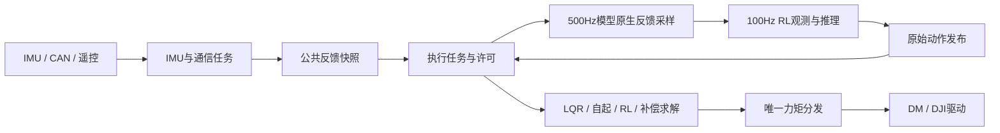

# 工程代码总览

## 2026-10-23 · 目标腿长转机体高度固件已烧录

作者本次确认“电机动力已断开，保留H7和RX供电，可以烧录”。1290项来源及大机ELF/BIN/HEX哈希与软件检查版本一致后，经PowerDebugger/OpenOCD SWD200kHz写入；16:23:53结束，耗时79.934秒，退出0，Programming Finished、Verified OK、Resetting Target齐备。HEX SHA256 `c1b1dcdc67550d8e7163321f8166947fb85a9692bef680ca1428454dcbce6305`。model13842、100Hz策略/500Hz PD保持，已写入目标腿长加0.03648m的训练机体高度换算及低位恢复门槛。未使能电机或做真机行为测试，H7负责人待确认。下方“未烧录”为准备阶段历史。[本次证据](../../../artifacts/h7-leg-to-body-height-20261023/flash/result.json)；[接口](../../../docs/interfaces/20261023-h7-leg-to-body-height.md)。

## 2026-10-23 · RL目标腿长转机体高度，源码构建通过、未烧录

按作者“几何换算／做”实现USB大机目标映射：`h_cmd=clamp(rc.len+0.03648,0.2165,0.3664)`，RC仍为腿长目标，RL拨轮范围0.18002～0.32992m；0.30m腿长对应0.33648m训练机体高度。偏移仅来自训练XML直立目标参考，不改实机轮半径/杆长/极性/零点。低位恢复阈值随目标下调，保持原200ms启动/500ms稳定/2000ms超时语义；反馈height仍为髋轮竖直投影。两机各180组实际C模式回归、XML参考几何、恢复计时、大小机各108单元完整编译/链接通过，权重保持model13842。**本次未烧录，板上仍是下方15:53:22版本的直接腿长裁剪逻辑**；真机效果和H7负责人待确认。[接口与证据](../../../docs/interfaces/20261023-h7-leg-to-body-height.md)。

## 2026-10-23 · model13842已导入并烧录，策略100 Hz／PD500 Hz

本次USB大机生成网络已替换为model13842，MACHINE_POLICY_DIV20→10匹配100Hz训练；500Hz采样/PD/下发及200ms启动保持、500ms稳定计时保持。ONNX256组最大差3.815e-6、实际生成C64组4.768e-6，51782参数与两固件权重逐字节一致；大小机各108单元编译/链接通过。1284项既有受保护来源仅策略宏和task_policy首行注释改变，标定/极性/零点/PD/门控不改。用户本次随后确认动力断开后，15:51:48～15:53:22经OpenOCD SWD200kHz烧录，93.295秒、退出0，Programming Finished/Verified OK/Resetting Target齐备。未使能电机；板端真实时序/行为与H7负责人待确认。旧模型与50Hz时序需成套回退；下方旧日期为历史。详见[交付与证据](../../../docs/model-deliveries/20261023-model13842-h7-import.md)。

## 2026-10-22 · model9845大机固件已烧录并校验复位

作者本次确认电机动力已断开、仅保留H7/RX供电后，Codex经PowerDebugger/OpenOCD SWD 200kHz烧录大机MACHINE_DEFAULT=0。22:51:30结束，耗时63.964秒，退出0，Programming Finished、Verified OK、Resetting Target齐备；HEX SHA256 `9fe37c6eba4e006566079d836b4771f4f5d6fdb477e18352201fede1a0ee2f95`。烧录前固件及1263项既有受保护文件、已导入生成网络哈希再次核对一致。仅写入、读回校验、复位，未使能电机；板端推理数值/时序、真机行为和H7负责人核对待确认。此前零速保持退化结论保留；下方“尚未烧录”为历史导入阶段。[烧录证据](../../../artifacts/model9845-h7-20261022-223919/flash-20261022-225027/flash-result.json)。

## 2026-10-22 · model9845已导入并构建，尚未烧录

按作者要求将最新9845导出为固定batch1/opset13 ONNX并导入USB工程networkzn1。仅成套替换7个生成C/H及报告，模型包在models/model9845-20261022；256组ONNX误差5.722e-6、64组实际生成C误差5.245e-6，51782参数逐字节一致，大小机各108单元编译链接通过，固件权重再次核对通过。1263项既有控制/标定/库/IOC文件保持，未改另一主工程；未连接硬件、烧录或使能。零速保持8/32→4/32退化，不代表行为验收。旧6848网络已在artifact备份；CubeMX重新生成前需选择新ONNX，IOC历史路径未改。H7负责人待确认。[完整交付与版本](../../../docs/model-deliveries/20261022-model9845-h7-import.md)。

## 2026-10-22 · 采集吞吐修复已烧录并通过断动力稳态复测

采集持续丢记录已修复并烧录大机。最终方案为输出批量24→48、三处遥测CRC同结果逐字节计算、USB忙/失败不消耗10ms限速额度；队列容量、采样/控制频率、模型6848、PD及物理配置保持。大小机完整编译及实际C/原驱动回归通过；60.023164秒实采中，5秒预热后的约55秒，两条记录流新增丢弃/包缺口/记录缺口/CRC拒绝全部为0，镜像约99.66Hz。开头仍新增丢弃输出2条/时序6条，输出尾部893字节截包与64个CAN pending保留，全文件完整性仍失败，未清计数或删原始字节。首轮仅增大批量的失败记录保留；本次只证明禁用/无电机反馈状态吞吐，正常RL/PD/成功CAN与H7负责人核对待确认。 [最终证据](../../../artifacts/h7-capture-throughput-fix-20261022/report.md)。下方“候选未烧录/未实采”为历史阶段。

## 2026-10-22 · 输出采集吞吐修复候选（未烧录）

已定位首采丢记录：原H7OUT001每包上限24条，2335包/30.024801秒的导出能力约1866条/秒，低于禁用档约2000条/秒的记录量，导致新增3972条丢弃。仅将OUTPUT_CAPTURE_BATCH改为48，保持128项队列、原88字节记录、CRC/版本/控制/采样频率不变；新解码器接受0～48项，仍兼容旧24项包，旧解码器需更新。最大USB合并包从11032增至13144字节，静态缓冲增加2112字节，不靠清丢弃计数或丢采样隐藏问题。 大小机各108来源GCC编译/链接、原驱动652组逐字节回归及旧会话/CRC/缺号检查通过；实际C双队列/发送器在虚拟50Hz导出、1000/500Hz分发、40ms停顿下，12000条输出及36400条时序记录无丢弃。异步忙不覆盖、失败不出队、13144字节三格式分片解码通过。模型207128字节权重与此前已验证ELF相同，控制/配置/标定文件哈希保持。当前只是候选软件验证通过，尚未烧录或证明板端吞吐。 [候选及证据](../../../artifacts/h7-capture-throughput-fix-20261022/delivery.json)。

## 2026-10-22 · H7LAT001断动力首采完成，正常RL待测

2026-10-22本次经Jetson只读录制30.024801秒并取回，原始会话哈希和结束标志校验通过。新时序182263条，分离出29.769029秒连续禁用档区间：实际1kHz分发周期均值1000.000μs、标准差1.200μs、最大1007.778μs，执行任务单拍均值31.074μs；六电机反馈无效，MOTOR/CAN故障，未执行有效推理或PD。时序全文件有历史积压/缺口及530字节尾部残包，原输出队列新增丢弃3972条，持续吞吐未通过；没有正常500Hz RL或成功CAN完成样本。本轮未写串口、使能电机或重新烧录，H7部署负责人核对待确认。 [原始会话与分析](../../../artifacts/h7-latency-live-20261022-195342/report.md)。下方烧录阶段“未采新数据”为当时状态。

## 2026-10-22 · H7LAT001时序采集固件已烧录

2026-10-22 19:48，作者本次确认电机动力断开、仅保留H7/RX供电并授权烧录。核对大机候选的122项源码输入及BIN/ELF/HEX哈希均一致后，经PowerDebugger/OpenOCD SWD 200kHz写入；退出0，Programming Finished、Verified OK、Resetting Target齐备。HEX SHA256 `09a6066e3e3cb3c382bb88ad756c355c039a19ad8310e53a4144e9174bdd9e10`，模型仍为6848；本次仅写入/校验/复位，未使能电机、触发脉冲或采集新时序。采集开销、持续吞吐、实际调度及行为仍待实测，H7部署负责人核对待确认。 [烧录证据](../../../artifacts/h7-latency-flash-20261022-194645/flash-result.json)；[测点与实采步骤](../../../docs/interfaces/20261022-h7-latency-capture-v1.md)。

## 2026-10-21 · 初始角度分支修复已烧录

2026-10-21本次用户明确要求烧录并确认电机动力已断开、H7/RX保持供电。当前源码重新完整编译退出0，HEX本次生成；与已验证候选仅CubeAI生成网络的编译时间字符串3字节不同，其余全部609496字节Flash地址/内容一致。随后PowerDebugger/OpenOCD SWD1000kHz实际写入，Programming Finished、Verified OK、Resetting Target齐备，退出0；到此停止。当前大机HEX SHA256 `57c2a6813b071a6d1a249e29e7ec86463f5f4904531e8aa85a0a55ac90ba726e`，模型仍6848，初始角度分支锁存修复已写入。尚未做板端只读角度核对或动力响应试验，不声称左腿失联/饱和已经消除。H7负责人待确认。证据：`artifacts/h7-rl-angle-branch-fix-20261021/flash-01/flash-result.json`。 [完整版本与验证](../../../docs/interfaces/20261021-h7-rl-angle-branch-fix.md)。下方“候选未烧录”为先前阶段。


## 2026-10-21 · RL初始角度分支候选已验证，未烧录

RL_Motor_Map首次有效RL样本按原驱动周期锁存最靠近q_reference的整圈偏移，观测与PD共用修正后连续角；运行中不逐拍取模，退出RL才重选，源失效/恢复不改偏移。驱动原连续量及USB10～13仍保留，旧零点/极性/增益/限幅/网络和LQR/台架逻辑保持。实际C52组检查及最新数据796个有效样本映射通过，265个失效样本仍无效，大小机O0完整编译/链接通过。候选尚未写入板，反馈中断/物理表现待验证。 [完整修复/版本/验证](../../../docs/interfaces/20261021-h7-rl-angle-branch-fix.md)。


## 2026-10-21 · model6848已接入并烧录

作者本次调用shaolu并选择转换6848再烧录。生成网络现为model_6848_opset13，名称仍networkzn1、接口39→6，配套CubeAI 10.2.0/legacy运行库不改。51782个float权重逐字节核对一致，64组生成C宿主输出最大差3.815e-6；独立worktree大机109项来源由eIDE/unify_builder+ARM GCC编译通过。HEX SHA256为cbfa46dde22e7cf7a267c7e70f59cefe5cad34c01cedd0694ff8e25a5f3b9e01，用户本次确认电机动力已断开后，PowerDebugger/OpenOCD 1000kHz实际写入、校验、复位成功。未做带动力试验，板端数值/最坏周期及H7负责人核对待确认；控制/极性/零点/换算及固定300ms台架逻辑保持。当前IOC仍保留旧Windows 5849模型来源，未来CubeMX重新生成前须选[6848 ONNX](../models/model6848-20261021/model_6848_opset13.onnx)。[本次完整证据](../../../docs/interfaces/20261021-h7-model6848-flash.md)。下方首次文件交付的“未转换/烧录”为历史状态。


## 2026-10-21 · model6848待导入文件

用户要求导出并放入H7，完整PT、固定batch1/opset13 ONNX、256组NPZ/CSV参考向量和SHA256SUMS已存放于[models/model6848-20261021](../models/model6848-20261021/)。PT是电脑用训练checkpoint；现有H7流程通过ONNX生成C网络，不能直接加载PT。导出数值检查和交付ONNX的12秒零速MuJoCo回放通过，版本/来源/限制见[交付记录](../../../docs/model-deliveries/20261021-model6848-h7-export.md)。本次仅准备文件，X-CUBE-AI/App/networkzn1*仍为5849，未转换、构建或烧录，控制/标定保持。后续转换须沿原流程保持networkzn1名称并成套生成，板端数值/时序/真机及H7负责人核对待确认。


2026-10-21完整台架实录：独立120秒拟合/验证各4次左右正反脉冲，每份240000项，CRC/缺口/新增丢弃/截包/HAL失败全0，持续约300ms且四髋零请求。实际触发间隔未全部达到10秒，温度未测。固定/可调armature只生成独立候选XML；可调组总体轮速改善但加速不及固定组，旧RL10/50ms俯仰变差，不能采纳或训练。来源、真实边界、图及重现见[完整输入校准报告](../../../docs/diagnostics/20261021-fixed300-complete-input-calibration.md)；新完整RL验证和H7负责人复查待确认。

2026-10-21最新台架固件：作者明确要求“取消全部提前停止，只保留300ms结束”；RUN锁存300ms，运行中遥控离档/离线、超速、反馈/故障/发送失败不撤销，四髋仍失能。触发前检查保留，普通RL/LQR不改。实际C回归及大小机各107来源GCC链接通过；17:18大机已写入/校验/复位，10秒断动力零输出采集通过，有动力300ms左右正反响应已采集，两份独立完整会话各4次；轮端候选尚未通过整机轮速/俯仰联合验证。候选/哈希/边界见[完整输出接口文末](../../../docs/interfaces/20261021-h7-output-capture-v1.md#2026-10-21-固定300ms台架候选源码构建通过未烧录)。

2026-10-20本目录已改为H7板载USB CDC向Jetson发送只读姿态镜像；Jetson本地屏幕显示MuJoCo。当前USB操作见[镜像与Jetson启动](#vofa)，下方UART联机记录仅解释历史，不是本版USB验收。

2026-10-18按已同步到本仓的H7源码核对说明。本文说明职责、调用关系和参数入口；数值以源码为准，编译成功不等于实机标定或控制效果已验证。部署来源与同步结果见[部署同步记录](../../../docs/interfaces/20261018-h7-model5849-deployment-sync.md)，训练／实机接口与后续方案见[部署接口约定](../../../docs/deployment-contract.md)。

## 文档与阅读顺序

根目录[AGENTS.md](../AGENTS.md)提供AI自动阅读入口，规则正文统一在本目录。四份长期维护文档为：[AGENTS.md](AGENTS.md)（含Git与协作偏好）、[CLAUDE.md](CLAUDE.md)（阅读入口）、本文（代码总览）、[sysid-change-map.md](sysid-change-map.md)（历史记录）。作者另行要求的[训练部署对接说明](H7_RL_训练部署对接说明_20261015.md)为可交付的版本快照；历史参数、通道和规划不替代当前源码。

先看`main.c → freertos.c → robot_control.c`了解启动，再看`task_comm/task_imu → feedback_snapshot → task_actuation`了解控制主链；处理RL时继续看`task_policy → rl_observation/rl_policy/rl_torque`。

## 当前实现概览

2026-10-21新增完整输出记录（本worktree大机已烧录，断动力30秒USB采集通过）：`bsp/output_capture.c/.h`缓存每个实际控制分发快照及DJI实际CAN提交；原v2镜像前缀后，同一次USB提交追加H7OUT001批次。队满只记缺口、不阻塞控制；台架撤销原因、原接收年龄、真实四槽电流码与HAL返回分别保存，不把请求或电流换算当实测轴矩。原控制/标定/策略保持，大小机GCC构建和有限软件检查通过，板端2ms节拍及长期吞吐仍待确认。结构、协议、命令及边界见[完整输出接口](../../../docs/interfaces/20261021-h7-output-capture-v1.md)，只读离线解码入口为`sim2sim/h7_output_capture.py`；旧100Hz拟合入口不会自动使用旁带。

2026-10-21作者选择“恢复原控制器，准备实采”：当前`rl_torque.c`为原0.1轮速比例输出，最后统一±3.9Nm限幅；左上/右中恢复RL投入，原许可/故障保护、LQR和左上/右上轮台架保持。试验补偿不再接入，`wheel_response.c/.h`及Keil登记已移出当前工程，完整试验源码保留在`artifacts/real2sim-wheel-response-h7-20261021/source/`。USB槽158固定版本0；156/157仍为复位计数、159仍为CRC，接收器保留归档版本目录。大小机各106来源编译链接及108组实际C轮矩检查通过，报告`artifacts/real2sim-original-controller-20261021/check.json`；Jetson接收程序已同步、旧版已备份。后续大机已烧录原控制加完整输出记录版，写入/校验/复位通过；尚未进行无人扶持RL试验；Jetson打开接收并排空缓存后，断动力30秒USB实际观察59980项记录，无缺口/新增丢弃/CRC拒绝，RL时序和机械响应仍待验证。独立圆柱接触模型只用于诊断，不是正式XML；实验结论统一见[项目实验记录](../../../docs/ai/project-log.md#当前状态2026-10-21)。

2026-10-17在回退后按作者重新确认的方案接入model5849平地命令与倒地恢复：复用公共rc.vel/yaw/len，仅在RL观测入口限制至训练命令包线；公共高度只求两腿L*cos(theta)均值；RL实际投入状态决定NORMAL/RECOVER、ground_start、policy_active和恢复出力。保留作者生成网络、K表、自起参数、IMU与电机标定。完整软件链路已接入并通过下述软件检查，板端站立、估计准确性和恢复效果仍待验证。

| 文件组 | 已实现变化 |
| --- | --- |
| rl_types、rl_observation C/H | 内部四腿两轮，网络原始action为左右两侧顺序；唯一映射[0,1,3,4,2,5]供目标/历史观测共用；原生q/dq构造obs39，仅保留最新样本，无人为延迟 |
| rl_policy C/H | 单float32输入39、输出6及独立I/O缓冲；保留SDK接口/返回/输出检查；作者新生成的model5849保留，外围支持平地命令和倒地恢复，板端效果待验证 |
| rl_torque C/H、machine_config C/H | 跟随训练默认角与参考角、腿60/2及轮0.1速度环；目标与力矩分别限幅，再配对还原固件方向；当前CPU multimode入口已同步默认角中心与轮0.1速度环，旧差异只按历史记录解释 |
| dm、feedback_snapshot、task_comm | 新增保留原驱动标定的累计角rad，并经同一快照传到执行；旧pos_zero_rad继续供几何使用，动作停更/持续不可用分开处理 |
| robot_control、robot_state、task_policy、task_actuation | 大机500Hz采样/PD/正常下发、100Hz推理；普通初态无保持，趴地初态保持200ms；投入/退出/失败清历史，模式切换只撤销旧动作就绪并拒绝在途推理；观测完整发布，统一输出口复查许可 |
| air_detection、slip、leg_solver、斜坡、DM/DJI初始化 | 删除固定配置/初始参数合法性扫描及无消费者的状态字段；反馈、新运算、奇异性、公共协议/SDK边界、状态机和出力许可仍检查 |
| math_utils、PID/腿解算/LQR消费者 | clip、clampf和相同逐圈环绕统一公共内联入口；保留原NaN/Inf、负零、端点和舍入语义，独有fmodf/非有限清零/协议行为保持 |
| vofa_debug C/H | 所有模式固定通道赋值、一次发送；旧腿部/LQR赋值注释保留，换布局手动编辑，不用模式/就绪标志选帧 |

2026-10-17公共驱动采用作者提供的LQR可用标定，RL通过额外配对映射恢复作者提供的RL可用坐标：motor_sign按左前、左后、右前、右后、左轮、右轮填写为{1,1,-1,-1,1,-1}，额外motor_zero为0；不能按网络action的左右两侧顺序填写。24组电脑端对照确认模型q/dq和最终硬件方向力矩与原RL标定等价，连续角跨圈、板端及实机控制效果待验证；权重正确和电脑端通过不等于机器人已验证能站立。

LQR仍使用原单圈标定角解算几何、原K/增益/限矩/补偿和1kHz周期；RL专属坐标、增益、限矩和节拍不套到LQR。RL计算频率增加会改变任务及总线负载，实机调度和控制效果尚未验证。

## 目录职责

| 路径 | 职责与主要入口 |
| --- | --- |
| [Core/Src/main.c](../Core/Src/main.c) | 时钟/外设与通信初始化，启动FreeRTOS；用户改动限定在CubeMX保护区 |
| [Core/Src/freertos.c](../Core/Src/freertos.c) | 五个任务的创建、初始化调用、等待与循环节拍 |
| [imcalib/config/machine_config.c](../imcalib/config/machine_config.c) / [头文件](../imcalib/config/machine_config.h) | 两机只读配置、编译选机和节拍宏；驱动/几何/IMU/LQR/RL共用 |
| imcalib/task | 反馈准备、策略仲裁、求解调用、最终输出及后台服务 |
| imcalib/Algorithm | 姿态、几何、LQR/RL、自起、离地、速度融合与补偿；不直接发送控制报文 |
| imcalib/drivers | DR16、HI229、DM/DJI等协议解析、反馈换算、在线判定与报文发送 |
| imcalib/bsp | CAN/UART、DMA缓存、单调时间、VOFA发送及板级适配 |
| imcalib/common | PID、斜坡、低通、数学/DSP及motor/RC/RL纯类型；kalman是保留数学工具 |
| [imcalib/common/math_utils.h](../imcalib/common/math_utils.h) | 纯数学公共内联入口：区间clampf、对称clip、逐圈Angle_Wrap_180及Float_Array_Finite；不依赖几何/PID任务状态 |
| [tools/matlab/run_all.m](../tools/matlab/run_all.m) | LQR模型、Q/R选择及增益表生成入口 |
| X-CUBE-AI/App、Middlewares/ST/AI | networkzn1生成网络/权重和AI运行库；通过rl_policy封装调用 |
| Drivers、Middlewares | HAL/CMSIS、FreeRTOS、USB及厂商运行库，保留其版权和生成边界 |
| gcc_support | eIDE专用GCC补充依赖：原版FreeRTOS ARM_CM4F端口及CubeAI10.2.0 GCC库，置于CubeMX生成目录之外，内容与原版本一致 |
| USB_DEVICE | 板载USB CDC固定发送镜像；接收丢弃并继续挂接，不解析控制命令 |

## 启动与任务主链

`main`完成外设初始化后调用`FDCAN_Config`、单调时钟及遥控/IMU/电机初始化，再启动RTOS。`FDCAN_Config`会把机器宏的数据段时序套到FDCAN1/3，当前确实生效；FDCAN2仍取其初始化配置。BMI088源文件保留，主初始化未启用它；姿态来源为HI229；UART7接HI229，UART10旧探测接收仍初始化，但不再从镜像回报；Jetson镜像连接板载USB，IMU离线故障保留。

| 任务入口 | 单周期职责 | 节拍来源 |
| --- | --- | --- |
| [comm_task_body](../imcalib/task/task_comm.c) | DM/DJI解析与物理量刷新、两腿解算、遥控解算/发布、故障/跌倒与使能看门狗 | freertos中的osDelay |
| [imu_task_body](../imcalib/task/task_imu.c) | HI229读取/去重、按机器表取轴和符号、姿态/补角、IMU发布 | freertos中的osDelay |
| [ctrl_task_body](../imcalib/task/task_policy.c) | RL39观测、CubeAI推理、原始动作发布 | TIM6按MACHINE_POLICY_DIV释放策略信号量 |
| [output_task_body](../imcalib/task/task_actuation.c) | 快照与许可、速度/离地更新、模式求解、唯一力矩分发 | TIM6基础执行信号量；RL按MACHINE_RL_CTRL_DIV执行分频 |
| [background_task_body](../imcalib/task/background_service.c) | 普通VOFA与灯效；USB初始化仍在默认任务入口 | 默认任务循环及osDelay |

LQR使用`MACHINE_LQR_DT`，RL内环使用`MACHINE_RL_CTRL_DT`，策略使用`MACHINE_POLICY_DT`。公共腿长拨轮累加在通信任务的`Rc_Command_Update`完成，按`MACHINE_TICK_DT`推进。原通用周期兼容别名已移除，不能用一个周期替代各路径。大机RL间隔拍保持原已发输出，退出/故障仍在每个基础执行拍优先检查。



<a id="shared-state"></a>
## 状态所有权与模块边界

[robot_control.c](../imcalib/task/robot_control.c)定义共享实例、总初始化和动作清零；[robot_control.h](../imcalib/task/inc/robot_control.h)声明任务/许可接口，[robot_state.h](../imcalib/task/inc/robot_state.h)声明共享状态。当前单模型RL已删除切换入口，参数直接读机器表；算法不能包含这两个任务头，应接收显式参数或读取只读机器配置。

执行拍类型`control_frame_t`定义在robot_control.h，实例仍由task_actuation.c私有持有；其compensation字段保存本拍统一预计算的模型值。发布元数据集合类型`feedback_metadata_t`定义在feedback_snapshot.h，metadata实例仍由feedback_snapshot.c私有持有。工程自有结构体类型统一放入对应头文件，类型可见不代表实例跨模块共享。

| 状态 | 周期写入方 | 消费方式 |
| --- | --- | --- |
| imu_state | IMU任务 | 经公共快照供策略/执行读取 |
| motor_state、leg_l/r | 通信任务 | 电机反馈及对应双腿解算配套发布 |
| rc_command、robot_state、ctrl_fault | 通信任务；有效落地更新公共len | 执行/策略消费命令和许可，后台读取状态 |
| RL最新反馈样本、PD/目标与力矩 | 执行任务500Hz | 策略在短临界区读取样本；PD使用当拍反馈 |
| RL39观测、上一请求、policy、action_state | 策略任务100Hz | 执行消费原始请求；执行清零时递增reset_count使旧推理失效 |
| lqr_state、leg_balance、自起/离地/速度状态、最终力矩及补偿诊断 | 执行任务 | 求解和最终输出；Watch及后台按实际代码读取 |

[feedback_snapshot.c](../imcalib/task/feedback_snapshot.c) / [头文件](../imcalib/task/inc/feedback_snapshot.h)由发布方在短临界区提交，执行任务每基础拍读取完整快照；策略任务读取执行任务准备的RL最新样本，不另直接读取原始快照。成功复制不代表传感器有效，各消费者仍检查所需online/valid和许可；同一软件快照不代表物理采样同步。

快照中已有TODO标记的元数据/时间字段仍属作者选择保留的预留链路；当前控制消费者不使用这些时间字段，不能把它们当作已经接入的样本龄门控。离地已改为固定周期，DM接收时间不再传入离地输入；驱动及快照保留的时间元数据不参与其dt计算。

几何、速度和雅可比只归`leg_solver`；DR16字节解析只归驱动，遥控死区/量程与模式请求解码只归`rc_command`；网络生命周期只归`rl_policy`。实际出力许可、控制求解与力矩下发只归`task_actuation`，通信任务保留电机使能/失能/故障看门狗职责。

## 数据有效性与校验边界

当前调用关系中，控制/观测对象和数组由任务提供固定有效地址；相应固定指针防御和重复扫描已精简。固定配置和代码初始化参数直接使用，不在初始化或实时循环扫描合法性。SDK动态缓冲区、可选模型、公共接口边界、反馈有效性、几何奇异性、新运算结果、设备/动作失联超时和最终发送许可仍按实际语义检查。离地不再另设样本龄、四髋时间偏差或新帧门控。

| 数据 | 当前保证与消费者 |
| --- | --- |
| IMU | Attitude_Update完成四元数归一化、欧拉角换算、三路数值验证，并调用原Attitude_Accel_Vertical生成accel_vertical；竖直结果也通过后才返回成功，由task_imu发布online=1。离地直接读取缓存值，不每执行拍重复投影和校验。pitch_world_valid仍独立表示补角可用；轴向和原计算公式保持 |
| 双腿 | comm在两路源电机在线时解算，否则清输出有效标志；Leg_Solve统一验证腿长/腿角/变化率/虚拟关节量与各雅可比，成功后valid=1。force_valid另外保证力映射行列式有限且满足原奇异性阈值。LQR/自起/离地消费这两个标志，不重复扫描原始反馈 |
| 电机组 | motor.valid由通信更新时一次汇总四髋/双轮online及四髋无DM故障；故障沿用Dm_Has_Fault原判据，与反馈复制共用一次遍历。RL、执行许可和Robot_Fault_Update直接读组标志，不再另遍历DM故障；CAN异常仍单独检查，数据可用不等同于电机已使能或命令已执行 |
| 轮速/遥控 | 轮速由int16_t RPM及本机固定非零齿比换算，LQR/RL的重复轮速有限性扫描已删；RC用整数通道及固定公共量程产生有限命令，LQR目标更新只保留在线门控 |
| RL观测/动作 | 电机和IMU由发布端保证；RL_Motor_Map验证新模型位置/速度，投影在采样生成处检查。RL39生成后发布valid，推理信任valid；SDK形状/类型、动态缓冲区、返回值及6维输出动作仍检查。不存在125维历史或latent |
| 补偿 | 执行拍准备阶段使用固定本机模型和同拍几何计算实体弹簧力、抵消量及两种角度引用的重力值；模型新结果在准备端验证，消费端读取valid，保留反馈反解和叠加新结果检查。模型、坐标、符号及原叠加顺序保持 |

LQR_State_Update已删除无计算用途的dt参数，只检查imu.online/左右腿valid后进行状态构建；速度融合、位置积分、PID/斜坡等实际使用周期的函数仍传各自周期。执行入口读取本拍IMU/补角/双腿/电机组可用标志后形成drive，避免仅等待缓存故障汇总。自起实测角度范围、运行状态、新计算结果、最终出力许可仍保留必要检查。纯计算助手只在调用方确认反馈可用后使用，不能把无效数据强行标为有效。

2026-10-13再次按作者要求检查当前全部自有源码调用：固定对象/数组不重复检查NULL；Slip消费LQR已验证的运动学速度/加速度和固定周期，LQR速度回填消费Slip.valid，不再逐层检查同一速度。斜坡实测量由几何保证、周期由任务保证，目标及新斜坡结果仍检查，固定速率范围检查已于2026-10-14删除。自起保留入口反馈标志与阶段/许可，删掉后续重复补角检查；补偿台架信任normal已包含的补角许可。Rc_Axis不再重复夹取DR16_Validate已验证范围内的原始通道，公共命令量程与腿长限幅保持。DM/DJI接收回调信任Can_Bus已经检查的标准数据帧和8字节长度，缓冲地址和上下文由注册表固定提供；协议入口、缓存容量、设备状态、SDK返回及最终发送保护仍保留。

2026-10-14按作者要求扩展检查所有自有模块：删除Air_Params_Valid及仅转调复位/校验的Air_Detection_Init，初始化直接Reset；Slip删除初始方差/Q/R/门限参数范围和独立noise正值检查，保留计算方差的有限/正值及状态/协方差结果检查。Leg_Input_Valid只验反馈，固定杆长和腿配置就绪标志不再扫描；腿map与config中无人消费的configured字段及初始化赋值同步删除。comm只按绑定电机的online决定腿解算；DM/DJI初始化不再扫描固定总线/ID。轨迹速率直接使用配置，保留目标/运算结果检查。机器功能开关、状态机保护、实际限幅、协议/公共接口边界以及SDK模型接口检查保持。

## 拨杆模式与输出许可

唯一解码入口为[Rc_Command_Update](../imcalib/task/rc_command.c)。每次通信更新生成`rc.mode.strategy / rc_enable / engage`，随遥控指令一起发布；执行快照直接读取`control_frame.rc.mode`，总使能检查读取`rc_command.mode`，不再重复解码。模式类型归公共`rc_types.h`，保留原策略枚举值；`robot_state.rc_enable`在发布时同步mode许可，供既有状态/调试读取。故障、跌倒恢复、电机使能和总输出开关仍按实际周期检查，不缓存成模式请求。

| 左拨杆 | 右拨杆 | 请求行为 |
| --- | --- | --- |
| 中 | 上 | 仅弹簧与完整重力台架，两轮为零；模型或许可不足则失能 |
| 中 | 中 | 自起/LQR投入 |
| 中 | 下 | 已选LQR，零力矩 |
| 上 | 中 | 原RL投入已恢复并随完整输出固件烧录；无人扶持零速采集未执行 |
| 上 | 上 | 单轮短脉冲测试（策略5），先按下节准备 |
| 上 | 下 | 已选RL，零力矩 |
| 下或遥控离线 | 任意 | 失能 |

普通控制的投入请求不等于实际出力，仍需在线、故障、翻倒/恢复许可、电机使能、总输出开关和求解有效性；新台架候选的已触发RUN例外见下节。`output_dispatch`在发送前复查实时故障与总输出开关；无效/失能路径发送零力矩或停止。发送入队、请求力矩和实际受力是不同概念。

## 单轮固定300ms脉冲测试（已实测，整机校准未通过）

台架阶段按用户要求设置左上/右上测试，并暂时注释左上/右中RL投入；随后用户选择准备无人扶持零速采集，源码已恢复原RL投入行，后续已随完整输出固件烧录；本次未进行RL动力测试。LQR原有档位与算法保持。仅修改H7_RL_ros，主H7_RL、物理极性/零点/减速比、XML和模型权重不改。测试函数及状态在`imcalib/Algorithm/wheel_bench.c/.h`，由原执行任务调用，不新增任务；CAN仍只从`output_dispatch()`发送。eIDE扫描来源自动包含新文件，MDK工程同步登记。

2026-10-21已烧录的±0.05Nm版完成1001帧零输出核对和9901帧／7次短脉冲采集；此前保护版源码为±3Nm、最长300ms、30rad/s撤销门限；本段实录均为保护版历史，新候选触发后仅按300ms结束，见本节操作。本次用户重新确认断电后，新配置已完成大机编译、写入、校验和复位，证据见`artifacts/wheel-bench-3p00-300ms-speed30-flash-20261021/flash.json`；随后95.37秒9534帧实录8次±3Nm脉冲，实际约40～70ms提前归零、峰值约37rad/s，新数据/条件拟合见`artifacts/wheel-bench-3p00-300ms-speed30-test-20261021/`，不作为完整300ms恒矩或物理硬限速验收。本次用户重新确认断电后，大机编译、烧录、校验和复位通过，证据见`artifacts/wheel-bench-1p70-flash-20261021/flash.json`；±1.7Nm版已实际采集6次左右正负脉冲，详见`artifacts/wheel-bench-1p70-test-20261021/result.json`；3rad/s门限下输出提前归零，峰值约5.07rad/s，当前USB未导出具体中止reason。旧版证据见`artifacts/wheel-bench-flash-20261021/`及`artifacts/wheel-bench-test-20261021/result.json`。操作只适用于车身可靠固定、双轮悬空的台架：

1. 左下/右上保持至少300ms，双轮绝对轮速均小于0.2rad/s且反馈/保护有效后准备；调试Watch中`wheel_bench.phase=2`代表READY。准备后独占输出，中途经过补偿/LQR/RL档不出力。
2. 新候选切左上/右上，每次只发一个固定300ms请求窗口；触发后离档/离线不提前取消。依次为左轮+3、左轮−3、右轮+3、右轮−3Nm，之后循环；每项必须重新回步骤1，长时间留在上/上不连发。正负沿用固件坐标，不能据此认定实机前后方向。
3. 新候选触发前仍要求有效许可和双轮静止；触发后不再因30rad/s、反馈失效、遥控离档/离线、故障、总开关、执行间隔或发送失败提前撤销。运行轮子/指令锁存到300ms；HAL失败仍如实记录，不立即另发轮零矩。到时请求归零，零电流不保证立即停转，MCU停调度或CAN失效也不保证物理300ms停机。
4. RUN结束后，左下/右下保持至少300ms，`reserved=0`释放独占，LQR原有档位恢复可用。RUN中下/下不提前取消，也不释放独占；READY时短暂下/下仍取消准备。重新上电仍需步骤1，不能上电即发脉冲。

四髋由既有失能/看门狗保持失能；只有反馈确认四髋未使能时测试才可出力。`wheel_bench`还保留`reason/count/wheel/command_nm`供Watch检查。USB保持v2固定160路只读布局、不接控制命令；既有CSV中的`rc_strategy=5`、门控后轮矩请求、电流raw、轮速和输出标志可重现脉冲，32～46槽仍为0。100Hz镜像只采样1kHz输出，不能当作全部CAN命令或精确电机延迟。±3Nm使用现有电流换算，是命令刻度，不是独立实测力矩；小脉冲不转时不自动加幅。

验证入口仍为训练仓`scripts/agent/check_real2sim_huananhu.py --h7-root deployment/H7_RL_ros --build-h7 --out artifacts/<新名称>/check.json`。本轮正式报告见`artifacts/wheel-bench-3p00-300ms-speed30-20261021/check.json`，覆盖真实C状态机/拨杆解码/许可/最终输出函数的宿主检查及大小机编译链接；驱动与RTOS为替身。±0.05Nm版已采到触发／到时归零与电流/微小轮速响应；不据此验收全部保护边界。±1.70Nm版已烧录并完成6次短脉冲采集；部分请求提前归零，全部保护边界/物理方向和H7部署负责人复查待确认。

## 配置与调参入口

2026-10-21无人扶持采集准备：仅恢复`rc_command.c`原RL投入行，未改PD/策略/标定；软件检查与大小机106来源编译链接分别见`artifacts/real2sim-zero-stand-20261021/check-usb-software.json`、`check-arm-build.json`。前者检查原C拨杆解码、台架独占及释放后RL/LQR投入；后者不代表已写入板端。板端仍为此前RL暂停的台架固件；新版本需本次明确烧录授权及断电确认。采集操作见[USB镜像接口的无人扶持零速采集](../../../docs/interfaces/20261020-h7-ros-usb-mirror.md#无人扶持零速采集准备)。

只通过`MACHINE_DEFAULT`编译选机，`machine`指针不可运行时换机。小机RL未配置，不把大机网络参数直接套给小机。

| 配置 | 内容与生效位置 |
| --- | --- |
| machine.rc | 公共前进/偏航量程、腿长初值/速率；RC统一解算，LQR直接使用，RL读取同一命令后按训练包线限幅，不回写RC |
| machine.lqr | trim/位移目标、停车条件、角速度低通、腿长/横滚PID、支撑前馈和运行开关默认值 |
| lqr_debug | LQR运行时工作配置与对照入口；初始化取机器默认值，部分物理符号对照保持原源码，不能擅改 |
| machine.rl | 实体motor_sign/motor_zero、原生nominal_pos/reference_pos、RL39缩放/裁剪、训练四腿PD/轮速度比例及独立限矩；两条动作看门狗，无人为延迟或NORMAL启动保持 |
| standup_param / air_param / slip_param | 独立自起、接触估计/空中接入、速度融合模块参数，读取对应源文件顶部 |
| machine.spring / machine.gravity | 弹簧几何模型及完整腿自重模型；大机绑定，小机按NULL旁路 |
| DM/DJI量程、极性、零点、几何、IMU映射 | 物理标定；只能由作者实测决定，遵守AGENTS红线 |

控制周期直接取`MACHINE_LQR_DT / MACHINE_RL_CTRL_DT / MACHINE_POLICY_DT`；仅为配套检查设置的`.lqr.dt`已删除。运行参数或PID在初始化/复位位置加载，不能假定改配置副本会自动同步现有控制器。name仅是调试标签，不参与控制。

`rc_command.len`为米，沿用原公式：拨轮死区/归一化后，`len += wheel × rc.len_rate × dt`，回中保持。USB大机RL模式夹到训练高度范围反算的腿长0.18002～0.32992m；LQR及小机仍夹到原机械范围与K表域交集。通信任务直接传`MACHINE_TICK_DT`，更新后若未投入LQR/RL则把腿长恢复`rc.len_init`；离线由RC恢复初值。LQR离地时拨轮仍更新公共目标，轴向释放继续由执行层处理。有效落地仍设置0.20 m，写公共目标及执行当拍命令；作者已移除通信整段临界区，指令发布本身仍由快照接口保护。无新增累加状态、时间戳或复位接口，模式请求在RC解码，实际出力由执行层检查。

## LQR与腿力控

[lqr_balance.c](../imcalib/Algorithm/lqr_balance.c)构建十维状态/目标，按实测腿长求K并输出双轮及左右虚拟髋摆矩。状态顺序为`[s,ds,phi,dphi,thL,dthL,thR,dthR,pitch,dpitch]`，输出顺序为`[左轮,右轮,左虚拟髋,右虚拟髋]`。

2026-10-18按作者要求记录站立震荡分项：u_col保存左轮十列贡献，u_hip_col保存左虚拟髋十列贡献，均复用实际反馈求和中的term，包含原保持开关、角度环绕和AIR列选择，不在VOFA重算K/误差。每次求解开始及运算失败清分项，避免带出上次有效值；此清理只影响诊断。各分项为限幅前的N·m，求和加u_eq后再经过原限幅得到u；虚拟髋u不含腿长/横滚轴向力、模型补偿及最终电机门控，不能当作实测电机力矩。

[lqr_gain_table.c](../imcalib/Algorithm/lqr_gain_table.c)由`MACHINE_DEFAULT`编译绑定本机独立的`lqr_gain_small/big.c`，与machine配置选机使用同一宏；运行时不切换大小机K表，也不做机型/周期/几何/状态约定等配套检查。生成表中相关字段只保留来源描述。目标腿长夹到机械范围与K表域的交集；实测超域只夹增益求值位置，不伪造测量，也不证明域外稳定。实时输入/计算结果的有限性检查保留；LQR请求许可直接读取machine.lqr_configured。

大小机固定使用各自当前生成表；小机历史表、对照开关/状态/分支和同系数旧候选文件已删除。腿长变化超过原阈值时重新求K，这是同一张表随实测腿长求值，不是切换表。

[leg_balance.c](../imcalib/Algorithm/leg_balance.c)计算左右长度PID、横滚差动力及支撑前馈，加入LQR摆矩后经公共雅可比映射/补偿/限幅。最终腿长目标、斜坡输出/PID给定、实测腿长是三个量。原Ramp_Target_Update首次从实测播种，之后沿上一给定推进；它限制给定速率，不保证实际运动速率。

通用[pid.c](../imcalib/common/pid.c)位置式D使用每拍误差差分，未除周期；RL腿D则直接乘实际关节速度，两者不能按同一Kd口径解释。PID_History_Set只预置历史，不能每拍调用来抹掉真实阻尼。

2026-10-14按作者要求将重复纯数学助手统一到math_utils.h：rl_observation/rl_torque的clip、原leg_solver.h的clampf，以及腿解算/LQR/PID的逐圈角度环绕均共用该头。leg_solver.h和pid.h引入公共头维持现有调用可见性；新增调用可直接include math_utils.h。短函数使用static inline，无需新增C文件或修改构建清单。NaN处理、比较顺序、float常量与±π端点保持；Standup_Wrap原fmodf预处理、abs_limit非有限清零、fminf/fmaxf边界夹取及协议编码限幅保持原实现，不按名称强行替换。

<a id="rl39"></a>
## RL39观测、推理与实体电机执行

当前生成网络对应 `model_13842`（2026-10-23转换、编译并烧录），接口仍为 `chuanliantui-huananhu-multimode-39-82-v1`、单输入39／单输出6，采用100Hz策略与500Hz实体控制；已接入公共遥控和平地NORMAL／RECOVER。模型交付见[model5849说明](../../../docs/onnx-huananhu-multimode-model5849.md)，同仓同步及待验收项见[部署同步记录](../../../docs/interfaces/20261018-h7-model5849-deployment-sync.md)。

2026-10-15的model3023迁移、交付提交773f88e与导出源码269ba935eeb3a39fc3fedcb87b554a4f654ffcec只解释历史初版。当前跳跃／台阶／坡地逻辑未实现，机身接触与绝对高度使用实机替代估计，不能把平地恢复接口称为完整multimode实机验收。

模型位置/速度、PD目标/诊断及观测电机段采用`[lf0,lf00,rf0,rf00,lfwheel,rfwheel]`；网络原始action、action_state.a及last_action采用`[lf0,lf00,lfwheel,rf0,rf00,rfwheel]`。RL_Action_Index统一[0,1,3,4,2,5]，供PD目标与上一动作观测共用；这是通道排列，不是左右角色交换或极性变更。

### 输入与映射

DM新增`pos_continuous_rad`：在原`pos_zero_rad`上补已解包的整数圈，原驱动极性/机械零点和供几何使用的反馈保持。此连续量随电机/双腿快照一起发布，RL不再用thigh、virtual_shank或固定加π作为电机位置。

`motor_sign[6]`与`motor_zero[4]`仅描述已标定固件反馈至模型实体坐标的映射：`q_model=s*(q_continuous-zero)-latched_integer_period_offset`、`dq_model=s*dq_firmware`；输出采用`tau_firmware=s*tau_model`，驱动继续执行其既有物理极性和单位编码。

2026-10-17回退保留本轮前已确认的RL/LQR兼容入口：公共驱动保持作者提供的LQR可用dm_sign/dji_sign/dm_zero，RL额外motor_sign按四腿两轮顺序为[1,1,-1,-1,1,-1]、motor_zero为0。它将公共驱动反馈及输出配对转换到作者原RL可用坐标，不能按网络action的左右两侧顺序填表；此前24组电脑端等价对照记录见历史账本，连续角跨圈和板端控制效果仍待验证。旧虚拟角sign/zero不恢复。

| 索引 | actor39内容 |
| --- | --- |
| 0～2 | clip(rc.vel,1.5)、0、clip(rc.yaw,1.5)，单位m/s及rad/s |
| 3 | USB大机`clamp(rc.len+0.03648,0.2165,0.3664)`后×5；直立目标腿长转训练base高度（2026-10-23已烧录）；小机仍直接裁剪0.27～0.34m |
| 4～6 | 机体系gyro限±100后×0.5 |
| 7～9 | inverse quaternion投影世界重力[0,0,-1]，限±100 |
| 10～13 | 四实体模型角减名义角，限±100 |
| 14～15 | 轮位置槽固定0 |
| 16～21 | 同顺序实测速度限±200后×0.1 |
| 22～27 | 上一拍原始网络action按[0,1,3,4,2,5]重排，再限±100 |
| 28～34 | 普通为[1,0,0,0,0,0,0]，启动保持/恢复为[0,0,0,1,0,0,0]；其余模式槽0 |
| 35～38 | ground_start在实际投入时锁存；policy_active仅NORMAL/RECOVER为1；airborne/step_active固定0 |

nominal_pos是训练微蹲默认姿态在模型原生坐标下的q_nominal；reference_pos是XML的qpos0，二者不是实机编码器零点。版本化XML与主线XML的19个body、19个joint、14个site属性一致；本机未安装指定mjlab环境，按相同前腿目标和定位点独立核算后链闭合，得到原生默认角，未冒充运行过训练环境。参数以machine_config.c为准。输入单位rad/rad/s，轮速已由驱动按轮轴齿比换算，不重复换算。

执行任务500Hz保存最新模型样本，策略100Hz在短临界区复制样本和动作历史，在本地构造39维输入后完整发布，避免遥测读到半更新观测。坏反馈立即清sample_valid。部署不主动添加训练噪声、观测/目标延迟或均值方差归一化，仅存在实际任务、总线与设备延迟。模式和启动标志来自执行任务的同一恢复状态，SDK ready与policy_active分开；当前接model5849的平地运动/起立/倒地恢复，不自动请求跳跃、台阶或坡地，不借用LQR离地检测制造airborne。

### 输出与启动

先按唯一映射取得各实体action。腿目标`clampf(q_nominal+0.5*a,q_reference-3.14,q_reference+3.14)`；轮速目标`clip(10*a,150)`。腿力矩为`60*(target-q)-2*dq`；轮为`0.1*(target-dq)`。采用训练侧定义；训练仓当前CPU multimode回放已同步q_nominal目标与轮0.1速度环，旧q_reference目标／0.12/0.02公式只属于历史差异。位置误差不做最短路径环绕，PD使用当前未缩放的模型原生反馈。先按RL独立40Nm/3.9Nm裁剪，再通过相同motor_sign还原固件电机力矩，进入唯一输出口。

训练腿D项是实际速度阻尼，现有pid_calc的位置式D是两拍误差差分且未除dt，目标变化也会进入D；相同Kd数值不能直接互换。当前直接计算训练公式，不维护多余PID历史或积分；若将来复用PID，必须保证P/D含义和P+D合成后的限幅顺序一致，不能先限P再叠D。RL独立限矩与公共DM/DJI限幅、MIT编码刻度分别维护。

RL不调用雅可比、不叠加弹簧抵消或重力。实体被动弹簧仍存在；LQR/自起/台架的几何、补偿和原参数保持。RL实体PD不依赖雅可比；恢复流程需要公共height_valid，因此坏腿几何不会被当作有效低高度，届时停止本次输出。IMU、补角、电机组、模型、故障和实际输出许可继续检查。

大机基础/LQR仍1kHz，RL分频2→500Hz，策略分频10→100Hz，一个原始action名义保持5个2ms控制子步。正常力矩每RL子步计算/下发，中间基础拍保持命令；退出/故障仍每基础拍检查。增加的执行与总线负载需要实测逐次周期、漏拍和发送成功，不能用宏定义或平均频率代替实测。

实际投入、退出、失能及恢复超时清原始动作/历史/PD目标；NORMAL与RECOVER/启动激活切换保留原始历史，仅清rl_ready并递增reset_count，拒绝切换前在途的推理，等待新模式首帧才出力。普通初态直接NORMAL；趴地初态200ms内继续推理但最终门控强制零力矩，之后进入RECOVER。ground_start锁存整个投入段，中途倒地不重新等待200ms。未实际投入但选择RL可零出力推理，不能提前推进恢复计时；零action不是零力矩。

退出/坏观测/推理失败清动作可用性并发送零输出；模型未就绪不触发尚未开始的动作超时。动作停更和实际投入持续不可用仍分别使用现有期限保护；SDK就绪、模型policy_active、实际硬件出力许可保持独立语义。

### 网络与接入

2026-10-17当前生成文件来源为作者的model5849，本次保留生成文件/IOC原样，接入其平地命令与恢复外围；下述3023导出及数值校对为2026-10-15历史，不是当前权重的验收结论。5849此前电脑端核对见历史账本，本次不重复生成/验证权重，也不把宿主任务检查说成板端或真实网络行为验收。

`rl_policy`仅接受float32单输入[1,39]、单输出[1,6]、batch1；初始化检查生成头及SDK实际逻辑元素数/格式，显式绑定独立的39/6维I/O缓冲，不依赖导出时是否将I/O放在activation。2026-10-15作者曾用ST Edge AI Core 2.2.0 / CubeAI 10.2.0生成并替换model3023网络，输入obs39、输出actions6、四层Dense和三个ELU；输出无tanh。当前静态接口匹配，板端policy.ready及实际SDK调用尚未验证，不能仅凭宏定义声称上板成功。

2026-10-15核对桌面ONNX的SHA256与3023交付记录一致；按生成C实际偏移逐字节比对8组权重/偏置，共51782个float，全部与ONNX一致。ST工具host模式用交付前64组参考输入/输出核对，384个输出最大绝对误差约6.635e-6，小于1e-4；该结果来自电脑端C模型，不代替板端数值验收。生成配置启用activation内I/O分配，与当前封装另行绑定独立I/O的方式兼容，无需为此修改作者生成文件。

2026-10-14按作者要求删除RL_Config_Valid及初始化中的配置限矩比较；固定RL极性、零点、缩放、增益、延迟和期限直接读取机器表，不扫描合法性。configured保留为机型启用开关；SDK接口/返回值、新观测/动作/力矩的运行时检查与最终出力许可保持。RL算法、配置及任务C/H已补核心流程、坐标、单位、延迟和状态切换注释。

新ONNX须使用上述实体契约及配套JSON；在CubeAI中保持网络名`networkzn1`，生成并成套替换`X-CUBE-AI/App/networkzn1.c/h`、`networkzn1_data*.c/h`及`networkzn1_config.h`（按实际生成清单），保留该工具链配套运行库。不能只改尺寸宏、只换部分权重或复用旧模型。当前只有单模型入口，旧多模型切换/索引及无人消费的命令镜像删除。导入后正常初始化自动恢复policy.ready，再做同输入PyTorch/ONNX/CubeAI对照。

Watch输入为`rl_control.observation.obs[0..38]`；原始请求为`action_state.a[0..5]`，按网络左右两侧顺序；PD目标、当前模型位置/速度、模型裁剪力矩及固件请求为`rl_control.torque_state.target/pos/vel/motor_torque/last_torque`，按四腿两轮顺序。最终门控后命令为`rl_output_dm_cmd_nm/rl_output_wheel_cmd_nm`，不能混为同一层量。板端网络数值与实际2ms/10ms周期、反馈更新和总线发送仍待验证。


RL恢复状态复用rl_observation.c/h内的模式生成逻辑，不新建公共离地/运行框架。执行任务每基础拍推进一次：request=遥控在线且选RL并投入，feedback_valid=实际驱动许可且公共高度有效；进入时锁存ground_start=(fallen || height<=0.20)。状态及时间如下：

| phase | 含义及转移 |
| --- | --- |
| 0 IDLE | 未实际投入/运行反馈不可用，不出力；等待有效投入 |
| 1 HOLD | 趴地投入前200ms，recover=1、policy_active=0，持续推理而最终力矩为0 |
| 2 RECOVER | 允许训练PD恢复出力；姿态正常且height>0.20连续500ms才转NORMAL |
| 3 NORMAL | 读取限幅后公共命令；fallen或height<=0.20立即转RECOVER，中途不重复HOLD |
| 4 FAILED | 连续倒地严格超过2000ms，清动作并禁止使能/输出；退出投入才复位 |

连续倒地计时在姿态回正且高度高于门槛时清零，恢复稳定计时被任意一次倒地打断就清零；不是从进入RECOVER起固定2秒超时。ground_start在成功及后续倒地时保持原值。故障、模型失败、源反馈不可用与最终发送许可各自保留，失败锁定不被姿态回正自动解除。RL可在公共fallen下使能，但不因此放开LQR的使能条件；公共40度判据本身仍由两种策略共用。

公共rc.len仍受机械/K表域限制，当前大机最大约0.31m，故直接夹取时实际可调RL高度为0.27～0.31m；低于0.27m的拨轮行程被截住。未额外重映射拨轮、修改公共初值或新建rc.height。

## 自起、离地与姿态补角

公共robot_state.fallen继续直接用IMU euler_deg（沿用LQR实际取轴），pitch或roll任一严格超过40度为倒地；IMU故障保留旧标志。公共高度由Leg_Height_Estimate单独计算0.5*(L_left*cos(theta_left)+L_right*cos(theta_right))，随同批电机/双腿一起发布到robot_state.height/height_valid及反馈快照，LQR不消费高度，也不改air_detection。该值是机体系髋轮投影间距，悬空/倾斜时不等于绝对离地高度；按作者“阈值直接按仿真”要求，0.20m作为实机低高度替代门槛，不能宣称等同仿真base_contact>1N或root高度测量。

[standup.c](../imcalib/Algorithm/standup.c)独立管理起立准备和倒置恢复，按姿态/许可推进阶段，生成目标后运行独立控制器与公共补偿；PREPARE/BALANCE/STOP路由交给执行层，准备过程两轮为零。正常自起和翻身共用独立长度速率standup_param.length_rate，与LQR长度速率分开。

[air_detection.c](../imcalib/Algorithm/air_detection.c)用同侧髋反馈反解、弹簧/自重和IMU估计支撑力；armed是初次支撑确认，valid是本拍估计有效，flight是接触状态。缓存未更新也按固定MACHINE_LQR_DT处理；无效观测不会自动清flight，检测只发布状态。

大机按作者要求收紧确认条件：更低的支持力均值持续更久才判离地，首次支撑需要更高支持力且持续更久；压缩落地需要更大的单腿压缩量并持续更久。小机保留原门槛。参数统一在air_param初始化中按机型维护，数值以源码为准；本次不新增起立后固定屏蔽时间，不改变任一腿满足即可确认压缩落地的原逻辑。确认更严格会增加真实离地/落地的判定延迟，误触发改善仍待实机验证。

作者2026-10-13进一步要求取消离地时间戳处理，统一固定dt并允许旧缓存参与。估力差分、两级滤波、初次支撑/离地与左右压缩计时均使用MACHINE_LQR_DT（当前两机1ms），不再传接收时间或按样本去重；首次和估计失败恢复仍先播种差分，首次有效拍也推进计时。joint_ready只汇总原四髋在线/实际使能条件，不包含新帧和时间偏差判断。竖直加速度随新IMU帧生成并随online发布，离地读取imu.accel_vertical。

Robot_Control_Init直接调用Air_Detection_Reset清检测历史；固定air_param不在上电或实时Update扫描合法性。IMU时间戳停滞门控仍按作者此前要求删除；本轮继续删除rx_ns/now_ns/sample_ns/valid_ns、sample_timeout/sample_skew及执行快照接收时间中转。输入可用性由原反馈标志和joint_ready保证，新估力结果仍验证；失败清连续计时、保留flight，并立即置诊断fault，恢复成功清fault，不新增失败时间计数器。

固定周期假设每次调用经过一个执行拍；重复缓存也持续满足条件时会完成状态切换。若反馈实际间隔变长，腿投影速度的阶跃差分可能增大；若执行任务漏拍，累计时间不补偿真实调度延迟。全项目审核发现其他控制算法已使用固定MACHINE周期，自起阶段计时已按固定dt累计，无其他接收时间dt链路需要替换。DM/DJI/DR16/HI229在线超时、RL动作停更/持续不可用、CAN重试/死链、SPI发送预算仍使用实际时钟；改成固定调用次数会在任务延迟或阻塞时改变保护时限。推理/任务耗时统计与预留接收元数据不属于控制dt门控。

执行层组合AIR与释放开关。释放期间轴向主动力为零，暂停长度/roll PID和执行斜坡，公共RC拨轮仍按原累加规则更新；跳过弹簧抵消，仍保留原空中摆矩及重力补偿。有效落地事件一次复位长度目标，恢复后从实测重播斜坡；退出、复位或坏反馈不伪造落地。AIR还暂停轮速修正及停车积分；恢复冲击、阈值与实时性仍需台架确认。

[pitch_world.c](../imcalib/task/pitch_world.c)保留原IMU pitch的大小，通过同帧四元数投影重力Z的符号选补角分支，返回环绕后的正常/倒置pitch；不重写公共IMU标定或LQR反馈。当前补角无法单独区分横滚倒置和俯仰倒置，输入/有效标志与物理姿态分类应分清。

## 弹簧与重力补偿

[gas_spring.c](../imcalib/Algorithm/gas_spring.c)按实测腿长求挂点几何传动比，把模型弹簧推力换算为等效伸腿力。Gas_Spring_Prepare一次生成gas_spring_result_t中的force[2]、delta_dm[4]及valid：实体力供离地估计，负等效力按原Leg_Force_Map_Forward映射成输出抵消量。Gas_Spring_Apply只叠加已准备值，不再查模型或映射。

当前模型把弹簧轴向推力作为常量force_n，随腿长变化的是几何传动比；没有另建弹簧行程/压力、摩擦或迟滞模型。命令路径先算Fs，再将F=-Fs、Tp=0转换为前后髋增量，与原控制力矩相加并在调用方限幅。只作用于四髋，不直接修改轮矩。

RL不叠加弹簧或重力；地面LQR、自起和补偿台架走弹簧加完整重力的组合入口。LQR空中轴向释放时跳过命令侧弹簧抵消，使实体弹簧自然伸腿，重力摆矩仍保留。GAS_SPRING_COMP_ENABLE控制是否生成/叠加抵消量，不关闭离地所需的实体力估计；未绑定spring的小机返回零实体弹簧力并旁路补偿。Gas_Spring_Force是准备端的模型入口，后续消费者直接读缓存force，不再重复调用。

执行任务顺序为Control_Frame_Read → Control_Compensation_Update → Control_State_Update → 路由求解 → 唯一分发。Control_Compensation_Update按模式/许可选择准备项，结果放在control_frame.compensation（leg_compensation_values_t）：spring供实体力和抵消量，gravity供原姿态引用，gravity_world供pitch_world补角引用。未投入时清空值；RL不准备控制补偿模型，RL始终不接入弹簧抵消或重力。恢复路径重建LQR状态仍使用同拍准备值，不重复计算。缓存仅属于当前快照，不新增跨周期命中、序号或时间状态。

模型/检测链：准备Fs与原姿态引用重力摆矩 → Air_Estimate反馈反解 → 读取force[side]和gravity.leg[side].torque计算支持力。控制链：基础力矩 → 读取准备的spring.delta_dm → 读取对应gravity.delta_dm → 原限幅及诊断 → 唯一输出许可检查。LQR/自起/台架通过leg_compensation组合入口直接叠加；RL直接输出实体电机PD，不调用Gas_Spring_Apply。

[gravity_comp.c](../imcalib/Algorithm/gravity_comp.c)由腿长插值质心半径/偏角，用世界腿角算完整腿自重摆矩，只补摆矩，不增加轴向重力力。Gravity_Comp_Prepare生成摆矩、四髋增量和状态；两种引用需要同时准备时共用同腿查表值，相同规范化角度直接复用摆矩/映射，不再重复求值。原姿态角与pitch_world引用保持区别，自起原fmod环绕在有效角度域内与准备端规范化逐值核验一致；表外夹边界和诊断保持。旧Gravity_Comp_Apply包装已删除，叠加统一归leg_compensation。

[leg_compensation.c](../imcalib/Algorithm/leg_compensation.c)准备本拍模型值并按路径组合弹簧抵消、重力与最终四髋限幅。台架/自起/LQR使用组合入口，RL保留仅弹簧路径；保持base先加spring再加gravity的浮点顺序，不预先合并增量。诊断spring_dm仍取加弹簧后结果减base，避免改变舍入；失败不发布部分输出，保持最终保护。新增本拍缓存用于减少模型调用，不宣称源码行数或所有模式实测耗时下降；有效模型、轴向和极性只能按作者实测修改。

<a id="communication"></a>
## 通信与输入输出

本目录镜像固定通过板载USB CDC连接Jetson。原UART10／小机USART1探测接收仍保留，但不上传探测回报；不需要接Jetson FUNC_UART。UART7接HI229，UART9接DR16，IMU／遥控离线保护保留，电机CAN与原控制链保持。
正常DR16配置与HI229分别由驱动从UART IDLE/DMA快照取字节并解析；设备解析在任务内完成，UART中断/BSP只搬运和交付接收批次。[uart_idle.c](../imcalib/bsp/uart_idle.c)提供四参数初始化、ISR及统一带时间快照接口UART_Rx_Take_Timed；不需要时间时传NULL。未调用的普通Take包装、parse回调类型/字段/初始化参数和DR16空回调已清理。DMA接收缓存与发送缓存须保持M7 DCache一致性。

debug_rx按作者要求保留用于后续VOFA接收；当前只是预留实例，尚未接入初始化、中断和消费端。当前速度融合直接使用Slip_Update_Contact传入接触状态，未使用的默认接地Slip_Update包装已删除。低通/斜坡初始化与复位接口保持，气弹簧模型和补偿路径保持。

[rc_command.c](../imcalib/task/rc_command.c)唯一读取DR16通道并做死区/夹取/归一化、拨轮累加和模式请求解码。当前ch1为前进、ch2为偏航、wheel为长度/高度调节，保留原偏航符号；公共vel/yaw/len分别为m/s、rad/s、m。拨杆语义每次更新解码为rc.mode，执行层直接读取并检查实际出力许可。

[dm.c](../imcalib/drivers/dm.c)负责MIT量化、反馈换算、极性/零点、在线/使能看门狗及报文；[dji.c](../imcalib/drivers/dji.c)负责编码器/RPM/电流反馈、减速比、轮矩到raw电流及按反馈ID选择电流槽。所有控制者输出逻辑机体量，物理输出极性在驱动边界处理一次。

<a id="vofa"></a>
## 当前VOFA与只读实机镜像

2026-10-20按作者追加“缺少参数就增加”，镜像源码扩展为160路v2，补充只读策略／输出诊断；旧48路v1录制仍可回放。后台在`Vofa_Debug_Send()`内按
`HAL_GetTick()`经过至少10ms尝试一次，使用静态`Robot_Feedback_Read()`快照；不依赖RL投入，
不新增任务、不改电机控制、标定或网络。原LQR/RL完整函数保留行注释，手动切回时停用当前镜像函数、
启用原函数；Jetson镜像接收器会拒绝原LQR布局，不能同时混用两种解释。

仍使用JustFloat：v2为160个小端float32加`00 00 80 7F`尾，每帧644字节；v1为196字节。`Vofa_Send()`固定调用
`CDC_Transmit_HS()`，复制前先检查USB已枚举且发送空闲；异步完成前不覆盖静态缓冲。
未连接、忙或提交失败立即返回0，提交成功才增加发送序号；不排队、不等待、不影响出力许可。
USB初始化仍在默认任务，使用现有内置Full Speed PHY和FIFO中断，内部DMA保持关闭。
断开后跳过，重新枚举且空闲后继续最新快照；H7接口函数名中的HS不代表当前运行于High Speed。
CDC接受串口line coding，但1152000不决定USB链路速率。未测得端到端延迟或长期稳定性。

以下为旧v1布局；v2的0～31沿用，32～46仍为0，47改为扩展有效位，校验移至159。完整扩展表及验证状态见[接口记录](../../../docs/interfaces/20261020-h7-ros-usb-mirror.md#只读对照信号v2)。2026-10-21大机v2已烧录、校验并复位，Jetson十秒实际收到1000帧v2；旧v1会话继续兼容。同日10:34动态录制已核对1501个实际推理配对及2876个PD样本，计算与电脑一致；有人扶持／支架约束，物理映射及同条件动力学对照仍待台架。

| 通道 | 旧镜像v1定义 |
| --- | --- |
| 0～2 | 在线掩码、状态位、故障位；在线掩码仍为IMU/DR16/四髋/两轮的原0～7位 |
| 3～5 | 标识7101、版本1、编译机型（0大机／1小机，Jetson首期只接受0） |
| 6～7 | uint32发送序号的低／高16位；首个成功提交为1，按uint32回绕 |
| 8～9 | `captured_ns/1000000`的低32位毫秒时间，拆低／高16位 |
| 10～13 | 四髋`pos_continuous_rad`，左前／左后／右前／右后，rad |
| 14～17 | 同顺序四髋`vel_rad_s`，rad/s |
| 18～21 | 左／右轮`angle_total_rad`两路及`vel_rad_s`两路，轮轴侧rad／rad/s |
| 22～28 | 公共IMU四元数wxyz、角速度xyz，后者rad/s |
| 29 | 数据有效位：0=IMU，1～4=四髋，5～6=两轮；无效来源报文填0，不回写反馈 |
| 30～31 | IMU／电机的软件发布年龄ms；-1未发布，超过60000ms饱和；不是物理采样年龄 |
| 32～38 | 固定0：本版USB只上传姿态，不支持UART探测回报或USB控制 |
| 39～46 | 保留为0，不上传obs39／action或派生腿长 |
| 47 | CRC16/CCITT-FALSE数值（float精确表示0～65535），校验前47float的原始188字节 |

CRC参数为poly=0x1021、init=0xFFFF、不反射、xorout=0；序号／时间先拆16位再转float。
Jetson按v1的196字节／v2的644字节候选窗口、标识／版本／机型及CRC检查，扫描所有候选尾而非遇尾就截包。
序号缺口表示未观测到已提交序列，不能直接称为CAN丢帧；重启、CRC丢弃和断连分别处理。

`Robot_Feedback_Read()`保证结构复制完整，IMU和各电机仍异步到达。发布年龄不等于传感器采样年龄，
不将H7和Jetson的不同主机时钟直接相减作为延迟。状态位仍使用原0～9位；v2增加实际配对obs39/action6、PD当拍目标／反馈、门控后驱动入口力矩请求、HAL入队结果及原来源接收年龄。

Jetson入口为训练仓`sim2sim/real2sim_huananhu.py`，依赖`sim2sim/requirements-real2sim.txt`，
不需要PyTorch或ROS 2。H7公共角度已经应用驱动极性／零点，轮角已经除减速比；Jetson只追加当前
`machine_config.c`大机RL的`motor_sign/motor_zero`一次，不重复公共标定，也不从obs反缩放。
该配置副本须与烧录固件同步交付，修改映射后不能继续使用Jetson上的旧副本。
程序固定实测lf0/lf00、rf0/rf00解其余被动关节与弹簧，不进行物理步进；连接残差超过1mm或解算异常则回滚该腿。
2026-10-20用户确认实机趴地，并选择超模型范围仍显示：闭链闭合但被动关节越界时保留计算姿态，腿显示黄色及MODEL RANGE WARNING；不改变训练XML、实机零点或H7许可。警告姿态不表示物理映射或装配分支已经验证。
用户接受当前趴地镜像效果，左膝超过模型上限约7°、右膝低于下限约4°作为已知差异记录，暂不修改XML和标定参数；这两个数是超限量，不是已经测得的实机角度误差。差异原因与完整机械行程仍待台架。
机身平移固定且标明非实测；IMU／腿／单轮反馈失效只冻结相应部位并标红，连续200ms无合法新帧标STALE。
串口仍有新帧时，软件发布年龄达到200ms、未发布或年龄非法的IMU／电机来源也冻结并标记过期。
姿态镜像程序仍仅read、不回发命令；策略／控制门控均未改变。

### Jetson板载USB启动

H7板载USB接Jetson USB口；Jetson与电脑的网线只用于SSH和文件同步。MuJoCo窗口在Jetson本地图形桌面启动。
在Jetson项目根目录使用已有Python 3.12 `.venv`，依赖见`sim2sim/requirements-real2sim.txt`；本版需同时同步
`deployment/H7_RL_ros/imcalib/config/machine_config.c`。接收程序默认仍指向主工程，所以下列命令必须显式指定本目录配置。

```bash
# 查找实际H7 CDC设备；优先使用稳定的by-id链接，不假定一定是ttyACM0。
.venv/bin/python -m serial.tools.list_ports -v
ls -l /dev/serial/by-id/

# 将设备路径替换为上一条实际显示的H7设备。先只读收包10秒。
.venv/bin/python sim2sim/real2sim_huananhu.py \
  --port /dev/serial/by-id/替换为实际H7设备名 \
  --machine-config deployment/H7_RL_ros/imcalib/config/machine_config.c \
  --headless --seconds 10 --report artifacts/usb-mirror-首次检查.json

# 在Jetson连接的屏幕上显示模型；不要与上一程序同时占用设备。
.venv/bin/python sim2sim/real2sim_huananhu.py \
  --port /dev/serial/by-id/替换为实际H7设备名 \
  --machine-config deployment/H7_RL_ros/imcalib/config/machine_config.c
```

报告`accepted_frames`持续增加、来源为OK表示正常显示；腿部MODEL RANGE WARNING表示数据可用且闭链闭合，但超出训练模型范围，黄色显示并继续更新。USB有数据但IMU或电机离线时，相应部位冻结并标红。
CRC损坏候选、重启和序号缺口分别记录，不把序号缺口称为CAN丢帧。200ms断流显示STALE并冻结；
逐个手动转动四髋、双轮、倾斜机身，核对模型方向和闭链姿态，物理映射仍待台架。
报告文件名必须换新，程序不覆盖既有报告。`h7_serial.py`的双向UART探测不用于本版USB验收。

### real2sim录制、离线回放与分析

先用当前只读反馈检查实机到模型的数据链、姿态变化与模型可达范围。录制与显示共用同一个串口接收线程，不另开采集程序争用USB；不向H7回发命令，不运行策略或物理步进。

```bash
# Jetson项目根目录：显示并录制30秒，每次使用不存在的新会话目录。
# 先关闭当前直播镜像窗口，同一个USB设备只保留一个直播／录制进程。
.venv/bin/python sim2sim/real2sim_huananhu.py \
  --port /dev/serial/by-id/替换为实际H7设备名 \
  --machine-config deployment/H7_RL_ros/imcalib/config/machine_config.c \
  --seconds 30 --record artifacts/real2sim-新会话名

# Jetson项目根目录：原速回放该会话，不连接USB；可在实机断开后运行。
.venv/bin/python sim2sim/real2sim_huananhu.py \
  --replay artifacts/real2sim-新会话名

# 将整个会话目录复制到训练仓后，在训练仓根目录离线分析。
# 复用本机mjlab环境已有Matplotlib，Jetson基础依赖不增加绘图库。
mjlab_training/.venv/bin/python sim2sim/real2sim_huananhu.py \
  --analyze artifacts/real2sim-新会话名
```

`--record`与现有`--port`直播组合；`--replay`、`--analyze`使用文件，不需要`--port`。
录制时右上角显示已用／剩余时间（不限时显示`manual stop`）、RX帧数、原始流MiB、待写事件、`SAVE`目录及错误／结束操作；终端每秒输出一次`{"recording": ...}`。结束后查看`status=SAVED`和完整绝对路径，并等待命令正常返回；`ERROR`表示保存未完成，不能只凭窗口关闭判断录制成功。
会话`meta.json`记录模型／机器配置的项目相对路径、SHA256及完整或错误结束状态；`stream.jsonl`保留原始收包字节、相对主机单调时间（ns）与连接事件，支持分包、断连和噪声流复现。
离线入口自动按会话记录定位模型和机器配置并核对哈希；另存位置可用`--model`／`--machine-config`显式指定，但内容仍须与采集时一致，不能静默使用另一套映射。
回放沿用直播的闭链解算、黄色范围警告和200ms过期规则。分析在会话`analysis/`输出`trajectory.csv`、`report.json`、`signals.png`，保留接收质量、有效性、模型姿态、腿长／腿角、闭合残差与越界信息。直播／录制／回放无需Matplotlib；完整软件检查包含分析，放在训练仓已有Matplotlib的mjlab环境执行，不要求在Jetson基础环境运行。

旧v1镜像没有RC命令、实际obs39、策略动作或力矩请求；v2补齐这些信号并在CSV保留配对序号／时间、有效位和坐标单位。旧录制的新增列留空，不能补造。100Hz遥测是50Hz策略／500Hz输出的最新快照，不能当作完整500Hz命令历史；HAL入队成功也不证明电机已执行。腿长和腿角由同一份实测关节反馈解算，不能作为独立测量证明标定正确；接触与世界平移仍无独立真值，也尚未做同输入动力学仿真对照。
上一阶段录制／回放软件检查通过，证据为`artifacts/real2sim-record-replay-20261020/check-usb-final-v3.json`；未修改主工程的默认UART最终回归也通过，见同目录`check-uart-final.json`。
首次774帧GUI会话保留为v1历史：约2.8秒初始化占用采样预算、关窗后最终统计误报STALE；已修计时与状态取样时点，旧报告不改写。最终版设置采集10秒，完整会话13.54秒（含初始窗口等待2.815秒），录制1072有效帧，CRC拒绝／序号缺口／重复／重启／乱序均0，无200ms过期间隙。Jetson不访问USB的离线回放同为1072帧，最终qpos与联机逐项一致、源状态一致；本机已生成分析三文件，见同目录`jetson-capture-final.json`、`jetson-replay-final.json`、`jetson-verified-session/analysis/`及`verification.json`。
上一阶段镜像脚本的本地／Jetson SHA256一致；H7发送／打包源码、机器配置与XML的内容保持本轮开始时原值。Jetson没有安装Matplotlib，分析只在训练仓mjlab环境运行；实时GUI已恢复，不在后台持续录制。
软件、硬件收包／会话保存和动态配合验收分别记录；实收会话有轮／IMU轻微变化，不称为受控静止或动态映射通过。有效来源持续为IMU／双轮OK、两腿范围警告，`state_bits=12`、故障0只说明本次未投入且反馈可读。逐关节方向／零点、IMU轴向、机械端点与实物闭链分支仍待台架。

用户随后30秒录制在退出时遇到`Segmentation fault`，已确认`artifacts/real2sim-20261020-223221`的2999有效帧完整保存、CRC拒绝／序号缺口0，原数据保持。无USB的离线回放也能复现窗口销毁线程与GLFW退出清理同时运行；当前增加关闭后等待渲染线程结束，再允许解释器退出。
录制信息及退出修复的软件检查通过；Jetson同一离线回放在GDB下正常退出，无信号。30秒实收复测正常返回，3074有效帧、CRC拒绝／序号缺口／重启／重复／乱序均0，最终`SAVED`、待写事件0、原始流1612855字节，会话完整；证据见`artifacts/real2sim-recording-info-20261020/`中的`check-usb.json`、`gdb-before-fix.json`、`gdb-after-fix.json`及`jetson-recording-fixed-30s.json`。用户原2999帧会话及流哈希保持。当前修复源码本机／Jetson一致，测试后窗口已关闭，没有后台录制或镜像；重新运行上述命令生效。

### 历史UART探测与联机记录

以下为切换USB前的UART实现和历史验证；当前USB帧32～38为0，不再回报这些UART状态。旧接收器保留用于Watch观察，不提供USB接管。

2026-10-19新增双向连通性探测：`imcalib/drivers/jetson_uart.c/h`在main初始化所选UART环形RX DMA，
comm任务每拍调用`Jetson_Uart_Process()`；不依赖IDLE中断，不新增任务。探测包为`J7P1`＋小端uint32
序号／随机数＋uint16 CRC16/CCITT-FALSE，共14字节，CRC校验前12字节。只更新通信状态，后台在既有
短临界区复制到33～38槽并使用原镜像CRC回报；不发布action，不改变RL／LQR／电机许可。
RX空闲时不刷新缓存；有数据时按DMA写位置消费，跨环尾及分包保留解析状态；噪声／坏CRC逐字节找包头。
RX只关闭HT半满中断，保留TC完成中断供HAL结束错误后的异步DMA终止；随后在comm任务重启DMA、清半包。
调试Watch为`jetson_uart_status`的序号、随机数、合法包数、
CRC错误数和DMA重启数。专用256字节DMA区与原`debug_rx`预留独立，后者仍未接通。
主机探测最多10Hz且一次只等待一个回报；轮询间不得积压一整圈DMA数据，不用于高速连续输入。
`sim2sim/h7_serial.py`仅依赖pyserial，10秒检查默认1152000／8N1；旧固件只接收、不发送探测。
往返耗时包含后台镜像发送等待，不是策略延迟；主机读回后先检查250ms期限，再匹配回报，到期或迟到均计超时。
断线或探测超时返回失败，不触碰电机状态。2026-10-20修复版已烧录／校验／复位，Jetson常用脚本已更新并保留旧副本。
通过Jetson TX BREAK连续注入三次接收错误，H7的rx_restarts为0→1→2→3，每次错误后26发／26回、超时0；
DMA已回到BUSY并保留TC。证据见`artifacts/uart10-dma-recovery-20261020/`；仅覆盖本次错误恢复，不代表长期稳定或控制行为验收。
与VOFA／姿态镜像二选一占用同一串口。接线和可执行命令见[部署接口](../../../docs/deployment-contract.md#host-debug-plan)。
MDK已登记新增源，eIDE源目录自动发现；本机固定builder.params若不重新生成，将漏掉新增文件，不能直接沿用旧清单。
本轮大小机各105来源ARM GCC编译／链接通过，仅旧BMI088 packed告警；实际C解析、镜像打包与模拟串口
双向／错包／旧固件检查通过。2026-10-19用户授权烧录并确认本次电机动力断开后，助手已更新本机固定
builder.params的新源清单、用eIDE重新编译并实际烧录H7，日志确认Programming Finished／Verified OK／
Resetting Target。证据见artifacts/serial-20261019/flash.json。Jetson网线SSH已登录并部署检查脚本。
实际ttyTHS1十秒检查0帧，ttyTHS1／2各三秒原始字节均为0；Jetson单包发出14字节，H7接收仍为0。
通过不暂停／不复位的SWD读取确认H7镜像提交计数持续增加，待核对TX／RX／GND线序；详见
artifacts/serial-20261019/jetson-uart8-diagnostics.json。实际串口／往返时间及H7负责人核对尚未通过。

接线调整后及2026-10-20双方重新上电复测，ttyTHS1十秒均收到1000个有效镜像帧、校验拒绝0，
39个下行探测均超时。上行约100Hz已实测，下行未通过；本次只读SWD显示RX DMA启用但NDTR仍256、
缓冲区全0，合法包及CRC错误数均0，需检查Jetson TX→H7 RX路径。证据见artifacts/serial-20261020/；
本次未重新烧录，H7负责人核对仍待确认。

2026-10-20用户要求改UART9，并确认先暂停遥控、只测通信且保留遥控离线保护。大机选择
MACHINE_VOFA_PORT=9；UART9 USER CODE区覆盖为1152000／8N1，补空闲DMA1 Stream0用于TX及中断，
RX沿用Stream4；UART9 IRQ交HAL，避免进入DR16未初始化的IDLE缓存。main／comm跳过DR16_Init／Process，
DR16_Online、FAULT_RC和出力门控保留，该测试配置不能遥控出力。小机USART1通信与UART9 DR16路径不变。
Core改动仅在USER CODE区，ioc保留基础DR16配置；后续用CubeMX生成UART9 TX DMA前须处理用户区已有
同名句柄／IRQ，避免重复定义。正式协议检查、大小机各105来源完整ARM编译／链接和编译后端口／IRQ选择
检查通过，证据见artifacts/serial-uart9-20261020/。用户本次确认断开电机动力后，UART9版已写入、校验并复位成功；只读SWD确认程序、UART9 DMA与引脚配置运行，遥控离线故障有效。十秒收到1000个镜像帧、校验拒绝0，下行38包均超时；用户已确认黄线接回，双向仍未通过。证据见同目录flash.json及uart9-link-1.json。板端控制时序、行为和H7负责人核对仍待确认。

2026-10-20按用户要求检查Jetson DBG_UART：H7端TX／RX断开、Jetson侧短接后，ttyTCU0／115200
原始模式回环确认LF由0A变成0D 0A，全字节序列256字节返回257字节；登录服务仅临时停止，测试后已恢复。
现有二进制协议不能直接迁移，196字节／100Hz亦超过该口115200／8N1带宽；该次检查时H7仍为UART9／1152000，
尚未修改编码、降频或重新烧录；随后UART7测试见下段。证据见artifacts/serial-20261020/jetson-dbg-binary-loopback.json。

2026-10-20用户确认改用H7 UART7＋Jetson FUNC_UART（ttyTHS1），暂时停用HI229，只测通信。
大机选7，USER CODE内覆盖UART7波特率为1152000、TX DMA1 Stream1为NORMAL，RX沿用Stream2环形区；
UART7 IRQ交HAL，避免进入未初始化的HI229 IDLE缓存。main／imu任务跳过HI229初始化／解析，DR16仍暂停；
HI229_Online／DR16_Online、FAULT_IMU／FAULT_RC和最终出力门控保留，不能用于机器人控制。
小机USART1通信、HI229与DR16接收路径保持。协议、镜像频率、模型和物理标定未改。
大小机各105来源ARM GCC编译／链接、现有协议检查、编译后端口／传感器调用选择检查及eIDE完整构建通过，
仅既有BMI088 packed告警；证据见artifacts/serial-uart7-20261020/。Core生成区与本轮前字节一致。
用户本次确认电机动力断开后，UART7版已烧录、校验并复位成功；用户确认接线完成后，FUNC_UART十秒收到1000帧、校验拒绝0，92探测全部回报、超时0，平均往返9.98ms。只读镜像确认IMU／DR16离线及对应故障位置位；证据见同目录flash.json、uart7-func-link.json和offline-protection.json。本次双向通信通过，真实控制时序、行为与H7负责人核对仍待确认。

2026-10-20用户要求将H7代码改回UART8复测，Jetson继续FUNC_UART。大机选8，PE1/TX、PE0/RX，
1152000／8N1，沿用RX DMA1 Stream5环形接收与TX Stream7单帧发送；UART7按已有条件恢复HI229接收。
DR16继续暂停，离线故障与出力门控保留；小机路径不变。未改协议、镜像频率或物理标定。
正式协议检查、大小机各105来源编译／链接、编译后串口／HI229／DR16调用选择及eIDE完整构建通过，
仅既有BMI088 packed告警；证据见artifacts/serial-uart8-retest-20261020/。复测版已按用户本次断电确认及明确重烧要求写入／校验／复位成功：首次1000kHz写入出现外部复位失败，200kHz重烧成功，根因未确定。见同目录flash-attempt-1.json和flash.json；用户确认移线后正式十秒收到1000帧、校验拒绝0，92探测全部回报、超时0，平均往返9.99ms、最大10.13ms；UART8与FUNC_UART本次双向通过，证据见同目录uart8-func-link.json。之前下行失败根因仍未确定，HI229实测、控制时序／行为及H7负责人核对仍待确认。随后作者要求再次测试，同一UART8／FUNC_UART重新打开串口十秒收到1000帧、校验拒绝0，但39探测均无回报并超时；第二轮下行未通过，见同目录uart8-func-link-2.json。与首次通过结果不同，期间物理接线是否变化及根因未确认；本次未修改代码或烧录。第三轮仍为39探测无回报，第四轮恢复为十秒1000有效帧、93探测全部回报、超时0，平均往返10.00ms；证据见同目录uart8-func-link-3.json及uart8-func-link-4.json，通信稳定性仍待确认。

2026-10-20用户要求UART7和UART8互换功能：大机Jetson选7，HI229_Init按该选择改用huart8／DMA1 Stream5；
UART7为1152000／8N1，TX Stream1保持NORMAL、RX Stream2由Jetson探测轮询；UART8覆盖为921600／8N1，
RX Stream5由HI229的IDLE缓存交接，UART8 IRQ转到UART_Idle_Isr；UART7 IRQ交HAL。
main／imu任务恢复无条件初始化／解析HI229，不再沿用先前UART7测试版“暂停IMU”的行为。
遥控仍暂停、离线保护保留；小机USART1通信、UART7 HI229与UART9 DR16路径不变。协议、控制频率与物理标定未改。
正式协议检查、大小机各105来源编译／链接、编译后双串口／DMA／中断／HI229启用选择及eIDE完整构建通过，
仅既有BMI088 packed告警；Core生成区未改，证据见artifacts/serial-uart7-uart8-swap-20261020/。
互换版尚未烧录或硬件验证，最近烧录仍为UART8接Jetson版；HI229真实输入及H7负责人核对待确认。

2026-10-20用户要求撤销尚未烧录的UART7／8互换，将Jetson链路改到H7 UART10，Jetson端仍为FUNC_UART。
已核对上一版源码指纹后恢复互换前的HI229、UART7／8初始化及IRQ路径；HI229仍为UART7／921600，UART8无业务收发。
大机选10；硬件名USART10，PE2/RX必须用AF4，PE3/TX必须用AF11，两脚分别初始化，依据ST DS13313表8。
用户区MX_USART10_UART_Init配置D2PCLK2、1152000／8N1、空闲DMA2 Stream0环形RX（请求118）／Stream1单次TX（请求119），
并补USART10、DMA2 Stream0／1中断及启动调用，先完成硬件初始化再启动Jetson协议RX。未复用或改写DMA1资源。
Core仅修改USER CODE区；ioc仍未登记USART10，后续CubeMX启用它前须迁移用户区的句柄、初始化和IRQ，避免重定义。
DR16仍暂停，离线保护与出力门控保留；小机USART1、UART7 HI229、UART9 DR16路径不变。协议、频率及物理标定未改。
现有正式协议检查、大小机各105来源编译／链接、编译后端口／HI229调用及实际中断向量绑定、Core生成区字节核对、
eIDE完整构建通过，仅既有BMI088 packed告警；证据见artifacts/serial-uart10-20261020/。UART10版尚未烧录／联机，
按此前“先不烧录”的选择保留板上旧固件，硬件波形、真实时序及H7负责人核对待确认。

2026-10-20用户要求恢复遥控：当前UART10配置重新调用DR16_Init／DR16_Process，UART9仍为100000／8E1，
PD14/RX、DMA1 Stream4和原IDLE接收路径不变。DR16_Online、FAULT_RC及最终出力门控保留，不绕过遥控许可。
Jetson UART10、HI229 UART7及其频率／引脚不变；此前UART7／8／9测试配置仍维持各自原暂停条件，小机路径不变。
大小机各105来源编译／链接、编译后DR16初始化／解析／UART9 DMA与IDLE归属、离线检查调用及eIDE完整构建通过，
仅既有BMI088 packed告警；证据见artifacts/serial-uart10-rc-20261020/。未重跑未修改的协议／模型数值检查。
当前恢复遥控版已在用户本次断电及接线确认后写入／校验／复位成功。前两次下载器CMD_INFO失败且未进入写入，重置对应PowerDebugger TX的USB连接后200kHz下载成功；见同目录flash.json。UART10与FUNC_UART十秒收到999有效帧、校验拒绝0，93探测全部回报、超时0，平均往返9.99ms，首次双向通过，见uart10-func-link.json。真实遥控接收／模式切换／控制时序及H7负责人核对仍待确认，长期稳定性未由此证明。

本轮大小机各104来源ARM GCC编译／链接通过，仅原BMI088 packed告警；eIDE清单15条不存在的历史
虚拟文件被列入构建报告，未修改工程清单。Jetson宿主编译实际C打包代码的硬件替身检查、串口故障检查
及96个模型姿态检查通过；这些不替代烧录、真实接收节拍、手动方向／零点／姿态和装配分支验收。
H7负责人及真机核对状态仍为待确认。接口／命令见[部署对接](../../../docs/deployment-contract.md#host-debug-plan)。

<a id="matlab-gain"></a>
## MATLAB增益表与模型

日常机器、模型与Q/R入口为[run_all.m](../tools/matlab/run_all.m)，机械来源为[machine_table.m](../tools/matlab/machine_table.m)，动力学为[model_AB.m](../tools/matlab/model_AB.m)，扫描/设计/拟合/闭环检查/写C由[build_gain_table.m](../tools/matlab/build_gain_table.m)完成。当前sjtu5路径已接入，newton15仍保留未接入错误分支。

运行前读取CFG.machine/model/deploy。开启deploy并通过检查后才覆盖对应机型生成表；不能覆盖公共lqr_gain_table绑定/求值实现，也不能用他机K。output中的候选C和报告是数值生成结果，不是板上运行或实机稳定性证明。当前只有大小机对应的生成表，不保留旧单表对照入口。

<a id="build"></a>
## 构建与验证

验证规模按作者2026-10-14要求，默认选择数十或数百个代表性特征点，覆盖正常输入、实际边界和关键状态切换；不是为了凑数量遍历几万组。已有检查通过后仅针对新改动或具体剩余疑点补覆盖。历史账本的大规模记录保留真实结果，不作为新工作的默认规模。

RL39外围迁移时已做大小机各104项GCC编译及完整链接；旧BMI088 packed告警保持。工程外宿主编译实际rl_observation、rl_torque、machine_config、task_policy及Action_State_Clear，240项断言覆盖映射、裁剪/缩放、动作重排、PD/限幅、最新样本、失败/退出与清零期间在途推理；另执行实际output_task_body的200个基础拍，361项断言核对100次采样、10次策略推理、首个有效动作后99次正常下发及投入/退出/失能。反馈、时钟、网络、其他控制器与IO为替身，只证明软件步序。作者替换网络后，本轮另完成大机104项GCC编译/链接、权重字节核对及64组ST host数值验收；未重跑之前的替身测试，也未执行AC5、烧录、板端数值、周期/CAN测量或物理标定。

Keil工程入口为[CtrBoard-H7_ALL.uvprojx](../MDK-ARM/CtrBoard-H7_ALL.uvprojx)，eIDE为[.eide/eide.yml](../.eide/eide.yml)。GCC/AC5分别使用各自的启动、FreeRTOS端口、硬浮点ABI与AI运行库，不混用厂商库。核验时读取当前compile_commands或工程参数，把对象、依赖、ELF/map输出到工程外临时目录，避免污染增量构建。

CubeMX的.ioc目标为MDK-ARM，eIDE另用GCC。重生成曾删除Middlewares里的GCC端口和AI库；仅补回文件和关闭DeletePrevious后，文件再次丢失、开关也回到true。当前不再依赖该开关保留GCC文件：将原版port.c/portmacro.h迁至gcc_support/FreeRTOS/ARM_CM4F，AI库迁至gcc_support/AI，内容逐字节保持原样，.eide/eide.yml成套更新源、包含目录和链接库。原Middlewares旧GCC路径保持缺失时，eIDE实际unify_builder仍可全量编译并生成HEX/BIN；MDK继续使用自己的RVDS端口/Keil库，不改用RVDS头文件给GCC编译。没有新增自动恢复脚本或构建钩子。首次变更后重新加载eIDE工程再全量编译；若重新导入MDK工程，需保留这三项GCC专属引用。

本次持久路径修复使用eIDE实际unify_builder 3.11.1，按当前参数仅替换以上三处路径并将产物改到工程外临时目录，103个C文件、1个启动汇编、2个库完整构建成功。旧生成目录依赖未恢复，因此验证未借用旧路径。Flash仍为597592B，仅既有BMI088 packed告警；未烧录或重跑网络/控制数值测试。

变更共享头/配置后按两种MACHINE_DEFAULT核验相应消费者；需验证链接时使用完整来源清单。改动纯文档只检查文件、链接、历史保留与引用；注释/提示文字变更核验相应源文件。记录实际检查结果及告警，不能沿用旧测试计数宣称本轮通过。

工具链路径由本机配置提供，工程不写入个人依赖路径。eIDE旧实例可能回写缓存，目录或包含路径变更后先重载，再查源码/编译清单；找不到GCC/Newlib或.NET时核对安装位置、specs、PATH与DOTNET_ROOT。GCC构建通过不代表原任务栈一定足够，USB初始化后的栈余量与节拍信号量应在台架核验。

Python测试/工具和旧tests/Sysid固件已经移除，不再生成额外工程测试文件。旧测试命令、失败记录、源码指纹流程和USB/Sysid操作只保存在历史账本；当前优先使用实际工程编译、MATLAB已有检查和VOFA/Watch台架数据。

<a id="terminal-flash"></a>
### Linux终端编译与PowerDebugger烧录

当前路径使用创芯工坊 **PowerDebugger TX（电脑端）＋RX（板端）**，通过OpenOCD的CMSIS-DAP接口烧录。工程目标为STM32H723VGTx，内部Flash起始地址`0x08000000`。本节适用于这套设备；PowerWriter的Windows客户端不是本流程的依赖。

**1. 编译USB工程**：以下命令在训练仓根目录执行，报告目录每次换新。检查入口读取本目录eIDE的实际来源和包含目录，编译、链接大小机；输出均在工程之外。不能沿用主工程`h7-rl-build/builder.params`，否则可能烧录另一份固件。

```bash
ARM_CC=/usr/bin/arm-none-eabi-gcc mjlab_training/.venv/bin/python \
  scripts/agent/check_real2sim_huananhu.py --h7-root deployment/H7_RL_ros \
  --build-only --out artifacts/h7-usb-mirror-新检查/check-build.json &&
/usr/bin/arm-none-eabi-objcopy -O ihex \
  artifacts/h7-usb-mirror-新检查/h7-machine-0/firmware.elf \
  artifacts/h7-usb-mirror-新检查/h7-machine-0/firmware.hex
```

报告`ok: true`且两机`linked: true`才表示本次构建通过。上面HEX来自大机`machine-0`，不要把小机结果烧进大机；构建失败时停止，不使用残留固件。

**2. 连接与烧录**：电脑插TX，板端RX与H7控制板供电，先断开电机动力。`lsusb`看到`ICWorkshop PowerDebugger Wireless TX`仅证明电脑识别TX，RX及目标芯片以OpenOCD输出为准。

```bash
openocd \
  -f interface/cmsis-dap.cfg \
  -c "transport select swd" \
  -f target/stm32h7x.cfg \
  -c "adapter speed 200" \
  -c "program {artifacts/h7-usb-mirror-新检查/h7-machine-0/firmware.hex} verify reset exit"
```

本次普通用户访问下载器成功；若其他机器权限不足，在自己的终端使用`sudo openocd`并输入密码。
HEX自带地址；此命令会擦除所需Flash区段、写入、校验并复位。必须先确认本次编译成功及电机动力断开，不自动执行烧录。

个人“烧录”技能（`$shaolu`）已关闭自动触发，只能在用户当次明确调用或同意使用后执行；直接调用时本次范围是编译与烧录，明确说“只编译”或“只给命令”时按该限定执行。每次新的烧录任务，写板前必须提醒“请断开电机动力，保留H7和RX供电；烧录会复位控制板”，并取得本次断电确认，不沿用上次确认。等待确认时可按本次授权检查或编译，但不能连接、暂停、复位或写入目标。若用户本次请求已明确确认断电，提醒后可继续，不重复确认。助手遇到sudo需要密码时，仅在上述授权与断电确认齐备后交付合并命令，并明确烧录尚未执行，不将编译成功报告为烧录完成。

成功判据为`Programming Finished`、`Verified OK`、`Resetting Target`。2026-10-19用户已回传这套TX/RX的完整成功日志：CMSIS-DAPv2、STM32H72x/73x、1MB单Bank Flash；固件写入与校验通过，随后执行复位。该记录只证明烧录成功，未证明程序运行、实际控制周期、物理标定或机器人行为通过。

**定位失败阶段**：

- `unable to find a matching CMSIS-DAP device`：先看`lsusb`是否识别TX，再确认命令是否具有USB访问权限；本机普通用户访问曾失败，用户以`sudo`执行后成功。不要据此直接判定H7损坏。
- 下载器已初始化，但读不到`SWD DPIDR`或Cortex-M7：检查RX供电、TX/RX连接状态及板端SWD接线，不能只凭指示灯判断连通。
- 写入或校验失败：保留完整日志，核对最新编译成功的固件路径及实际芯片。不自动全片擦除、改保护位、改电机标定或反复重试。
- 日志里的`Padding image section`和区段末尾的`Adding extra erase range`是本次成功日志中出现过的写入对齐提示；仍须以最终写入/校验结果判断成功。

构建器命令行用法见[eIDE作者说明](https://github.com/github0null/eide/discussions/285)；PowerDebugger与OpenOCD的配合见[PowerDebugger的VSCode＋STM32示例](https://docs.powerwriter.com/docs/next/powerdebugger_for_arm/applicationnote/makefile/)。

## 生成物与维护边界

Core/USB的CubeMX生成区、HAL/CMSIS/FreeRTOS/USB库、CubeAI网络/权重、生成K表、链接脚本与编译缓存各有自己的维护入口。改Q/R走MATLAB；改模型走对应生成流程；业务算法不复制到任务循环或驱动。构建产物和数值报告不能替代当前源码或板端验证。

后续新增/删除模块更新本文的目录、职责、调用和参数入口；每次历史修改写入sysid-change-map。保持四份项目Markdown，不恢复独立模块文档或计划文件，除非作者另行要求。物理标定及修改授权遵守AGENTS。

## H7LAT001本地时序采集（2026-10-22已修复吞吐并实采，正常RL待测）

新增`imcalib/bsp/latency_capture.c/.h`，执行/策略任务仅旁路记录来源接收年龄、样本/动作编号、首次有效PD消费、实际任务入口和旧动作保持；TIM6只增加触发计数与同钟时间。`can_bus.c`按总线/硬件buffer关联原提交和完成通知，处理复用前完成、失败与停止未完成；不改CAN载荷、时序参数或出力许可。完成IRQ/轮询是带软件响应的时间上界，不证明目标电机接收或力矩生效。

原USB镜像和H7OUT001之后同次提交H7LAT001，1024×64B队列、最多128项/批，合并最大13144B（输出最多48项，首版24项为11032B）；忙/失败不出队、满只记丢弃，不加任务或控制收包。旧记录器保留全部原始字节，新解码为训练仓`sim2sim/h7_latency_capture.py`；无新旁带的旧会话明确拒绝。固件、源码快照、有限检查与新采集命令见[时序接口记录](../../../docs/interfaces/20261022-h7-latency-capture-v1.md)。

大小机GCC编译链接及原输出/USB回归通过，模型与控制/标定/初态/仿真参数不改。大机修复版已写入、校验并复位，断动力60秒接收的预热后约55秒通过双队列稳态吞吐检查，首尾不完整与历史丢弃保留。当前遥测CRC使用等价逐字节展开，USB忙/失败在下个后台拍重试；记录开销A/B、正常RL实际调度和电机行为仍待实测，部署负责人待确认。
