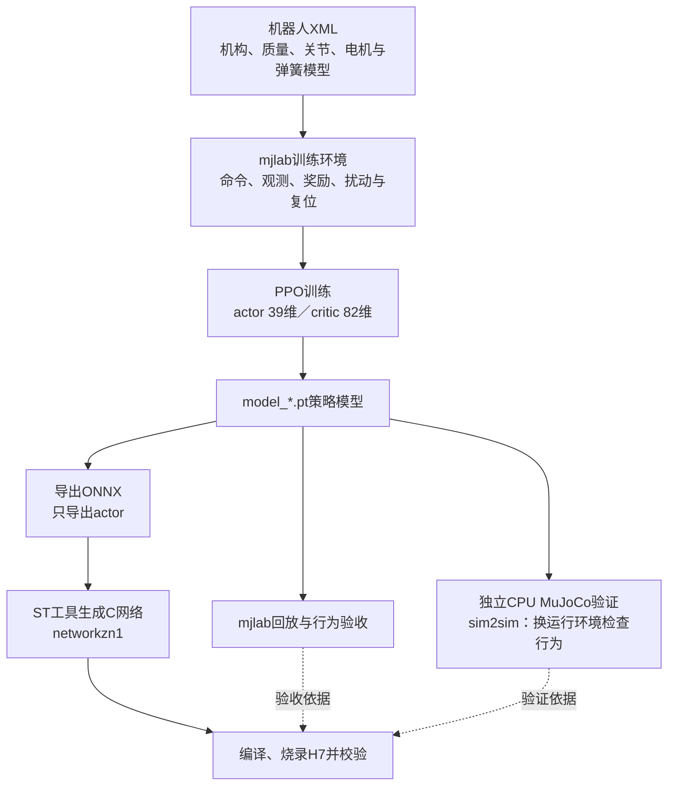
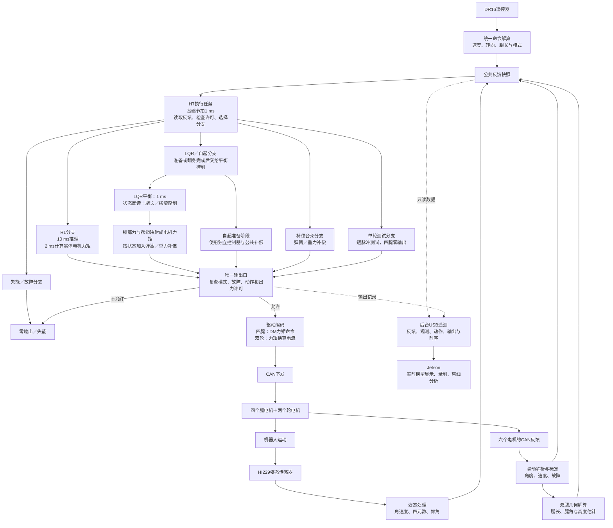
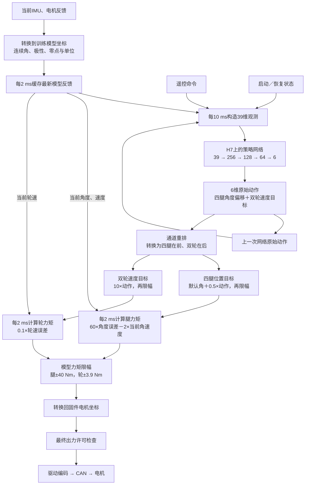
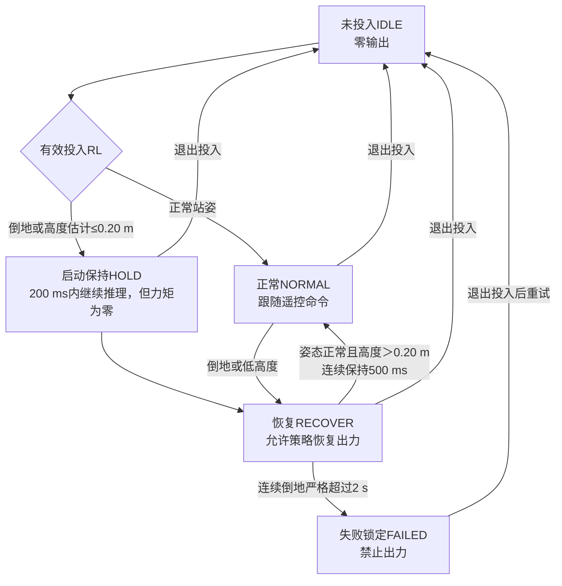

# 架构与数据流

串联腿当前训练使用独立 `mjlab_training/`：华南虎 multimode 任务由 mjlab 原生管理器负责控制、子步观测、奖励、终止、随机化、生成地形和复位，RSL-RL PPO 负责学习；接口见 [multimode 接口](../interfaces/chuanliantui-huananhu-multimode-replay-v1.md)。下文 Isaac 数据流只描述历史入口。

2026-10-23起mjlab与独立CPU sim2sim使用100 Hz策略／500 Hz物理与PD；USB工程`deployment/H7_RL_ros`导入model13842后，大机源码同步100 Hz策略／500 Hz控制，下文真机图按该候选实现更新，板端真实时序待测。UART工程仍为50 Hz，烧录实际状态见[13842交付](../model-deliveries/20261023-model13842-h7-import.md)，接口见[100 Hz记录](../interfaces/20261023-mjlab-policy100hz.md)。

华南虎训练、独立CPU sim2sim与real2sim当前共用`resources/robots/chuanliantui_new_1/mjlab/chuanliantui.xml`。旧multimode_model3023下XML为兼容符号链接；只编辑唯一源，策略权重和姿态库各自保留。结构及有限验证见[共享XML说明](../diagnostics/20261021-shared-huananhu-xml.md)。

当前共享XML包含joint_sharp等效轮端响应。训练load_spec将轮USER增益转为后端固定G，动作执行每物理步补速度因子；CPU加载原生USER增益回调。两端参数同源、G只乘一次，H7名义控制与标定不改。历史录制按哈希读取artifacts/model-versions冻结版本，见[接入说明](../diagnostics/20261021-h7-wheel-response-integration.md)。

## 来源

本仓库 fork 自 [legged_gym](https://github.com/leggedrobotics/legged_gym)，并把 [rsl_rl](https://github.com/leggedrobotics/rsl_rl) **内嵌**为 `wheel_legged_gym/rsl_rl/`（不是 pip 依赖）。改 RL 算法直接改这个目录，不要去装外部 rsl_rl。

## 训练与部署仓库

| 仓库 | 职责 | 本机位置 |
|---|---|---|
| Wheel-Legged-Gym（本仓库） | 强化学习训练、策略导出与 MuJoCo sim2sim 验证 | 当前克隆的仓库根目录 |
| [H7_RL](../../deployment/H7_RL/md/file-guide.md) | 板端策略部署与真机控制 | 本仓 `deployment/H7_RL`；`.env.local` 中的 `H7_REPO_PATH` 可显式改为外部克隆 |
| [H7_RL_ros USB工程](../../deployment/H7_RL_ros/md/file-guide.md) | 当前大机板端控制、USB遥测与Jetson只读镜像 | 本仓 `deployment/H7_RL_ros`；目录名含ros，但当前镜像无需ROS 2 |

本机配置与团队流程见 [CONTRIBUTING.md](../../CONTRIBUTING.md)。内置 H7 工程作为普通目录随训练仓版本管理；当前来源及同步核对见[部署同步记录](../interfaces/20261018-h7-model5849-deployment-sync.md)。涉及板端实现时，以该目录代码和固件说明为准；若使用外部克隆，再分别核对 URL、分支、版本与未提交改动。接口差异及同步要求见 [部署接口约定](../deployment-contract.md)。

## 当前大机完整控制链路

2026-10-23按华南虎multimode训练代码及`deployment/H7_RL_ros`核对。主链路为：**遥控器给目标 → H7读取反馈并选择RL或LQR → 计算六路力矩 → CAN下发电机 → 电机和姿态反馈回到H7**。Jetson当前只负责显示、录制和离线分析，策略推理在H7上运行。

本节记录结构与调用关系；周期、增益、限幅和恢复阈值为本次源码快照，后续以实际代码为准。当前模型、烧录状态和行为验收结论统一见[项目实验记录顶部](project-log.md)，具体模型来源及烧录证据见[模型交付记录](../model-deliveries/20261022-model9845-h7-import.md)。烧录、网络数值检查和行为验收是不同结论。

### 训练、验证与部署

PPO是根据奖励更新策略的强化学习算法；actor是实际决定动作的策略网络，critic是训练时帮助评分的网络。当前actor输入39维、输出6维，critic输入82维，上机仅保留actor。



训练、CPU回放和real2sim镜像共用本文开头的XML唯一源；训练随机化与板端实际延迟的区别见[H7仿真时序说明](../interfaces/20261022-h7-simulation-timing.md)，不能把训练中的随机等待写成固件额外添加的延迟。

源码入口：[训练环境](../../mjlab_training/src/ct_mjlab/envs/chuanliantui/multimode_env_cfg.py)、[训练动作执行](../../mjlab_training/src/ct_mjlab/envs/chuanliantui/huananhu_action.py)、[CPU回放](../../sim2sim/mj_sim2sim_huananhu_multimode.py)。

### 真机反馈、控制分支与输出

LQR是根据状态误差计算纠正力矩的传统控制器。RL、LQR、自起和台架分支由模式选择；自起完成后交给LQR平衡，不同时叠加两套控制输出。



执行任务是最终出力入口；通信任务负责协议解析、反馈发布、遥控解算及使能管理；IMU任务负责姿态发布；策略任务只负责RL观测和推理。公共快照保证软件复制完整，不代表各传感器在同一物理时刻采样。

LQR支路使用腿几何、速度融合和离地估计，腿部力矩经几何映射生成。RL支路直接使用实体电机角度和速度，不经过LQR或腿部力映射，也不额外叠加弹簧／重力补偿；实体被动弹簧仍参与机器人的真实运动。

源码入口：[任务节拍](../../deployment/H7_RL_ros/Core/Src/freertos.c)、[通信任务](../../deployment/H7_RL_ros/imcalib/task/task_comm.c)、[IMU任务](../../deployment/H7_RL_ros/imcalib/task/task_imu.c)、[执行与唯一输出口](../../deployment/H7_RL_ros/imcalib/task/task_actuation.c)、[LQR](../../deployment/H7_RL_ros/imcalib/Algorithm/lqr_balance.c)、[腿部力映射与补偿](../../deployment/H7_RL_ros/imcalib/Algorithm/leg_balance.c)、[Jetson只读镜像](../../sim2sim/real2sim_huananhu.py)。

### RL内部控制链路

PD是按位置误差推向目标，同时用速度阻尼抑制运动。USB工程大机策略每10 ms更新一次原始动作，位置／速度控制每2 ms用当前反馈重新计算力矩：**保持的是网络动作，力矩随反馈变化**。基础1 ms执行拍仍检查退出和故障。



39维观测组成如下，裁剪和缩放在观测生成入口完成，不改变PD使用的原始物理量：

| 内容 | 维度 | 板端来源／含义 |
| --- | --- | --- |
| 命令 | 4 | 前进速度、固定为0的侧向速度、偏航角速度、高度命令 |
| 机体角速度 | 3 | HI229角速度 |
| 重力方向 | 3 | 四元数将世界重力投影到机体系 |
| 电机位置 | 6 | 四腿相对默认角，双轮位置槽固定0 |
| 电机速度 | 6 | 四腿与双轮角速度 |
| 上一动作 | 6 | 上一次网络原始动作，按观测电机顺序重排 |
| 模式 | 7 | 当前平地只使用普通／恢复模式，其余模式槽为0 |
| 状态标志 | 4 | ground_start、policy_active、airborne、step_active；后两项当前固定0 |

网络原始动作顺序为`[lf0, lf00, lfwheel, rf0, rf00, rfwheel]`，电机反馈和PD内部顺序为`[lf0, lf00, rf0, rf00, lfwheel, rfwheel]`。两者由`RL_Action_Index`统一重排，不能把通道重排当作极性变换。腿目标围绕XML参考角限幅，位置误差不做最短路径环绕；默认角、XML参考角和实机机械零点是三个不同的量。

公共`rc.len`是腿长目标；USB大机源码现通过`RL_Command_Height`按训练XML直立目标换算为`clamp(rc.len+0.03648,0.2165,0.3664)`机体高度命令，小机保持原直接裁剪。该换算已于2026-10-23烧录、读回校验并复位；反馈height仍为髋轮竖直投影，不是机体离地高度。具体范围见[部署工程RL39说明](../../deployment/H7_RL_ros/md/file-guide.md#rl39)。零action仍指向默认腿角，并不等于零力矩。

源码入口：[39维观测与模型坐标映射](../../deployment/H7_RL_ros/imcalib/Algorithm/rl_observation.c)、[策略推理与动作发布](../../deployment/H7_RL_ros/imcalib/task/task_policy.c)、[动作转目标与力矩](../../deployment/H7_RL_ros/imcalib/Algorithm/rl_torque.c)、[机器参数](../../deployment/H7_RL_ros/imcalib/config/machine_config.c)。

### RL启动、恢复与退出



高度由双腿髋轮投影间距估计，不是绝对离地高度，也不等同于仿真接触力。`ground_start`在实际投入时锁存本次是否从趴地启动，起立成功后仍保留；中途倒地直接进入恢复，不重复200 ms启动保持。除失败锁定外，运行反馈不可用也会退回IDLE并停止出力；FAILED必须退出投入后才能复位。

实际投入／退出和失败会清理动作历史；NORMAL与RECOVER等激活模式切换保留原始动作历史，但撤销旧动作就绪并拒绝切换前的在途推理，等待新模式首帧。恢复状态、动作可用和最终硬件出力许可分别检查。

遥控档位由[唯一模式解码入口](../../deployment/H7_RL_ros/imcalib/task/rc_command.c)生成；下表表示模式请求，实际出力仍受反馈、故障、机器配置和测试独占状态约束：

| 左拨杆 | 右拨杆 | 请求 |
| --- | --- | --- |
| 上 | 中 | RL投入 |
| 中 | 中 | LQR／自起投入 |
| 中 | 上 | 补偿台架 |
| 上 | 上 | 单轮短脉冲测试，四腿零输出 |
| 下 | 任意 | 失能 |

本节仅按源码核对控制结构，不替代板端时序、物理映射或真机行为验收；本次补充未操作硬件。

## Isaac旧任务训练数据流

```
train.py
  └─ task_registry.make_env(name)      # envs/__init__.py 里注册的 (EnvClass, EnvCfg, TrainCfg)
  └─ task_registry.make_alg_runner()
       └─ OnPolicyRunner (rsl_rl/runners/on_policy_runner.py)
            ├─ ActorCriticSequence (rsl_rl/modules/)
            └─ PPO (rsl_rl/algorithms/ppo.py)
                 └─ RolloutStorage (rsl_rl/storage/)

每步：
  env.step(actions)                     # envs/base/legged_robot.py
    ├─ action_fifo 延迟随机化（0~10ms）
    ├─ decimation 次内环：compute_torques → gym.simulate → 差分更新 dof_vel
    ├─ post_physics_step：算观测、奖励、终止、reset
    └─ 返回 obs / privileged_obs / rewards / dones
```

## 观测结构（mini_wheel_legged / imcawl）

三路观测，缺一不可：

| 名称 | 维度 | 去处 |
|---|---|---|
| `obs` | 27 | actor 输入的一半 |
| `obs_history` | 135 = 27×5 | 喂 encoder，输出 3 维 latent |
| `privileged_obs` | 143 | 只给 critic，部署时不存在 |

`action = actor(cat(obs_27, encoder(history_135)))`。

latent 的前 3 维被监督为 `base_lin_vel * 2`（见 `rsl_rl/algorithms/ppo.py`），即 encoder 兼任**速度估计器**。部署端没有真实 `base_lin_vel`，全靠这个估计——它是当前性能上限的来源，详见 [sim2sim.md](sim2sim.md)。

`obs_history_length = 5` 意味着 encoder 只有 50ms 窗口。

## 配置继承

`base_config.py` 提供属性递归实例化机制；`LeggedRobotCfg` / `LeggedRobotCfgPPO` 是所有任务的基类。子类**继承内部类**来局部覆盖：

```python
class Mini_WheelLeggedCfg(LeggedRobotCfg):
    class sim(LeggedRobotCfg.sim):
        class physx(LeggedRobotCfg.sim.physx):   # 必须继承，否则未列出的字段全丢
            contact_offset = 0.02
```

**不继承就会丢掉基类的兄弟字段**（`solver_type`、`num_threads` 等）。这是本仓库最容易踩的配置坑。

奖励函数按约定装配：`rewards.scales` 里每个非零字段名 `foo` 都会去找环境类的 `_reward_foo()` 方法。把 scale 设为 0 即禁用该项。

## 奖励函数清单

奖励函数随分支和版本变化，以下为 imcawl 相关实现的索引。`MiniWheelLegged` override 了 `_reward_tracking_lin_vel`、`_reward_tracking_lin_vel_enhance`、`check_termination`。

跟踪类：`tracking_lin_vel`、`tracking_lin_vel_enhance`、`tracking_ang_vel`、`tracking_ang_vel_enhance`、`tracking_lin_vel_pbrs`、`tracking_ang_vel_pbrs`（后两个是 PBRS 势能形式）

姿态与高度：`lin_vel_z`、`ang_vel_xy`、`orientation`、`base_height`、`base_height_enhance`、`nominal_state`（惩罚双腿不对称）

能耗与平滑：`torques`、`power`（τ·ω）、`dof_vel`、`dof_acc`、`action_rate`、`action_smooth`（动作二阶差分）

限位与接触：`dof_pos_limits`、`dof_vel_limits`、`torque_limits`、`collision`、`stumble`、`feet_contact_forces`、`termination`、`stand_still`

跨维护线移植奖励时核对所选版本的实现与配置；不能仅凭任务同名认定奖励一致。

## VMC 工作原理

VMC（Virtual Model Control）把关节控制抽象到**虚拟腿**空间，实现见 `envs/wheel_legged_vmc/wheel_legged_vmc.py`：

1. 策略输出 `theta0`（腿摆角）、`L0`（腿长）、轮速
2. 正运动学 `forward_kinematics(theta1, theta2)` 求出当前 `L0 / theta0`，并差分得到 `L0_dot / theta0_dot`
3. 虚拟腿空间 PD 得到虚拟力 `F` 与力矩 `T`，再经雅可比映射为两个关节力矩
4. 轮子仍是直接 PD 速度控制

用途是把开链（wl）与闭链机构的运动控制统一到同一套虚拟腿接口，换机构不必重训策略。注意 `LeggedRobotVMC` 的 27 维观测与基类结构不同（用 `L0/theta0` 替代原始关节量）。

## 坐标约定

imcawl 的**前进方向是机体 +y 轴，不是 x**。腿装在机体 x 两侧（x=±0.179），轮绕 x 轴滚动。

基类 `LeggedRobot` 是为 wl 机器人（x 前向）写的，`MiniWheelLegged` 子类 override 了 `_reward_tracking_lin_vel` 系列改用 `base_lin_vel[:, 1]`。**给 imcawl 写任何涉及方向的代码前，先确认用的是哪个轴。**
