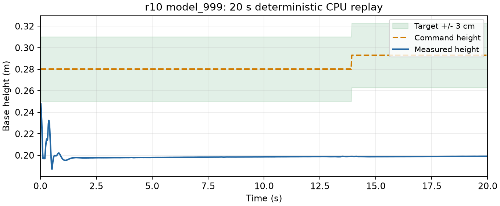

# r10 云端 model_999 效果评估

2026-10-10，26_wheelleg，HEAD `58947e8fabc4683b2025d42bda742b06c84dc566` 加未提交r10改动。RTX4090云端4096环境／1000轮训练已正常结束，退出码0，15:37:20（Asia/Shanghai），训练耗时20分44秒。训练记录见 [云端记录](20261010-mjlab-r10-cloud-training.md)。本轮只下载、回放和评估，没有修改训练参数或启动新训练。

## 结论

**没有通过严格起立和目标站高验收。** 多数初态能保持20秒，但最终维持约0.20 m的低姿态，目标为0.27～0.34 m，没有学会高度跟踪。两组共64个GPU样本严格起立与持续静止站稳均为0；没有数值异常。

这里只证明这次模型在所测初态下的表现，未定位哪个参数是唯一原因。r9曾全部短回合机身接地失败，r10存活表现不同，但两轮初态配置不同，不能把两个评估当作相同初态的因果对照，也不能用reward改善证明已经学会站高。

## 模型与下载

源模型：`/root/gpufree-data/wheelleg-remote/logs/mjlab/chuanliantui/20261010_151622_292362_wheelleg_recover_r10_cloud_4096_1000/model_999.pt`。

本机保存到新目录：`logs/mjlab/chuanliantui/20261010_151622_292362_wheelleg_recover_r10_cloud_4096_1000_download_155320_121485/model_999.pt`，同时下载参数、事件记录及源快照；未覆盖历史目录。远端与本机最终模型SHA256一致：`5514f88c186fb3d6ff8855fe0ba00708f08a276f4afe67fe355817c4c71a5240`。

## 正式CPU回放

```bash
scripts/mjlab.sh eval \
  --checkpoint logs/mjlab/chuanliantui/20261010_151622_292362_wheelleg_recover_r10_cloud_4096_1000_download_155320_121485/model_999.pt \
  --seconds 20 --report /tmp/ct-r10-cloud-cpu-eval.json
```

退出码0，seed42，确定性actor，关闭训练域随机化，连续20秒无隐式复位；`passed=false`。无机身接地终止，严格恢复false；后半段平均高0.19885 m，最大高度误差9.43 cm，最大平面速度0.0310 m/s。这是一条地面初态轨迹，不代表全部初态。

[完整CPU轨迹](20261010-mjlab-r10-cloud-model999-cpu-eval.json)：



## 原生GPU补充评估

本机RTX4060，32环境×两组，seed42，各20秒，确定性actor，不学习。按checkpoint恢复r10初态配置；普通和地面由0.5概率独立抽样。两组因随机化初始化耗用不同随机数，抽到的普通／地面数量不同，不能把组间差异归因到某一随机化项。

| 指标 | 关闭训练域随机化 | 开启训练域随机化 |
|---|---:|---:|
| 严格起立 | 0/32 | 0/32 |
| 持续静止站稳15秒 | 0/32 | 0/32 |
| 连续存活20秒 | 29/32 | 32/32 |
| 物理失败 | 3/32 | 0/32 |
| 数值异常 | 0/32 | 0/32 |
| 存活环境末5秒平均高度 | 0.1973 m | 0.1978 m |
| 存活环境末5秒平均绝对高度误差 | 10.92 cm | 11.03 cm |
| 存活环境末5秒平均平面速度 | 0.0243 m/s | 0.0953 m/s |

分初态：关闭随机化时地面11个，严格恢复0、存活10；普通21个，严格恢复0、存活19。开启随机化时地面17个、普通15个，各自全部存活但均严格恢复0。两类初态最终高度都约0.20 m。

严格站姿要求高度误差≤3 cm、roll/pitch各≤15°、双轮接触各>5 N、基座接触≤1 N并连续保持0.5秒。持续静止站稳还要求首次严格恢复后观察15秒，至少95%样本满足严格站姿、平面速度≤0.15 m/s、yaw速度≤0.30 rad/s，并存活20秒。

`auto_reset=false`；结束环境显式复位后永久排除统计，其余环境保持连续轨迹。达到20秒的正常timeout算存活，物理／数值终止才算失败。诊断初稿把timeout后的done算作未存活，已修正并完整重跑；上表及已保存报告均为修正后的结果。末5秒统计只包含完整存活到20秒的环境，不把不同失败时刻的高度混成站高。

执行脚本：[GPU诊断脚本](20261010-mjlab-r10-cloud-model999-gpu-eval-script.txt)，退出码0。逐环境结果：[GPU报告](20261010-mjlab-r10-cloud-model999-gpu-eval.json)，高度轨迹按0.1秒保存，指标仍按全部0.02秒控制步计算。该GPU补充诊断不替代上面的正式CPU回放。

## 原生20环境可视回放

```bash
DISPLAY=:0 XAUTHORITY=/run/user/1000/gdm/Xauthority scripts/mjlab.sh play \
  --checkpoint logs/mjlab/chuanliantui/20261010_151622_292362_wheelleg_recover_r10_cloud_4096_1000_download_155320_121485/model_999.pt \
  --num-envs 20 --random-reset --render --seconds 20
```

退出码0，窗口正常运行20秒并结束。预览允许自动复位，连续存活率采用上述禁止隐式复位的评估。

## 训练末轮日志

平均reward−0.65、平均回合1000步、平均动作std0.13、高度误差日志0.0680、严格恢复0、数值异常0。这些是末轮完成回合样本的训练日志，height_error按固定20秒归一化；GPU末5秒误差则只统计存活环境的持续状态，两者口径不同。奖励上升和回合延长没有改变严格起立未通过的结论。

没有新模型导出、H7改动或真机验证，不能据存活率把此模型当作可部署的站高策略。
