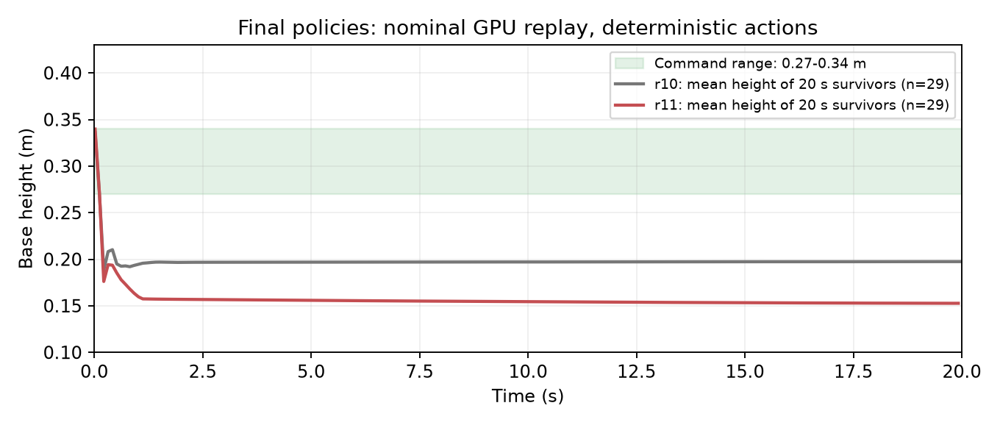

# r11 云端 model_999 效果评估

2026-10-10，分支26_wheelleg，HEAD `58947e8fabc4683b2025d42bda742b06c84dc566` 加未提交r11改动。远端RTX4090、4096环境／1000轮，随机actor／critic／优化器、seed42；恢复实体被动膝knee_limit权重-0.5、余量0.15 rad。正常完成1000轮，退出码0，完成时间2026-10-10T16:59:03+08:00，耗时25分12秒。本次只下载与评估，没有改参数或启动新训练。

## 结论

**仍未学会严格起立、目标站高或持续静止站稳，且这次回放低于r10。** r10末5秒平均高约19.7cm，r11降至15.3～15.9cm，目标27～34cm；零速度命令下平面速度约0.36～0.43m/s，同时频繁腿部接地。两组64个初态严格起立及持续静止站稳均0。不是数值发散：数值异常0。

这是此次随机初始化、1000轮模型在所测初态的结果。对比是两次完整训练和各自存活样本，不是单步奖励因果实验；不能仅凭一次训练认定膝惩罚是唯一原因。两轮均未用参考工程已有稳定策略初始化，参考实验训练历史见 [先前分析](20261010-mjlab-r9-reference-analysis.md)。

## 最终模型

远端：`/root/gpufree-data/wheelleg-remote/logs/mjlab/chuanliantui/20261010_163329_854336_wheelleg_recover_r11_knee_limit_cloud_4096_1000/model_999.pt`。

本机：`/home/zn/文档/Wheel-Legged-Gym/logs/mjlab/chuanliantui/20261010_163329_854336_wheelleg_recover_r11_knee_limit_cloud_4096_1000_download_165938_763660/model_999.pt`。

新目录下载参数、事件记录和源快照，未覆盖历史logs。SHA256远端与本机一致：`6c8b4a39ffa812ded73056bee56673ea82f0180065e5aa03c797048d1ea70634`；本机r11 manifest检查与actor加载通过。

## 正式CPU回放

```bash
scripts/mjlab.sh eval --checkpoint '/home/zn/文档/Wheel-Legged-Gym/logs/mjlab/chuanliantui/20261010_163329_854336_wheelleg_recover_r11_knee_limit_cloud_4096_1000_download_165938_763660/model_999.pt' --seconds 20 --report /tmp/ct-r11-cloud-cpu-eval.json
```

退出码0、20s、seed42、确定性actor、关闭域随机化、禁止自动复位；单地面初态：passed=false、strict_recovered=false、物理失败时间null，后半段平均高度15.34cm、最大高度误差14.03cm、最大平面速度0.4413m/s。存活不等于站起。

[CPU完整轨迹](20261010-mjlab-r11-cloud-model999-cpu-eval.json)。

## 原生GPU补充评估

本机RTX4060、32环境×两组、seed42、20s、确定性actor，不学习。按checkpoint读取模式、动作顺序、限位奖励权重和混合初态。沿用 [r10协议](20261010-mjlab-r10-cloud-model999-evaluation.md)，每轮结束环境显式复位并永久排除统计，其余环境保持连续轨迹；20s timeout算存活，物理／数值终止算失败。

| 指标 | 关闭训练随机化 | 开启训练随机化 |
|---|---:|---:|
| 严格起立 | 0/32 | 0/32 |
| 持续静止站稳15秒 | 0/32 | 0/32 |
| 连续存活20秒 | 29/32 | 26/32 |
| 物理失败 | 3/32 | 6/32 |
| 数值异常 | 0/32 | 0/32 |
| 存活者末5秒平均高 | 15.29cm | 15.94cm |
| 存活者末5秒平均绝对高度误差 | 15.45cm | 13.68cm |
| 存活者末5秒平均平面速度 | 0.4320m/s | 0.3607m/s |
| 存活者末5秒腿接地且基座不接地的样本比例 | 64.47% | 48.94% |

接地比例使用undesired_contact的瞬时净力>1N，且base_contact≤1N；此时力来自腿部匹配体。不是图像姿态分类，也不能区分具体哪个腿连杆。

分初态：关闭随机化普通21个／地面11个，存活20／9；开启随机化普通15个／地面17个，存活15／11；各组严格起立均0。随机化组与关闭组没有相同初态配对，不能把组间失败差异归因于某一随机化项。

严格姿态要求高度误差≤3cm、roll/pitch各≤15°、双轮接触各>5N、基座≤1N并连续0.5s；持续静止站稳要求首次严格恢复后15s中至少95%样本满足上述条件以及平面速度≤0.15m/s、yaw速度≤0.30rad/s，并连续存活20s。末5秒统计只含完整存活者。

[GPU完整报告](20261010-mjlab-r11-cloud-model999-gpu-eval.json)，[执行脚本](20261010-mjlab-r11-cloud-model999-gpu-eval-script.txt)，退出码0。完整指标按0.02s计算，保存高度轨迹每0.1s一帧。



图中两条线各统计对应模型的20s存活环境，均为29个，但不宣称存活者完全相同。绿区是目标命令范围，不是高度容差带。

## 20环境可视回放

```bash
DISPLAY=:0 XAUTHORITY=/run/user/1000/gdm/Xauthority scripts/mjlab.sh play --checkpoint '/home/zn/文档/Wheel-Legged-Gym/logs/mjlab/chuanliantui/20261010_163329_854336_wheelleg_recover_r11_knee_limit_cloud_4096_1000_download_165938_763660/model_999.pt' --num-envs 20 --random-reset --render --seconds 20
```

退出码0，原生窗口正常运行20s并关闭。可视预览允许自动复位；连续存活结论使用上面的禁止隐式复位评估。

## 末轮训练日志

平均reward-114.26、平均回合951.84步、动作std0.42、height_error0.1376、strict_recovered0、strict_stand_fraction0、数值异常0、knee_limit贡献-2.1418。训练height_error按固定20s归一化，和独立回放末5秒统计口径不同；奖励版本也不同，不将r10/r11原始reward大小当成功率对比。

本次无新ONNX或H7改动，没有真机验证。实例未自动关机。训练启动与完成记录见 [运行记录](20261010-mjlab-r11-cloud-training.md)。
