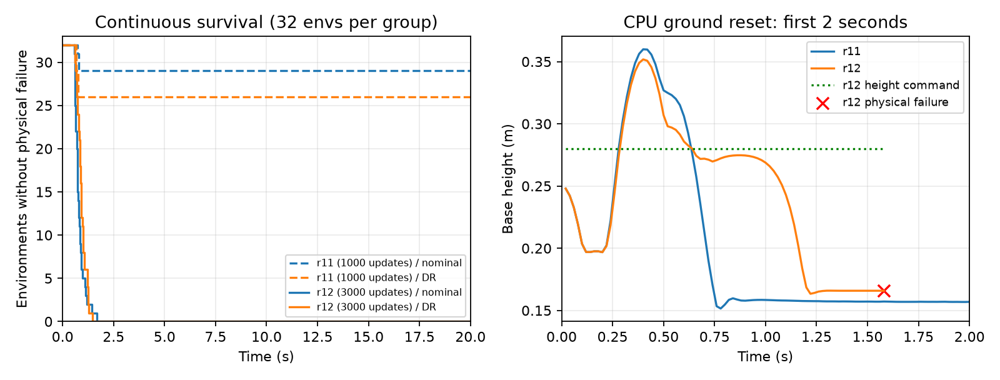

# r12 云端 model_2999 效果评估

2026-10-10，26_wheelleg，HEAD `58947e8fabc4683b2025d42bda742b06c84dc566` 加未提交r12改动。关闭knee_limit，从r11已完成1000轮的model_999恢复actor／critic／Adam及学习率1e-5，追加2000轮，累计3000轮；4096环境、seed42、远端RTX4090。退出码0，完成时间2026-10-10T18:14:30.055486+08:00，新增训练耗时54分19秒。本次只下载与评估，没有改参数或启动新训练。

## 结论

**此次续训后策略性能明显退化：两组64个初态全部快速触发物理失败，严格起立及持续站稳均0。** 关闭随机化的失败时间0.58～1.68s，中位0.74s；开启随机化0.62～1.46s，中位0.89s。CPU单地面初态在1.58s物理失败。数值异常0，属于机体接地／倾斜触发的行为失败，不能称为数值发散。

r11同协议下20s存活29/32、26/32，共55/64；r12变成0/64。r11也没有严格起立成功，本次不是从已有稳定策略续训。两版本比较是完整续训前后表现，不足以仅凭一次运行认定关闭膝惩罚是唯一原因。

## 最终模型与恢复

本机：`/home/zn/文档/Wheel-Legged-Gym/logs/mjlab/chuanliantui/20261010_171930_580570_wheelleg_recover_r12_no_knee_resume1000_plus2000_cloud_4096_download_200102_763163/model_2999.pt`。

远端运行目录见 [运行记录](20261010-mjlab-r12-cloud-training.md)。本机与远端最终模型SHA256一致：`43ec486322580d4a757da4e068932b2796706452360c7c301a22b9451b87f553`。manifest与actor加载通过；iter2999、effective completed updates3000，knee_limit权重0，reward_migration_history保留r11来源SHA。最终模型、resume_state、参数和事件日志已保存到新目录，源快照仍在后台传输；历史logs未覆盖。

## 正式CPU回放

```bash
scripts/mjlab.sh eval --checkpoint '/home/zn/文档/Wheel-Legged-Gym/logs/mjlab/chuanliantui/20261010_171930_580570_wheelleg_recover_r12_no_knee_resume1000_plus2000_cloud_4096_download_200102_763163/model_2999.pt' --seconds 20 --report /tmp/ct-r12-cloud-cpu-eval.json
```

命令退出码0，实际因物理失败提前在1.58s停止，passed=false、strict_recovered=false。失败前后半段平均高度21.09cm，最大高度误差11.67cm，最大平面速度1.234m/s。此处“后半段”仅指短轨迹的后半段，不能与r11完整20s的后半段高度作稳态对比。

[CPU轨迹](20261010-mjlab-r12-cloud-model2999-cpu-eval.json)。

## 原生GPU补充评估

本机RTX4060，32环境×两组、seed42、确定性actor、20s最大时长、不学习；从checkpoint恢复动态模式、四腿两轮顺序、奖励版本和50%普通／50%地面初态。沿用r11协议：禁止隐式自动复位，已结束环境显式复位后永久排除统计，其余环境连续运行；物理／数值失败不算存活，20s timeout算存活。

| 指标 | 关闭训练随机化 | 开启训练随机化 |
|---|---:|---:|
| 严格起立 | 0/32 | 0/32 |
| 持续静止站稳15秒 | 0/32 | 0/32 |
| 连续存活20秒 | 0/32 | 0/32 |
| 物理失败 | 32/32 | 32/32 |
| 数值异常 | 0/32 | 0/32 |
| 首次失败中位时间 | 0.74s | 0.89s |
| 首次失败时间范围 | 0.58～1.68s | 0.62～1.46s |

普通／地面分别21／11及15／17，全部失败。无20s存活者，因此末5秒站高、速度与接地比例都为null，不能用0填充或引用失败前样本冒充稳态统计。两组并非配对初态，不能把组间差异归因于特定随机化项。

严格起立要求高度误差≤3cm、roll/pitch各≤15°、双轮接触各>5N、基座≤1N连续0.5s。持续静止站稳要求首次严格恢复后15s中≥95%样本满足上述条件及平面速度≤0.15m/s、yaw≤0.30rad/s，并存活20s。

[GPU报告](20261010-mjlab-r12-cloud-model2999-gpu-eval.json)，[执行脚本](20261010-mjlab-r12-cloud-model2999-gpu-eval-script.txt)，退出码0。指标按0.02s计算，保存高度轨迹每0.1s一帧及最后失败帧。



左图终止环境不再统计；两次独立评估不宣称精确随机轨迹配对。右图只比较CPU前2s，r12红叉后已失败，没有外推高度。

## 训练日志为何看似改善

末轮平均reward−10.94，平均回合54.35步≈1.087s，height_error0.0068，strict_recovered0，strict_stand_fraction0，数值异常0，knee_limit贡献0。

`huananhu_mdp.py`中的height_error累计 `abs(height-command)*step_dt/episode_length_s`，分母固定20s；短回合会压小数值，它不是实际存活时长内的平均高度误差。reward同样是回合累积且本轮奖励版本变化，短回合负奖励较少不能直接判为策略进步。本次独立回放确认没有实现起立目标。

实例未自动关机；没有导出ONNX、改动H7或做真机验证。

## 20环境可视回放

使用本机最终model_2999、`play --num-envs 20 --random-reset --render --seconds 20`，原生回放命令退出码0，运行20s。窗口允许自动复位；上述存活与失败结论取自单独的连续轨迹评估。未通过桌面截图对图像作人工判读。
