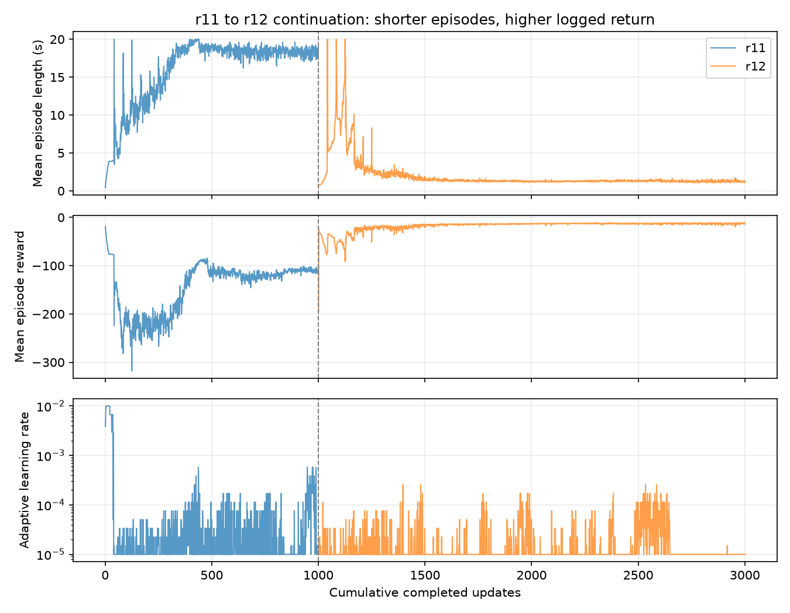

# r12为何比1000轮r11退化

2026-10-10，26_wheelleg，HEAD58947e8加已有r12未提交改动。本轮仅分析事件日志与代码，追加不学习的32环境奖励诊断；未改训练参数、未启动训练。正式行为结论见 [最终评估](20261010-mjlab-r12-cloud-model2999-evaluation.md)。

## 结论与边界

**最有证据的解释是奖励目标与起立验收错位：快速失败能减少后续累计负奖励，现有失败代价未能压住这种选择。** 本次相同新奖励下，3000轮策略的平均折扣回报高于1000轮策略，但其连续存活明显变差。进一步训练强化了对奖励函数有利、对用户起立目标不利的行为。

这不是“轮数增加必然变差”，也不能凭一次knee_limit改动证明该项是唯一原因。r11本身是低姿态、漂移、严格起立0的策略，非已学会站起的成熟策略；r12还更改了奖励目标，从该局部解恢复critic和Adam继续学习。关闭软膝奖励没有关闭XML实体限位或改变机器人资产。

## 同一套新奖励的诊断

两个actor均使用r12 knee_limit=0、同一机器人、四腿两轮顺序、动态normal/recover、名义物理参数、无训练随机化；32环境、确定性动作、最大20s、seed42。构造后明确reset(seed=42)，初始qpos SHA256及初始命令逐项一致（最大差0）；未逐项比对所有仿真内部缓存。诊断只累计首次回合，结束环境显式复位后排除统计。不学习，不使用旧版本reward与新版本reward交叉比较。

| 本次诊断指标 | 1000轮r11 actor | 3000轮r12 actor |
|---|---:|---:|
| 平均首次回合时长（上限20s） | 16.39s | 0.90s |
| 存活20s | 26/32 | 0/32 |
| 平均不折扣回合reward | -70.42 | -12.21 |
| 平均折扣回报，gamma=.99 | -11.81 | -9.24 |
| 每环境平均step reward的均值 | -0.1592 | -0.2749 |

**3000轮每步得分更差，却因为很快结束而取得更高的回合／折扣回报。** 这是奖励逃避机制的直接支持证据。诊断是确定性actor的有限32个初态，不等同于训练期随机策略的优势估计，不证明所有初态都更偏好失败。

本次显式reset产生的是新的一组初态，因此26/32不替代上次正式评估的29/32名义组结果。

[诊断数据](20261010-mjlab-r12-degradation-reward-probe.json)，[执行脚本](20261010-mjlab-r12-degradation-reward-probe-script.txt)，退出码0。终止惩罚贡献：r12每个回合-4；r11平均-0.75（6/32物理失败）。该诊断只用于奖励机制分析，不单独替代正式行为验收。

## 代码机制

1. `huananhu_rewards.py:23` 配置termination=-200，原始值是terminated.float()。mjlab RewardManager.compute统一乘控制dt=.02，因此单次真正扣分为**-4，不是-200**。物理终止在PPO回报中截断后续价值，超时有bootstrap；没有为物理失败继续累计剩余20s的负代价。
2. 1000轮actor仍有高度误差、腿接地、漂移和力矩消耗。在这次knee=0诊断中，整回合平均高度平方惩罚约-36.88、非轮接触约-32.15；长期保持这种姿态依然大量负分。正向速度奖励有3～6cm高度门控，低姿态在门外拿不到它们，且紧高度奖励趋近0。快速结束可绕过后续成本。
3. 严格恢复是指标，不是独立成功奖励或硬训练约束。奖励没有显式把“连续站稳并存活”作为每次更新必须满足的门槛。
4. gamma=.99、dt=.02，折扣权重的时间尺度约2s；10s后的收益只保留约0.66%的权重。它仍考虑未来，但早期动作代价和短回合后果更突出。
5. PPO clipping不保证所有更新后行为更好。官方说明clipping仍可能让新策略偏离旧策略；本机实现调学习率，没有同文档示例那种KL超阈值提前结束优化步骤。参考 [OpenAI Spinning Up PPO说明](https://spinningup.openai.com/en/latest/algorithms/ppo.html)。

本机依赖源码：`/home/zn/文档/mjlab/wheelleg_RL/.venv/lib/python3.12/site-packages/mjlab/managers/reward_manager.py` compute/reset；`rsl_rl/algorithms/ppo.py` process_env_step/compute_returns/adaptive学习率。依赖未修改。

## 训练曲线与续训状态

| 日志索引 | 平均回合秒数 | 平均reward |
|---|---:|---:|
| r11 999 | 19.04 | -114.26 |
| r12 1100 | 9.11 | -49.40 |
| r12 1200 | 2.84 | -20.64 |
| r12 1500 | 1.83 | -20.44 |
| r12 2000 | 1.31 | -13.42 |
| r12 2999 | 1.09 | -10.94 |

日志中间有波动，不是每轮单调下降；索引1124一度记录平均1000步。本表揭示后期整体缩短回合并减少累计负奖励的趋势。r11/r12奖励版本不同，原始日志reward不能当共同成功指标。

恢复证据中actor／critic／Adam逐项一致，学习率从1e-5恢复，非随机重新初始化；观测／动作／资产／复位配置已通过显式r11→r12校验。真实仿真回合和随机数流重新开始，未恢复中断时的物理轨迹。

奖励突变后critic最初value loss从r11末轮0.641升至r12首轮26.928，提示初期价值估计需要重新适应，但不能证明其是唯一退化原因。自适应学习率续训期间最高2.5629e-4（索引2585），不是始终固定1e-5，也不是固定1e-4。没有记录足够KL指标以单独判定哪一次策略步造成退化。

[抽样事件数值](20261010-mjlab-r12-degradation-scalars.json)。height_error以固定20s归一化，短回合会让它看起来更小；指标偏差只影响读数，不是导致策略退化的训练奖励本身。

## 建议处理顺序（尚未实施）

优先让“提前物理失败”的真实折扣回报低于可持续恢复动作，核对终止惩罚的dt尺度，配合达标站稳的正奖励／进步奖励；避免只在起立路径上堆负项。用严格起立率、连续存活和实际存活时间归一化误差选模型，保留行为更好的检查点；再针对奖励切换决定critic／优化器适配与学习率限制。不要只用原始reward挑最后一轮。

具体终止权重与新奖励需经代表性轨迹比较后选择，不能直接把“应该扣200分”视为必然正确数值。本次未调整、未重训。
