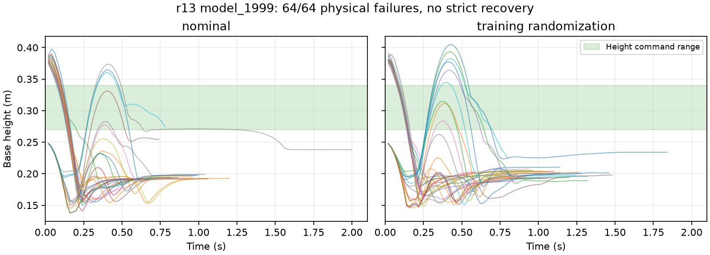

# r13宽高度门控，2000轮最终效果

评估日期2026-10-10。维护分支 `26_wheelleg`，HEAD `58947e8fabc4683b2025d42bda742b06c84dc566` 加未提交r13改动。4096环境，从r11的1000轮完整状态追加1000轮；新门控5～10 cm、knee_limit=0，严格起立标准仍±3 cm。来源／恢复／配置记录见 [训练记录](20261010-mjlab-r13-cloud-training.md)。

## 训练完成

21:08:42正常结束，退出码0，耗时27分40秒，iter1999／累计2000次更新。最终模型SHA256 `c531fd5faababe157357b175025c0fbaab4088f6f3fbf8c05cb5d0f950285b50`，本机下载后校验一致：

`/home/zn/文档/Wheel-Legged-Gym/logs/mjlab/chuanliantui/20261010_204040_465892_wheelleg_recover_r13_wide_resume1000_plus1000_cloud_4096_download_212427_214056/model_1999.pt`

末轮TensorBoard：平均reward -13.0176，平均回合61.41步（1.2282s），严格恢复0，数值异常0。[末轮及完整所选曲线](20261010-mjlab-r13-cloud-training-scalars.json)。`height_error=0.006626`按每回合固定20s累计归一化；当前大量回合提前终止，不能解释为实际稳态高度误差0.66 cm，参见 `huananhu_mdp.py` 的累计公式。

## 独立行为回放

GPU在训练使用的RTX4090实例，加载同一源码快照／模型，32环境×2组、seed42、确定性actor，无学习；一组关闭域随机化，一组开启训练域随机化。两组均按checkpoint的初态分布、动作顺序、动态模式、门控及膝权重路由。普通／地面混合初态，地面分别11／17个。请求每环境连续20s，失败后结束该环境样本；已结束环境单独复位并排除统计，不将下一回合计入存活。

| 评估组 | 严格起立 | 20s存活 | 持续15s站稳 | 物理失败 | 数值失败 |
|---|---:|---:|---:|---:|---:|
| 无域随机化 | 0/32 | 0/32 | 0/32 | 32/32 | 0 |
| 训练域随机化 | 0/32 | 0/32 | 0/32 | 32/32 | 0 |

无域随机化失败时间0.58～2.00s，训练域随机化0.58～1.84s。所有普通／地面初态都失败，没有连续20s存活样本，因此不存在有效的末5s稳态高度统计。严格起立要求高度误差≤3 cm、姿态≤15°、底盘不接触、双轮接触>5N且连续0.5s；持续站稳还要求15s窗口至少95%满足严格状态、平面速度≤0.15m/s及偏航速度≤0.30rad/s。

图中每条曲线只保留该环境首次失败前轨迹，绿色区间为高度命令范围。多数轨迹落入约0.19～0.23m，部分先上冲再失稳；短暂经过目标高度不等于起立成功。[原始GPU数据](20261010-mjlab-r13-cloud-model1999-gpu-eval.json)，[评估脚本本机复现版](20261010-mjlab-r13-cloud-model1999-gpu-eval-script.txt)。实际执行位于远端快照 `20261010T123852Z-58947e8-r13-ad109e/.evaluation-model1999/`，仅替换输入模型／输出报告路径并使用 `MUJOCO_GL=disable`。

CPU在本机相同任务管理器、单环境无随机化、无自动复位，0.76s触发物理失败，严格恢复false，验收未通过。失败前后半段平均高度0.319m、最大高度误差8.93cm、最大平面速度0.814m/s；这些是短暂过程统计，不能当作稳态表现。[CPU轨迹](20261010-mjlab-r13-cloud-model1999-cpu-eval.json)。

## 与已有结果比较

| 策略 | 严格起立 | 20s存活 | 数值失败 |
|---|---:|---:|---:|
| r11，1000轮 | 0/64 | 55/64 | 0 |
| r12，3000轮（窄门控） | 0/64 | 0/64 | 0 |
| r13，2000轮（宽门控） | 0/64 | 0/64 | 0 |

前两行来自历史本机GPU评估，本次GPU评估在远端4090，硬件不同，不能视作严格同硬件A/B。可确认本次两组独立样本均未起立且早期物理失败；宽门控没有解决稳定起立问题。当前策略不通过行为验收，不适合交付H7。未修改训练参数、启动新训练、TensorBoard或Git提交。
