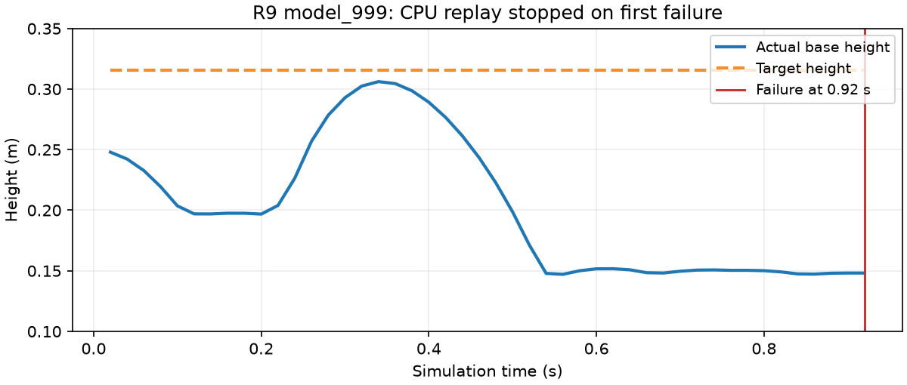

# r9 model_999 训练效果评估

2026-10-10，26_wheelleg，HEAD58947e8fabc4683b2025d42bda742b06c84dc566加未提交r9改动。模型：`logs/mjlab/chuanliantui/20261010_101723_976809_wheelleg_recover_r9_no_knee_4096_1000/model_999.pt`，SHA256 `4696c9dc01caaad52e1827f599221f57d40a142ff9d32d7e6fc09972384e44d3`。4096环境／1000轮训练已完成，见 [训练记录](20261010-mjlab-r9-formal-training.md)。本次只回放／评估，没有PPO更新或模型导出。

## 结论

未通过起立／稳站评估。CPU与原生GPU都观察到短回合机身接地失败；不是数值发散。不能仅凭reward从r6的-23.43变成r9的-12.11认定改进：r9平均回合67.81步约1.36秒，r6曾为1000步20秒，累计负奖励受到回合长度影响。r6→r9还包含动态mode及动作顺序变化，不据此把失败唯一归因于关闭膝限位奖励惩罚。

## 正式CPU回放

命令：

```bash
scripts/mjlab.sh eval --checkpoint logs/mjlab/chuanliantui/20261010_101723_976809_wheelleg_recover_r9_no_knee_4096_1000/model_999.pt --seconds 30 --report docs/diagnostics/20261010-mjlab-r9-model999-cpu-eval.json
```

退出码0表示评估命令执行正常，`passed=false`表示行为失败。请求30秒，0.92秒第一次失败即停止，没有自动重置掩盖失败；seed42，关闭训练域随机化，确定性actor。目标高0.315725m，短暂抬到0.306146m后下落；后半段平均高0.155590m、最大高度误差0.168602m，严格恢复false。这里只指不足1秒的失败轨迹，不是稳站平均值。[完整CPU轨迹](20261010-mjlab-r9-model999-cpu-eval.json)。



## 原生GPU补充评估

RTX4060／595.99.02已修复驱动后执行；两组各32环境、seed42，确定性策略，请求20秒；auto_reset=false，已结束的环境显式reset后永久排除后续统计，尚未结束环境保持连续轨迹。GPU补充诊断不替代上述正式CPU行为回放。[执行脚本](20261010-mjlab-r9-model999-gpu-eval-script.txt)，[逐环境报告](20261010-mjlab-r9-model999-gpu-eval.json)。脚本退出码0。中间诊断脚本曾因结束环境未复位以及InferenceMode外更新缓冲区失败；已修正临时评估脚本后重新执行完整两组，未修改训练实现。

| 组别 | 严格恢复 | 首次失败 | 首次失败时间范围／中位数 | 最后有效样本平均高度 | 数值异常 |
|---|---|---|---|---|---|
| 关闭域随机化 | 0/32 | 32/32 | 0.76～1.28秒／0.97秒 | 0.150192m | 0/32 |
| 训练域随机化 | 0/32 | 32/32 | 0.72～4.08秒／1.14秒 | 0.144854m | 0/32 |

两组全部失败时机身接触力>1N，失败时roll/pitch均未超过40°；符合机身接地连续20拍（0.4秒）终止路径。最后有效高度取各环境不同失败时刻，不是共同时间点平均站高或稳站高度。目标高度最后样本平均分别0.309116m及0.312831m。

## 原生可视回放

打开20环境随机初态、60秒预览：

```bash
DISPLAY=:0 XAUTHORITY=<当前桌面Xauthority路径> scripts/mjlab.sh play --checkpoint logs/mjlab/chuanliantui/20261010_101723_976809_wheelleg_recover_r9_no_knee_4096_1000/model_999.pt --num-envs 20 --random-reset --render --seconds 60
```

第一次启动因桌面Xauthority缺失而失败，补齐当前桌面授权文件后重试，60秒预览正常退出，退出码0。原生预览采用自动reset，画面反复起身／复位不代表连续站稳，行为结论采用上面禁止隐式重置的评估。

## 日志判读

末轮strict_recovered0、knee_limit贡献0、numerical_failure0。height_error0.0090是误差积分除以固定20秒回合期限；提前失败的短回合会压低该项，不能解读为实际站高误差9mm。没有H7板端／真机验证，不能交付部署。
