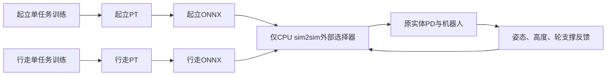

# MuJoCo双模型回放接口

原独立起立／行走训练task已按用户要求删除；本页只保留MuJoCo加载现有模型需要的观测、合同和切换定义，不提供旧task训练命令。`sim2sim/`实现保持原样；共用配置和验证模块保留原路径。

## 新观测与checkpoint契约

单帧25、历史5×25=125、Critic71、动作6、速度估计3。Actor和Critic均不输入模式one-hot、任务角色、原extra_flags或起立阶段标志。

| Actor槽 | 内容 |
| --- | --- |
| 0:3 | 机身角速度×0.25 |
| 3:6 | 机体系重力投影 |
| 6:9 | 实际vx/yaw/高度命令×[2,0.25,5] |
| 9:13 | 四个实体腿电机相对标称角 |
| 13:19 | 六电机实际速度×0.05，原电机顺序 |
| 19:25 | 上一拍真实策略动作 |

Critic71仅保留原物理特权通道，去掉模式和任务阶段/额外标志；历史末帧等于当前Actor帧。外部切换器的布尔状态和任务角色元数据不进入网络。

- observation：`chuanliantui-split-physical25-history125-critic71-v1`。
- profile分别为`chuanliantui-getup-physical25-v2`、`chuanliantui-walk-physical25-v8`，checkpoint `policy_role`分别为`getup`/`walk`。行走command contract为`split-walk-episode-height-stop-straight-spin-moving75-walk-ready-armed1s-down100ms-dirsplit-fwd30-40-bwd100-err10-v6`，含义为保留75%运动回合及walk原生就绪，新增前低速/后1.0起步的独立课程、0.10误差门槛。`command_config.height_range=(0.22,0.30)`、forward_speed_min=0.30/forward_speed_limits=(0.40,0.60,0.80,1.00,1.50)、backward_speed_min=1.00/backward_speed_limits=(1.00,1.50)、speed_error_threshold=0.10及256段/80%门槛严格核对，嵌套课程保存forward/backward各自档位、计数与上次成功率；旧walk v1～v7及旧标量课程/旧walking_speed_min或speed_limits字段拒载。行走reward recipe仍为`split-walk-relative-velocity-parking-noboost-tilt5-symmetry3cap10-v5`，18项权重不变且严格核对。起立v2课程标识仍为`split-getup-height30to22-recovered30pct-window4096-v1`，核对4096窗口及30%门槛，允许保存/恢复未解锁阶段；旧固定高度v1模型拒载，使用其历史训练快照保留回看。
- switch：`chuanliantui-two-policy-support-height22-tilt10-hold500ms-fall100ms-v1`。
- checkpoint严格核对角色、观测、控制时序、命令配置、奖励配方/权重和嵌套速度/yaw/停车参数；误载另一角色或旧32/160模型时在修改参数前拒绝。Actor/Critic、encoder及两个优化器完整续载。
- **1999/5999/6299不能直接续训这两个新任务**；新接口需要重新训练。没有通过截断/补零或删除检查来伪装兼容；旧入口仍可原样使用旧模型。

## 只有独立CPU sim2sim选择模型

入口：`sim2sim/mj_sim2sim_chuanliantui_two_policy.py`。物理由原生CPU MuJoCo推进，不创建mjlab训练环境；Viser仅绘图。沿用已有独立CPU入口的0.5ms积分、2ms PD、10ms策略；训练仍为2ms物理/10ms策略，原CPU与训练引擎的行为差异未据此宣告解决。

初始选择起立；以下条件连续0.5秒后选择行走：总体倾角≤10°、机高0.22±0.03m、横滚/俯仰合角速度≤0.5rad/s、机身接触力≤1N、每轮支撑≥max(重量10%,5N)、双轮合计在重量80%～120%。不以慢漂单独否决交接。失去最低轮支撑、机身力>10N、机高≤0.18m或总体倾角>40°持续0.1秒则切回起立；倒置立即切回，非有限状态拒绝推理。支撑超过120%只阻止进入，不单凭瞬时大支撑退出行走。

每次交接只选择一套动作输出；不叠加两个模型，不复位物理状态、不重置PD、不重新触发0.2秒启动等待。共享物理五帧FIFO和真实上一拍动作跨交接保留；仅物理回合复位清空。切回起立立即清除航向/停车基准和两轴命令，恢复后重新等待就绪和低速锁点；首次行走也等待原命令就绪时间。

行走命令外环在CPU调用方维护：yaw零请求锁当前航向、wrap误差×1.5/s、±0.5rad/s与1rad/s²斜率；停车原始vx=0、就绪且真值前向速度严格低于0.05m/s连续0.5秒后锁当时xy，前向投影P增益1/s、2cm死区、0.1m/s限幅、vx斜率1m/s²。原地转也保持位置，横向仅记录，无积分项。CPU这里用位置/速度真值；H7是否复用LQR积分仍待确认。

每个ONNX都是`observation_history[1,125] → actions[1,6], velocity[1,3]`，包含各自encoder+actor；切换、命令外环、FIFO、PD均在图外。CPU同时检查两个图/源PT的SHA和角色元数据，以及行走命令版本和高度范围。`--height`指定该次回放的行走高度（默认0.22m，限0.22～0.30m），整次回放固定；CPU起立固定0.22m且拒绝未解锁的getup v2模型，交接时换成行走高度，切回起立恢复0.22m。CPU不自行随机高度；vx/yaw原始请求互斥，界面选择直行时清转向请求，选择转向时清直行请求。没有H7交付或真机结论。
