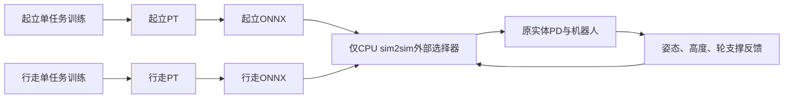

# 串联腿：起立与行走单任务训练，仅在CPU sim2sim切换

2026-10-30行走profile v8：速度课程按方向拆开，前进幅值U[0.30,F]、F=(0.40,0.60,0.80,1.00,1.50)，后退幅值U[1.00,B]、B=(1.00,1.50)，均从第0档开始。直行方向各50%；各方向只统计目标幅值≥本档上限80%的段，原斜率到位后等0.5秒再测至少0.5秒，未失败且平均绝对vx误差≤0.10才成功，各自累计至少256段/成功率≥80%独立晋级。checkpoint分别保存forward/backward的stage、segments、successes和last_success_fraction，严格核对两张表、下限及阈值；旧walk v1～v7（含接口夹具）全部拒载。删除walking_speed_min，继承的speed_limits仅服务旧任务、不再进入walk契约；walk不提供旧标量speed_stage。75%运动回合、三类等概率、1秒武装/100ms down/50拍等待、18项对称奖励及std0.2保持。play冻结并保留两个已保存档位，评估保留合并误差并新增前/后向误差；CPU仍由调用方控制命令，按保存的前/后档位分别限幅。软件、有限物理、PT/ONNX/play及CPU检查退出0，未训练、未行为验收；getup与本次起点契约不变，已有getup站稳前力矩罚v4导致旧v3模型拒载，未为walk回退。H7未改，负责人核对待确认。[本次证据与完整命令](../../artifacts/walk25-v8-direction-curriculum-20261030-192001/README.md)。

2026-10-30行走profile v7（尚未训练，补入左右腿对称惩罚）：命令就绪仍按walk自身满1秒武装、连续down满100ms/原终止/急停/非有限撤销，短掉载不重置50拍等待。恢复nominal_state：沿stand_v2同一髋轮几何/root逆旋转，原始值为左右摆角差平方，权重−3、加权下限−10（约104.6°饱和），不依赖首次站稳，仅沿用出力/数值屏蔽；walk现18项，其余17项及75%运动/std0.2均不变。profile保持`chuanliantui-walk-physical25-v7`，command仍`split-walk-episode-height-stop-straight-spin-speed-min1-moving75-walk-ready-armed1s-down100ms-v5`，reward recipe改为`split-walk-relative-velocity-parking-noboost-tilt5-symmetry3cap10-v5`；旧v1～v6及不含对称项的早期v7夹具严格拒载。getup奖励和本次修改前契约不变，保留工作区已有100ms接管渐变。历史v6轨迹每0.2秒固定抽样、包含起步/仅有效环境，摆角差均值84.64°、p95 98.54°，零运动请求均值84.42°。对称合成/17项逐位对照、就绪噪声、两角色20环境256步/ONNX/play及独立CPU检查退出0；CPU仍拒载未适配的滤波getup，切换只用合成getup。仅软件/合成检查，未训练、未行为验收。[本次证据](../../artifacts/walk25-v7-symmetry-20261030-170040/README.md)、[就绪修复原记录](../../artifacts/walk25-command-readiness-20261030-164456/README.md)。H7未改，负责人核对待确认。

2026-10-30行走profile v6：针对v5诊断（直行段少、1 m/s误差下主项≈e⁻⁴、停车锁点也拿×5、姿态8.1°饱和、std过早收敛）只改行走：×5只给未锁停车点的跟踪；vx主核分母改为max(0.25,vx命令²)；orientation改为max(0,cos5°−cosθ)、加权限−5（约19°饱和），0～5°不罚；运动回合比例50%→75%；Actor std下限0.2。用户明确不恢复低速课程，速度下限1.0与课程(1.0,1.5)保留。reward recipe `split-walk-relative-velocity-parking-noboost-tilt5-v4`、command contract `split-walk-episode-height-stop-straight-spin-speed-min1-moving75-v4`，新增`exploration`契约；旧v5拒载，getup不变。未训练，[检查](../../artifacts/walk25-tracking-economy-20261030-155225/README.md)。H7未改，负责人核对待确认。

行走复位初态现按名义0.30m轮子着地站姿求解，并同步初始化所有主动/被动关节；不改PD/观测标称角、XML或物理。保留原roll/pitch±3°、yaw全周和碰撞最低点2mm地隙，因此本次检查的实际根高度约0.303～0.314m，不是把旧0.27m姿态悬空抬高。训练与play、整回合与局部复位都使用同一新站姿，目标高度仍每回合均匀0.22～0.30m。仅改复位分布，两角色原契约/profile保持，旧v5可原样加载/续训（新初态不保证旧策略行为保持）；getup和旧stand/stand_v2默认0.27m站姿、地面路径不变。未启动新训练。[初态图与检查](../../artifacts/walk25-reset30-20261030-150035/README.md)。

2026-10-30行走profile v5：非零直行请求的速度绝对值下限由0.1提高到1.0m/s，最高仍1.5m/s；速度课程上限由(0.5,1.0,1.5)改为(1.0,1.5)。首档直行为±1.0m/s，按原256有效段/80%通过率晋级后，幅值均匀采样[1.0,1.5]。停车/原地转的vx请求仍为0，50%静止回合比例保持；停车P纠偏与限斜率过程不受此采样下限约束，不能把实际命令强行截到±1.0。奖励、高度、观测、PD及物理不变；新速度分布尚未训练或验收。[实现与检查](../../artifacts/walk25-speed-min1-20261030-142949/README.md)。

checkpoint新增command_config.walking_speed_min=1.0，严格核对新上下限、profile `chuanliantui-walk-physical25-v5` 与command contract `split-walk-episode-height-stop-straight-spin-speed-min1-v3`。刚完成的旧v4 model_999保留，但当前训练/play/export/CPU入口拒绝直接加载；不静默迁移。旧模型回看需使用对应旧版本源码。CPU调用方保持原斜率/停车小指令，ONNX形状仍125→6+3；下限描述训练的直行目标采样，不是硬件反馈速度或所有控制命令的下限。H7未改，负责人核对待确认。

2026-10-30后续getup：仅把torques权重−0.0001→−0.0002，保留六主动电机力矩平方和/曾站稳门控，加权后仍最多扣1（乘dt前）；其余18项及walk不变。当前getup reward recipe为`split-getup-torque2-full-strength-nominal-state-v3`，旧配方拒载。未训练，[本次检查](../../artifacts/getup25-torque2-20261030-140050/README.md)；下文v2为此前记录。

2026-10-30历史行走配方v4（本次v5沿用其奖励）：四实体腿电机的速度/软限位，独立17项运动奖励，姿态orientation权重−100且加权后限到−1、yaw主跟踪1.0，保留每回合随机高度0.22～0.30m和停车/直行/原地转。当前起立v2恢复0.30→0.22m高度课程及左右腿对称惩罚全程100%强度；原v1固定高度1000轮模型保留，正式行为未通过验收。旧v4已完成1000轮；新v5未训练，H7适配与负责人核对待确认。详见[起立高度课程](20261030-getup-height-curriculum.md)。

用户确认将起立和行走分成两套独立模型，策略不输入模式标志；进一步明确：**训练和mjlab play都只运行单任务，只有独立CPU sim2sim做两模型切换**。旧stand_v2及其1999/5999/6299、原logs和回放能力保留，不静默迁移旧权重。

## 任务和职责

| 项目 | `chuanliantui_getup` | `chuanliantui_walk` |
| --- | --- | --- |
| 职责 | 从地面起立并保持零速稳站；训练全程由该模型控制 | 站立平衡、vx、yaw、锁向、停车位置保持 |
| 训练初态 | 原地面姿态库，100%地面 | 原合法近站姿态，100%近站；不调用起立策略 |
| 目标高度 | 目标先0.30m、成功高度≥0.28m；4096完成回合窗口起立率≥30%后目标切0.22m、成功高度≥0.20m | 每回合开始均匀采样0.22～0.30m，整回合固定 |
| 命令 | vx/yaw恒0 | 25%回合静止；75%运动回合每2～4秒等概率采样停车/直行/原地转，前后向独立速度课程及原yaw/位置外环 |
| 结束 | 首次轮触地后倒置立即失败、双轮连续离地0.2秒失败，无需曾站稳；保留其余原失败及40秒超时，成功后继续稳站 | 原失败或失稳持续0.1秒、40秒超时；初始1秒给接地稳定时间，倒置/数值异常不等待 |
| 权重和优化器 | 自己的Actor/Critic/encoder及两个优化器 | 自己的Actor/Critic/encoder及两个优化器 |
| 日志 | `logs/mjlab/chuanliantui_getup/` | `logs/mjlab/chuanliantui_walk/` |

起立训练成功后继续由同一网络零速稳站；没有成功提前终止或训练内交接。现有奖励包含持续站立收益，避免仅改变成功结束条件引入拖延成功的激励。

高度只在物理回合复位时重新采样，各环境独立；切换速度段或重复读取命令不重采样。Actor高度命令槽8和Critic对应命令槽、原高度奖励均使用当回合目标；高度随机化不改观测尺寸。三个运动段等概率，不再采样同时非零的vx/yaw原始请求。直行锁向纠偏、原地转停车纠偏以及命令限斜率过渡仍保留，因此实际下发vx/yaw可能同时非零，不能把保持外环的修正误认为组合运动请求。

共享XML、实体PD、弹簧、电机顺序、物理参数和训练500Hz物理/100Hz策略不变。两任务复用现有传感器与命令公式；`chuanliantui_split/rewards.py`中起立继续调用stand_v2的getup分支，行走由独立`WalkRewardState`计算18项运动奖励（含v7恢复的nominal_state）。当前行走orientation权重为−100、yaw主跟踪为1.0，其余保留项权重不变；roll/pitch仍共用此姿态项，姿态精度须行为验收。

代码集中在`mjlab_training/src/ct_mjlab/envs/chuanliantui_split/`：`env_cfg.py`定义两个任务，`mdp.py`定义各自复位/结束，`observations.py`去模式输入，`network.py`定义25/125网络，`runner.py`核对角色/配方并完整续载。`rewards.py`的角色分发避免把行走奖励改动带入起立任务。没有训练时双策略路由。

## 行走独立奖励v4

v4将行走dof_vel和dof_pos_limits的关节集合修为实体腿电机lf0/lf00/rf0/rf00；膝余量仍单独取被动膝lf1/rf1。严格沿用XML已有范围：lf00/rf00无限位，保持[-inf,+inf]，不增加虚构软限位；只对有限范围取97%软区间，先屏蔽无限范围参与均值运算，避免inf−inf污染奖励。用户进一步选择同时调整：姿态权重保留−100、加权后限到[-1,0]，yaw主跟踪权重0.2→1.0；orientation公式仍为1+gravity_z。其余权重、命令和物理不变，command仍v2；profile升v4、reward recipe升v3严格拒载旧关节集合模型。工作区已有getup v2高度课程改动保留，本次不修改起立实现。

删除`recovered`（站稳进度）、`nominal_state`（左右腿摆角一致）和`base_link_airborne`（机身离地加分），由20项减为17项。行走奖励不再读取首次站稳/曾落地/站稳计时/高度解锁状态：速度、关节速度/限位、力矩及动作平滑从回合开始生效；上下运动和roll/pitch转动惩罚没有起立期10%弱化。高度核分母固定0.0025m²，取消先宽后窄的站稳计时切换，保留原15～40°姿态折减及机身接触折扣。机身触地惩罚也不再等待曾落地。

| 保留项 | 权重 |
| --- | ---: |
| tracking_lin_vel | 0.2，跟踪激活时×5 |
| tracking_lin_vel_enhance | 0.2 |
| tracking_lin_vel_tight | 0.5，仅跟踪激活 |
| tracking_ang_vel | 1.0 |
| tracking_ang_vel_enhance | 0.2 |
| base_height | 1 |
| orientation | -100 |
| dof_pos_limits | -1 |
| knee_limit_margin | -0.3 |
| base_link_contact | -0.3 |
| wheels_airborne | -0.3 |
| lin_vel_z | -1 |
| ang_vel_xy | -0.2 |
| dof_vel | -0.00005 |
| torques | -0.0001 |
| action_rate | -0.01 |
| action_smooth | -0.01 |

orientation保留权重−100，公式`1+gravity_z=1−cos倾角`不变；用户选定加权后限到[-1,0]。实现是在原始值阶段限制到[0,0.01]，由RewardManager乘−100和dt，避免重复乘权重。约8.1°及以上时本项饱和为−1（乘dt前），倒置也保持−1；与Isaac的sin²在倒置归零仍有区别。yaw主跟踪从0.2提高为1.0，yaw辅助项仍0.2。checkpoint严格核对17项reward_weights及v4/reward recipe v3；旧关节集合及旧yaw=0.2模型拒载。getup奖励仍为其原配方，不共享这些行走改动。

跟踪激活用于区分运动/停车外环是否已启用，保留其宽核倍率及窄核门控；这不是重新引入首次站稳奖励门控。数值异常与动作未启用时仍清零奖励，原加权限幅规则和每拍dt缩放保持。命令项自己的就绪判据、课程和失稳清点均不改；本次只删除奖励中的起立过程依赖。起立仍为原19项、原公式/缩放/门控；恢复高度课程后getup profile升v2；后续已恢复左右腿对称惩罚全程100%（权重−3），reward recipe为`split-getup-full-strength-nominal-state-v2`，旧缩放配方拒载。

## 新观测与checkpoint契约

单帧25、历史5×25=125、Critic71、动作6、速度估计3。Actor和Critic均不输入模式one-hot、任务角色、原extra_flags或起立阶段标志。

| Actor槽 | 内容 |
| --- | --- |
| 0:3 | 机身角速度×0.25 |
| 3:6 | 机体系重力投影 |
| 6:9 | 实际vx/yaw/高度命令×[2,0.25,5] |
| 9:13 | 四个实体腿电机相对标称角 |
| 13:19 | 六电机实际速度×0.05，原电机顺序 |
| 19:25 | 上一拍真实策略动作 |

Critic71仅保留原物理特权通道，去掉模式和任务阶段/额外标志；历史末帧等于当前Actor帧。外部切换器的布尔状态和任务角色元数据不进入网络。

- observation：`chuanliantui-split-physical25-history125-critic71-v1`。
- profile分别为`chuanliantui-getup-physical25-v2`、`chuanliantui-walk-physical25-v8`，checkpoint `policy_role`分别为`getup`/`walk`。行走command contract为`split-walk-episode-height-stop-straight-spin-moving75-walk-ready-armed1s-down100ms-dirsplit-fwd30-40-bwd100-err10-v6`，含义为保留75%运动回合及walk原生就绪，新增前低速/后1.0起步的独立课程、0.10误差门槛。`command_config.height_range=(0.22,0.30)`、forward_speed_min=0.30/forward_speed_limits=(0.40,0.60,0.80,1.00,1.50)、backward_speed_min=1.00/backward_speed_limits=(1.00,1.50)、speed_error_threshold=0.10及256段/80%门槛严格核对，嵌套课程保存forward/backward各自档位、计数与上次成功率；旧walk v1～v7及旧标量课程/旧walking_speed_min或speed_limits字段拒载。行走reward recipe仍为`split-walk-relative-velocity-parking-noboost-tilt5-symmetry3cap10-v5`，18项权重不变且严格核对。起立v2课程标识仍为`split-getup-height30to22-recovered30pct-window4096-v1`，核对4096窗口及30%门槛，允许保存/恢复未解锁阶段；旧固定高度v1模型拒载，使用其历史训练快照保留回看。
- switch：`chuanliantui-two-policy-support-height22-tilt10-hold500ms-fall100ms-v1`。
- checkpoint严格核对角色、观测、控制时序、命令配置、奖励配方/权重和嵌套速度/yaw/停车参数；误载另一角色或旧32/160模型时在修改参数前拒绝。Actor/Critic、encoder及两个优化器完整续载。
- **1999/5999/6299不能直接续训这两个新任务**；新接口需要重新训练。没有通过截断/补零或删除检查来伪装兼容；旧入口仍可原样使用旧模型。

## 只有独立CPU sim2sim选择模型

入口：`sim2sim/mj_sim2sim_chuanliantui_two_policy.py`。物理由原生CPU MuJoCo推进，不创建mjlab训练环境；Viser仅绘图。沿用已有独立CPU入口的0.5ms积分、2ms PD、10ms策略；训练仍为2ms物理/10ms策略，原CPU与训练引擎的行为差异未据此宣告解决。



初始选择起立；以下条件连续0.5秒后选择行走：总体倾角≤10°、机高0.22±0.03m、横滚/俯仰合角速度≤0.5rad/s、机身接触力≤1N、每轮支撑≥max(重量10%,5N)、双轮合计在重量80%～120%。不以慢漂单独否决交接。失去最低轮支撑、机身力>10N、机高≤0.18m或总体倾角>40°持续0.1秒则切回起立；倒置立即切回，非有限状态拒绝推理。支撑超过120%只阻止进入，不单凭瞬时大支撑退出行走。

每次交接只选择一套动作输出；不叠加两个模型，不复位物理状态、不重置PD、不重新触发0.2秒启动等待。共享物理五帧FIFO和真实上一拍动作跨交接保留；仅物理回合复位清空。切回起立立即清除航向/停车基准和两轴命令，恢复后重新等待就绪和低速锁点；首次行走也等待原命令就绪时间。

行走命令外环在CPU调用方维护：yaw零请求锁当前航向、wrap误差×1.5/s、±0.5rad/s与1rad/s²斜率；停车原始vx=0、就绪且真值前向速度严格低于0.05m/s连续0.5秒后锁当时xy，前向投影P增益1/s、2cm死区、0.1m/s限幅、vx斜率1m/s²。原地转也保持位置，横向仅记录，无积分项。CPU这里用位置/速度真值；H7是否复用LQR积分仍待确认。

每个ONNX都是`observation_history[1,125] → actions[1,6], velocity[1,3]`，包含各自encoder+actor；切换、命令外环、FIFO、PD均在图外。CPU同时检查两个图/源PT的SHA和角色元数据，以及行走命令版本和高度范围。`--height`指定该次回放的行走高度（默认0.22m，限0.22～0.30m），整次回放固定；CPU起立固定0.22m且拒绝未解锁的getup v2模型，交接时换成行走高度，切回起立恢复0.22m。CPU不自行随机高度；vx/yaw原始请求互斥，界面选择直行时清转向请求，选择转向时清直行请求。没有H7交付或真机结论。

## 行走迭代与行为决策

目标是完整任务稳定完成。当前模型排序、失败与实验结论只记在[项目实验记录顶部](../ai/project-log.md)，每轮具体假设和判据保存到该轮产物目录；代码检查通过只表示可以开始测量。

每轮开始先写实验卡：关键假设及已有证据、唯一改动、父模型与SHA、保持不变的条件、预算、预期行为、否定条件。能用冻结策略的对照试验验证时先做零学习测量；没有支持证据时不同时改控制/奖励/终止，不频繁改权重，不默认从头训练。续训保留两个优化器、课程和父模型来源；既有日志及模型不覆盖，预算结束即停，新增预算须另获授权。

比较固定同一组初态、命令序列、斜率、目标高度、时长、物理参数、延迟与噪声设置；固定种子之外还核对实际qpos/qvel及随机物理参数。记录引擎、采样频率、源码/模型/资源哈希；GPU不承诺逐位同轨迹。原生随机课程回放作为补充，命令分布不同不能当严格配对。首回合提前终止保留失败，不能拿复位后的样本补满，也不能只统计活下来的容易片段。

| 报告层次 | 必须报告 | 可以得出的结论 |
|---|---|---|
| 程序检查 | 加载/续载、数值、接口、预算及实际退出码 | 实现是否满足检查范围，不代表策略会完成任务 |
| 训练指标 | 分窗奖励、平均回合长度、两方向课程及成功窗口 | 学习过程是否变化，不代表固定测试有效 |
| 实际行为 | 每条件/每环境的完整存活、失败时刻和触发项、跟踪误差、双轮平衡与完整原速视频 | 仅按已覆盖条件评价；缺失测量标未验证 |

行为判断先比较旧成功保留与新增成功，再看共同有效窗口的误差，失败样本另列，不能由幸存者误差下降推断整体改善。原成功样本任一失效即判退化；对于尚未达标但有可靠局部能力的参照模型，明确保留的是哪些能力，不能把存活重标为任务成功。

本聊天当前用户明确的行走目标（2026-10-30）：零指令水平漂移速度≤0.05m/s，前进/后退跟踪±0.5m/s，站稳/匀速时pitch在±5°内，起步和刹车允许短暂超角；腿部不能持续明显往复摆动。水平漂移按真实世界水平速度模长测量，不能用速度均值或95分位代替最大值限制。稳态与起停分别报告，允许超角时长尚未确认。下段旧探针0.10m/s门槛只保留历史定义，不代表用户已经确认当前跟踪精度。

根据已有轨迹提出、**尚未获用户确认**的数值建议：逐环境稳态速度平均绝对误差≤0.05m/s且绝对误差95分位≤0.10m/s；每1秒取四个实体腿电机最大关节峰峰值，连续至少3个窗口超过2°且出现往复周期时标记持续摆动，并同时报告全部窗口最大值、持续时长和腿长变化。该建议不把正常一次高度调整判作往复，也不把5秒平均值当作无摆动。实验中“命令斜率到位后再等1.5秒”仅用于描述性分窗，未获确认的时长及数值不得作为正式通过条件。[建议及旧轨迹依据](../../artifacts/walk25-acceptance-threshold-proposal-20261030-r1.json)。

固定直行探针先覆盖零速、前进、后退和不同起停斜率，检查完整预定回合、斜率到位后等待0.5秒且测量至少0.5秒的速度平均绝对误差≤0.10m/s，并按[双轮平衡v3.1](chuanliantui-wheel-balance-acceptance-v2.md)检查末连续1秒。平衡门槛不包含高度/跟踪精度，它们须分别报告。局部探针改善仅支持下一步验证；完整任务结论还须覆盖当前任务全部速度档、0.22～0.30m目标高度、原地转/锁向/停车，以及独立种子与训练随机化。完整验收前冻结这些场景及各自门槛，并对照原成功；未覆盖、缺少角速度等必要记录、CPU未测均标明范围，仿真成绩不代表真机通过。

优先用实际目标角/目标变化率、实测角、力矩及饱和时长、竖直运动、逐轮承重与终止条件的时间顺序检查控制冲击。核对奖励与终止时使用同一段物理状态，区分公式盲区与已验证的学习原因；不为提高存活而放宽终止或验收。若单变量试验无行为收益，停止沿同一假设盲目追加训练，重新审视证据；控制干预先测原成功保留及完整跟踪，不能仅凭目标更平滑决定采纳。

## 检查证据

当前行走v4关节集合/姿态限幅/yaw增权见[电机奖励检查](../../artifacts/walk25-motor-rewards-20261030-024313/README.md)：分别扰动实体小腿电机和被动膝，检查腿速计入/排除、有限软限位、无限位电机保持无界、被动膝余量独立、旧v3拒载；冻结随机策略报告实际奖励贡献，不当作训练效果。

当前getup v2高度课程、续载/门槛/旧v1拒载与CPU保护检查见[本次记录](20261030-getup-height-curriculum.md)。下文getup v1兼容性结果仅适用于当时固定0.22m配方。

orientation=−100增量检查见[参数变更证据](../../artifacts/walk25-orientation100-20261030-023514/README.md)：除这一项外权重与此前v3逐项相同、公式AST相同、旧−1的walk严格拒载、getup仍−1。有限检查不替代新权重训练及行为验收。

当前行走v3见[精简奖励证据](../../artifacts/walk25-reward-simplify-20261030-021050/README.md)：实际17项注册及窄核分发、相同物理输入下奖励不依赖起立阶段、保留项在首次站稳前有效、固定高度精度、旧walk v2/奖励配方/权重拒载，起立原公式/权重逐项一致及已训练999契约接受；两角色有限物理/续载/ONNX/play检查。下述v2与v1证据仅为历史版本，不作为当前v3行为通过结论。

行走v2本次检查见[新证据](../../artifacts/walk25-random-height-20261030-013939/README.md)：两角色20环境各128步、随机高度/局部与物理复位/输入和奖励/三类请求、旧walk v1拒载、完整续载/ONNX/play、CPU32步及角色高度切换通过；getup固定物理输入128拍命令与RNG逐位相同，当前起立v1契约仍接受。仅接口及有限检查，无行走行为成绩。下列1000/256步为初版v1的历史检查，不冒充v2行为验收。

[完整产物](../../artifacts/chuanliantui-two-policy-20261030/README.md)。检查模型均带`interface-only`名称，未经学习，不能作为训练完成或行为通过的模型。

- 两个单任务20环境各1000步冻结推演；最终256步版本补查单任务结束/复位与行走失败计数、同拍不重复计时、角色/旧模型/停车参数拒载。
- 人工构造Adam动量/step=7，保存后扰动Actor和Critic、清空两优化器状态，再完整恢复逐项核对；没有调用`optimizer.step`。
- 两图各16组ONNX最大误差约1.1e-7，单模型真实play入口各32步有限检查。
- 另以模拟就绪状态检查行走非零vx/yaw、停车小指令及失稳清基准；这不是训练后的命令跟踪成绩。随机未训练网络在自然推演中未产生有效运动指令，不掩盖该限制。
- CPU实际独立32步、训练/CPU两角色25维初帧最大差≤1.2e-7；隔离物理的夹具核对50/10拍交接、FIFO/上一动作保留、清基准与复位。原1999的旧32/160入口32步回归通过。

## 先看20环境初态，再选择训练预算

新行走任务改为近站初态，先用以下可视预检看初态分布；无checkpoint时是零动作预检，不是策略行为回放。本次只交付命令，未启动这两个viewer或训练。

```bash
scripts/mjlab.sh play --task chuanliantui_getup --num-envs 20 --seed 43 --viewer viser --viser-port 8094
scripts/mjlab.sh play --task chuanliantui_walk --num-envs 20 --seed 43 --viewer viser --viser-port 8095
```

两任务分别从头训练，轮数由用户给定，运行名必须新建；下列占位符不是已获授权的预算。

```bash
scripts/mjlab.sh train --task chuanliantui_getup --num-envs 2048 --seed 42 \
  --iterations <起立训练轮数> --run-name getup25_20261030
mjlab_training/.venv/bin/python -m tensorboard.main \
  --logdir logs/mjlab/chuanliantui_getup --port 8081

scripts/mjlab.sh train --task chuanliantui_walk --num-envs 2048 --seed 42 \
  --iterations <行走训练轮数> --run-name walk25_20261030
mjlab_training/.venv/bin/python -m tensorboard.main \
  --logdir logs/mjlab/chuanliantui_walk --port 8082
```

后续同一角色可用`train --task <角色任务> --resume <该角色新PT> --iterations <轮数>`完整续训，配套TensorBoard指向上面对应任务日志目录。单任务回放只需`play --task <角色任务> --checkpoint <该角色新PT>`，不添加旧yaw/停车开关。

```bash
scripts/mjlab.sh export --checkpoint <新起立PT> --output exports/<新目录>/getup.onnx
scripts/mjlab.sh export --checkpoint <新行走PT> --output exports/<新目录>/walk.onnx
PYTHONPATH=mjlab_training/src OMP_NUM_THREADS=1 OPENBLAS_NUM_THREADS=1 \
mjlab_training/.venv/bin/python sim2sim/mj_sim2sim_chuanliantui_two_policy.py \
  --getup-checkpoint <新起立PT> --getup-onnx exports/<新目录>/getup.onnx \
  --walk-checkpoint <新行走PT> --walk-onnx exports/<新目录>/walk.onnx \
  --initial-states artifacts/chuanliantui-two-policy-20261030/check-final-v5/getup-initial.npz \
  --vx 0 --yaw 0 --height 0.26 --viewer --port 8094
```

CPU界面分别给互斥的vx/yaw请求，转向请求归零即锁向；headless诊断去掉`--viewer`，用`--seconds <时长> --report <新JSON>`。真实训练后还须验收两项各自能力、getup→walk交接、跌倒→getup恢复和独立CPU行为，不能用这些未训练夹具替代。
